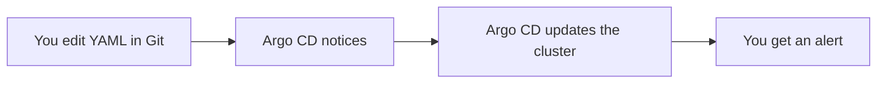

# 🧭 Start Here

> [!TIP]
> New to Argo CD? Read this page (5 min), then follow the **path** below. Every folder has the same layout, so once you read one you can read all.

## The idea in one picture
**Git is the recipe book. Kubernetes is the kitchen. Argo CD is the cook** who keeps the kitchen matching the recipe. You never cook by hand; you change the recipe.

## How every folder is laid out
| Section | What it gives you |
|---|---|
| **What & why** | Plain explanation and a real use case |
| **Architecture / flow** | A diagram of who talks to whom |
| **Key values** | The important settings: key → meaning → example |
| **Choose your approach** | A comparison table so you pick the right option |
| **Approach A / B / C …** | Every common way to do it, step by step, with files |
| **Verify · Troubleshoot · Checklist** | Proof it works, fixes, go-live list |

> [!NOTE]
> YAML files are shown in collapsible blocks (click **📄 file**) and also exist as separate files next to the README. `#` comments explain each important line. Replace anything in `<angle brackets>`.

## Learning path
| Step | Goal | Folder |
|---|---|---|
| 1 | Understand the parts | [01_architecture](../01_architecture/README.md) |
| 2 | Install Argo CD (Helm / Manifest / Kustomize) | [02_installation](../02_installation/README.md) |
| 3 | Put apps behind rules | [03_projects](../03_projects/README.md) |
| 4 | Connect Git and clusters | [05_repositories](../05_repositories/README.md) · [06_clusters](../06_clusters/README.md) |
| 5 | Deploy your first app | [04_applications](../04_applications/README.md) |
| 6 | Auto-deploy new images from ECR | [08_image_updater](../08_image_updater/README.md) |
| 7 | Alerts and graphs | [09_notifications](../09_notifications/README.md) · [10_monitoring](../10_monitoring/README.md) |
| 8 | Login and permissions | [11_authentication_sso](../11_authentication_sso/README.md) · [12_rbac](../12_rbac/README.md) |
| 9 | HTTPS, environments, secrets | [13](../13_exposure_https/README.md) · [14](../14_multi_environment/README.md) · [15](../15_secrets/README.md) |
| 10 | Go live | [19_checklist_troubleshooting](../19_checklist_troubleshooting/README.md) |

## Glossary (10 words)
| Word | Meaning |
|---|---|
| GitOps | Git is the source of truth; the cluster follows it |
| Application | "Deploy this Git folder to this namespace" |
| Project | A fence: allowed repos, clusters, namespaces, roles |
| Sync | Make the cluster equal to Git |
| OutOfSync / Synced | Different from Git / equal to Git |
| Healthy / Degraded | Pods fine / something is failing |
| Self-heal | Undo manual cluster edits |
| Prune | Delete what was removed from Git |
| Write-back | Where Image Updater saves a new tag: Git or Argo CD |
| SSO / RBAC | Who you are / what you may do |

## Five golden rules
1. Change **Git**, never the cluster.
2. **No plain secrets in Git** ([15_secrets](../15_secrets/README.md)).
3. **One project per environment.**
4. **Prod changes go through a pull request.**
5. A token pasted anywhere public is **burned**: revoke it.
