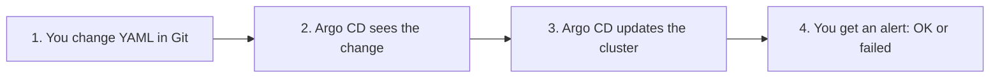
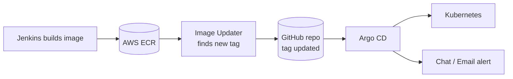

# 00 · START HERE (read this first, 5 minutes)

## The idea in plain words
Think of **Git as a recipe book** and **Kubernetes as the kitchen**.
**Argo CD is the cook** who keeps checking the recipe book and makes the kitchen match it.
You never cook by hand. You only **change the recipe (Git)**.

## Your real project flow (what you actually have)

## Words you must know (only 10)
| Word | Simple meaning |
|---|---|
| **GitOps** | Git is the boss. Cluster follows Git |
| **Argo CD** | The tool that copies Git to the cluster |
| **Application** | "Deploy THIS folder to THIS namespace" |
| **Project** | A fence: which repos and namespaces an app may use |
| **Sync** | Make the cluster equal to Git |
| **OutOfSync** | Cluster is different from Git |
| **Healthy** | Pods are running fine |
| **Self-heal** | Argo CD undoes manual changes |
| **Prune** | Argo CD deletes what you removed from Git |
| **Image Updater** | Robot that puts the new image tag into Git |

## Do it in this order (first time setup)
| Step | Do this | Folder |
|---|---|---|
| 1 | Install Argo CD | [02](../02_installation/README.md) |
| 2 | Create Projects (dev, prod) | [03](../03_projects/README.md) |
| 3 | Connect your private GitHub repo | [05](../05_repositories/README.md) |
| 4 | Create your Application | [04](../04_applications/README.md) |
| 5 | Turn on auto image update from ECR | [07](../07_image_updater/README.md) |
| 6 | Turn on alerts | [08](../08_notifications/README.md) |
| 7 | Turn on monitoring | [09](../09_monitoring/README.md) |
| 8 | Setup login (SSO) and permissions | [10](../10_sso_rbac_google/README.md) |
| 9 | Check the go-live list | [19](../18_production_checklist_troubleshooting/README.md) |

## Which file do I edit for…?
| I want to… | Edit this |
|---|---|
| Deploy a new app | `04_applications/application.yaml` |
| Change replicas / image / config | your app folder in Git (`k8-manifest/`) |
| Give a person access | add them to a **Google group** (no YAML) |
| Get alerts in Slack/Chat | `08_notifications/` |
| Stop auto deploy on prod | remove the `automated:` block in the prod Application |
| Roll back | `git revert` + push ([06](../06_sync_rollback_commands/README.md)) |

## 5 golden rules
1. **Change Git, never the cluster.**
2. **No passwords in Git** (use Sealed Secrets or External Secrets).
3. **One project per environment** (dev / staging / prod).
4. **Prod changes go through a pull request.**
5. **If a token was ever pasted anywhere public, revoke it.**

## Every YAML file here follows the same pattern
`apiVersion` + `kind` (what it is) → `metadata` (name) → `spec` (the settings).
Lines starting with `#` are explanations. Replace anything in `<angle brackets>`.
