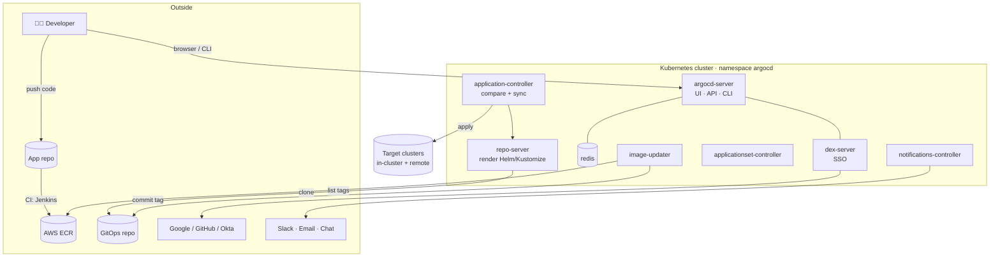
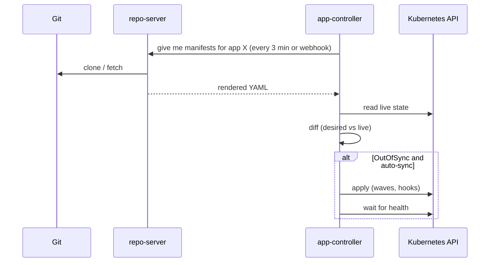
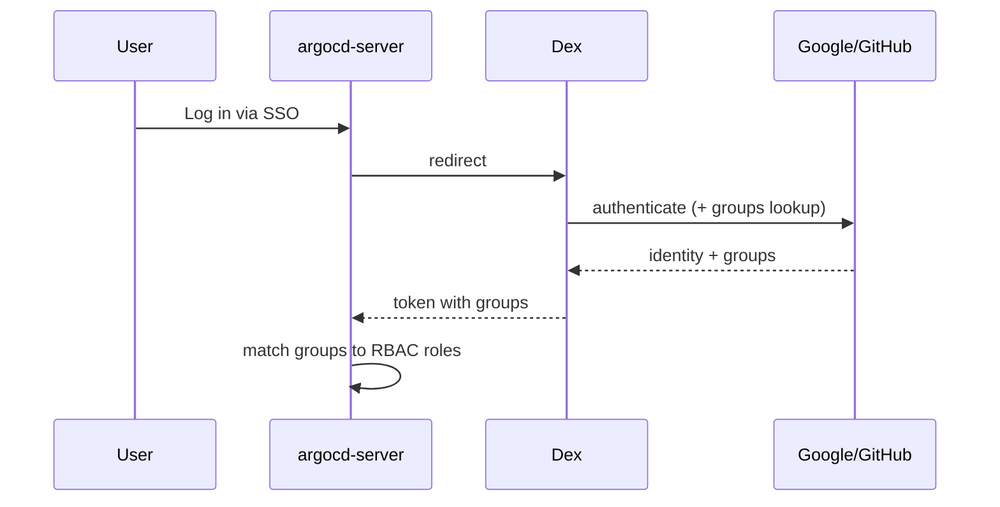
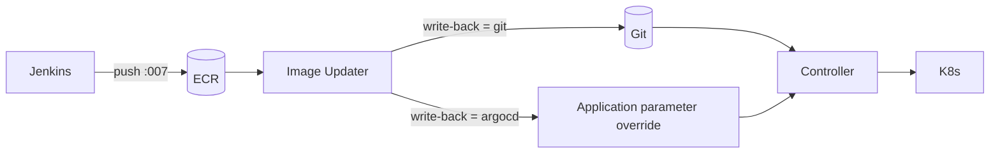
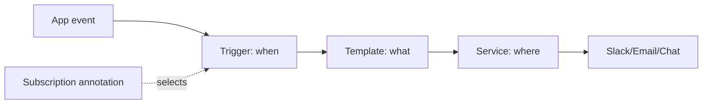

# 🏗️ 01 · Architecture, Components & Flows

> [!TIP]
> Read this once. Every later folder refers to these parts and flows.

## 1. Big picture


## 2. Components (what each service does)
| Service | Kind | Port | Job | Key settings | Use case |
|---|---|---|---|---|---|
| `argocd-server` | Deployment | 8080 (443 / 80) | UI, REST/gRPC API, login, RBAC checks | `url`, `server.insecure`, `admin.enabled` | You open the UI or run `argocd` CLI |
| `argocd-repo-server` | Deployment | 8081 | Clones Git, runs Helm/Kustomize/Jsonnet, caches result | `reposerver.parallelism.limit`, CMP plugins | Turns your repo path into final YAML |
| `argocd-application-controller` | StatefulSet | 8082 (metrics) | Compares Git vs live, syncs, health checks, self-heal | `controller.status.processors`, `operation.processors`, sharding | The "cook": keeps cluster = Git |
| `argocd-dex-server` | Deployment | 5556 | OIDC broker for Google, GitHub, LDAP, SAML | `dex.config` in `argocd-cm` | Login with Google/GitHub |
| `argocd-redis` | Deployment | 6379 | Cache | HA: `redis-ha` | Speed |
| `argocd-applicationset-controller` | Deployment | 7000 | Generates many Applications from a template | generators | One template for 50 apps/clusters |
| `argocd-notifications-controller` | Deployment | 9001 | Sends alerts on triggers | `argocd-notifications-cm/secret` | Slack message on failed sync |
| `argocd-image-updater` (add-on) | Deployment | - | Watches registries, writes new tags | `ImageUpdater` CR, registries | Auto deploy new ECR tag |

## 3. Configuration objects (all live in namespace `argocd`)
| Object | Purpose | Folder |
|---|---|---|
| `argocd-cm` | Main settings: URL, SSO, users, health rules | [11](../11_authentication_sso/README.md) |
| `argocd-rbac-cm` | Who may do what | [12](../12_rbac/README.md) |
| `argocd-cmd-params-cm` | Component flags (insecure, processors, limits) | below |
| `argocd-secret` | Server secrets (admin password hash, webhook secrets, SSO keys) | [15](../15_secrets/README.md) |
| `argocd-notifications-cm` / `-secret` | Alerts | [09](../09_notifications/README.md) |
| `argocd-ssh-known-hosts-cm` / `argocd-tls-certs-cm` | Git host keys and custom CAs | [05](../05_repositories/README.md) |
| Secrets with label `argocd.argoproj.io/secret-type` | `repository`, `repo-creds`, `cluster` | [05](../05_repositories/README.md) · [06](../06_clusters/README.md) |
| `AppProject`, `Application`, `ApplicationSet` | Your own resources | [03](../03_projects/README.md) · [04](../04_applications/README.md) |

### Key values in `argocd-cm`
| Key | Meaning | Example |
|---|---|---|
| `url` | External address (needed for SSO) | `https://argocd.example.com` |
| `admin.enabled` | Local admin login | `"false"` after SSO works |
| `exec.enabled` | Allow terminal in pods from the UI | `"false"` (security) |
| `timeout.reconciliation` | How often Git is checked | `180s` |
| `application.resourceTrackingMethod` | How resources are tied to apps | `annotation` |
| `resource.exclusions` | Kinds Argo CD ignores | Events, Endpoints |
| `accounts.<name>` | Local users | `apiKey, login` |
| `dex.config` / `oidc.config` | SSO | see folder 11 |

### Key values in `argocd-cmd-params-cm`
<details>
<summary>📄 <b>argocd-cmd-params-cm.yaml</b> — Component flags. Restart the component after changing.</summary>

```yaml
# ======================================================================
# FILE   : argocd-cmd-params-cm.yaml
# PURPOSE: Component flags. Restart the component after changing.
# APPLY  : kubectl apply -f argocd-cmd-params-cm.yaml && kubectl -n argocd rollout restart deploy argocd-server argocd-repo-server
# ======================================================================
apiVersion: v1
kind: ConfigMap
metadata:
  name: argocd-cmd-params-cm          # fixed name, read by all Argo CD components
  namespace: argocd
  labels:
    app.kubernetes.io/name: argocd-cmd-params-cm
    app.kubernetes.io/part-of: argocd
data:
  server.insecure: "true"                         # server speaks plain HTTP (TLS ends at ingress/ALB)
  # server.basehref: /argocd                      # serve under a sub-path (also set server.rootpath)
  controller.status.processors: "20"              # parallel app status checks (raise for 500+ apps)
  controller.operation.processors: "10"           # parallel syncs
  controller.repo.server.timeout.seconds: "120"   # wait time for manifest generation
  reposerver.parallelism.limit: "5"               # simultaneous manifest generations (protects memory)
  # application.namespaces: "team-a-*"            # allow Applications outside the argocd namespace
```

</details>

## 4. Flows
### 4.1 Sync flow (what happens after `git push`)

### 4.2 Login flow (SSO)

### 4.3 Image update flow

### 4.4 Notification flow


## 5. Deployment topologies
| Topology | Description | Use when |
|---|---|---|
| **Single cluster** | Argo CD deploys into the cluster it runs in (`in-cluster`) | Start, small teams |
| **Hub and spoke** | One Argo CD manages many remote clusters | Central platform team (most common in prod) |
| **Per-cluster** | An Argo CD in every cluster | Strong isolation, air-gapped |

## 6. Status vocabulary
| Sync | Meaning | | Health | Meaning |
|---|---|---|---|---|
| Synced | Live = Git | | Healthy | All good |
| OutOfSync | Live ≠ Git | | Progressing | Rolling out |
| Unknown | Cannot read | | Degraded | Failing pods/probes |
| | | | Missing / Suspended | Not found / paused |
