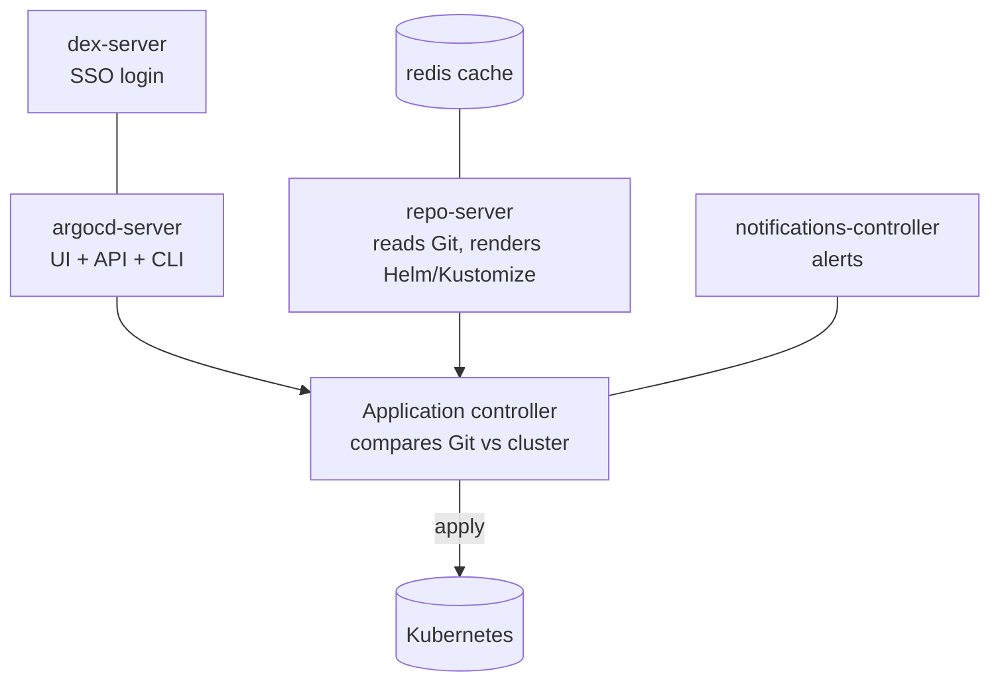
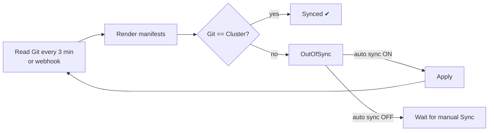

# 01 · GitOps Basics

> ### 🟢 Simple version
> **In one line:** Git holds what you want. Argo CD makes the cluster look the same.
> **Your goal:** Learn the 6 Argo CD pods and the check-compare-apply loop.
> **You will:** Read the table of pods → Understand Synced vs OutOfSync
> Need the full detail? Keep reading below. Otherwise jump to the files.

## What is GitOps?
| Old way (push) | GitOps way (pull) |
|---|---|
| CI runs `kubectl apply` on the cluster | Argo CD *inside* the cluster pulls from Git |
| Cluster credentials sit in CI | No cluster credentials outside |
| Manual changes go unnoticed | Drift is detected and can be auto-fixed (selfHeal) |
| Rollback = rerun old pipeline | Rollback = `git revert` |

## Argo CD parts (what runs in the `argocd` namespace)

| Pod | Job |
|---|---|
| `argocd-server` | UI, API, login |
| `argocd-repo-server` | Clones Git, runs Helm/Kustomize to make final YAML |
| `argocd-application-controller` | Compares **Git (desired)** vs **cluster (live)** and syncs |
| `argocd-dex-server` | SSO (Google, GitHub) |
| `argocd-redis` | Cache |
| `argocd-notifications-controller` | Sends alerts |
| `argocd-applicationset-controller` | Generates many apps from a template |

## Key words
- **Application** – "deploy *this Git path* to *this cluster/namespace*".
- **Project** – rulebook for apps (allowed repos, clusters, namespaces, who can do what).
- **Sync** – make the cluster equal to Git.
- **Status**: `Synced` / `OutOfSync` (drift) and health `Healthy` / `Progressing` / `Degraded` / `Missing`.
- **Self-heal** – undo manual cluster changes.
- **Prune** – delete cluster objects that were removed from Git.

## The reconcile loop

