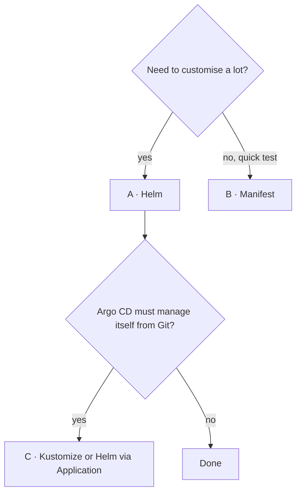

# 📦 02 · Installation

> [!TIP]
> Pick **one** install approach (A, B or C), then install the **CLI** (D) and expose it ([13](../13_exposure_https/README.md)).

## 1. What & why
Installing Argo CD puts the services from [01_architecture](../01_architecture/README.md) into the `argocd` namespace. How you install decides how you **upgrade, customise and recover** later.

## 2. Choose your approach
| | A · Helm | B · Manifest (kubectl) | C · Kustomize | D · CLI only |
|---|---|---|---|---|
| Customise | values.yaml (best) | edit ConfigMaps after | patches in Git | n/a (client tool) |
| Upgrade | `helm upgrade` | re-apply new version URL | change version in Git | `curl` new binary |
| Self-managed by GitOps | possible (Helm source) | no | **yes, natural** | - |
| HA | `redis-ha.enabled` | `manifests/ha/install.yaml` | HA URL as resource | - |
| Best for | most production teams | quick labs, learning | GitOps purists | everyone needs it |



## 3. Key values (Helm `values.yaml`)
| Key | Meaning | Example |
|---|---|---|
| `global.domain` | Public host name | `argocd.example.com` |
| `configs.params.server.insecure` | HTTP behind TLS-terminating proxy | `true` |
| `configs.cm.url` | External URL (SSO needs it) | `https://argocd.example.com` |
| `server.replicas` / `repoServer.replicas` | Availability | `2` |
| `redis-ha.enabled` | HA cache | `true` in prod |
| `*.metrics.enabled` | Prometheus metrics | `true` |
| `dex.enabled` | SSO broker | `true` |

## 4. Approach A · Helm
**Use when:** you want one `values.yaml` to control everything.
<details>
<summary>📄 <b>install-helm.sh</b> — Commands: add repo, install, upgrade, uninstall.</summary>

```bash
#!/bin/sh
# ======================================================================
# FILE   : install-helm.sh
# PURPOSE: Commands: add repo, install, upgrade, uninstall.
# APPLY  : sh install-helm.sh
# ======================================================================
# Approach A: Helm
helm repo add argo https://argoproj.github.io/argo-helm && helm repo update
helm search repo argo/argo-cd --versions | head -5             # choose a chart version
kubectl create namespace argocd
helm install argocd argo/argo-cd -n argocd --version <CHART_VERSION> -f helm-values.yaml
# upgrade:   helm upgrade argocd argo/argo-cd -n argocd --version <NEW_VERSION> -f helm-values.yaml
# uninstall: helm uninstall argocd -n argocd        (CRDs stay; delete them manually if needed)
```

</details>
<details>
<summary>📄 <b>helm-values.yaml</b> — Production-leaning values.</summary>

```yaml
# ======================================================================
# FILE   : helm-values.yaml
# PURPOSE: Production-leaning values.
# APPLY  : helm install ... -f helm-values.yaml
# ======================================================================
# Helm values for the argo/argo-cd chart (single-cluster, production-leaning).
global:
  domain: argocd.example.com            # your Argo CD host (no https://)

configs:
  params:
    server.insecure: true               # TLS ends at ingress/ALB, server speaks HTTP
  cm:
    url: https://argocd.example.com     # external URL (required for SSO)
    admin.enabled: "true"               # set "false" AFTER SSO works
    timeout.reconciliation: 180s        # Git poll interval
    application.resourceTrackingMethod: annotation
    exec.enabled: "false"               # no terminal into pods from the UI

controller:
  replicas: 1                           # raise only when sharding many clusters
  metrics: {enabled: true, serviceMonitor: {enabled: false}}   # true if Prometheus Operator exists

server:
  replicas: 2
  metrics: {enabled: true, serviceMonitor: {enabled: false}}

repoServer:
  replicas: 2
  metrics: {enabled: true, serviceMonitor: {enabled: false}}

dex:
  enabled: true                         # needed for Google/GitHub SSO via Dex
notifications:
  enabled: true
applicationSet:
  enabled: true
```

</details>
<details>
<summary>📄 <b>helm-values-ha.yaml</b> — HA overlay: redis-ha, 3 replicas, PDBs.</summary>

```yaml
# ======================================================================
# FILE   : helm-values-ha.yaml
# PURPOSE: HA overlay: redis-ha, 3 replicas, PDBs.
# APPLY  : add -f helm-values-ha.yaml
# ======================================================================
# Add on top of helm-values.yaml for HA:  -f helm-values.yaml -f helm-values-ha.yaml
redis-ha:
  enabled: true                         # 3 redis + haproxy
redis:
  enabled: false                        # turn off the single redis
controller:
  replicas: 1                           # controller is sharded, not load-balanced; see 16_advanced
server:
  replicas: 3
  pdb: {enabled: true, minAvailable: 1}
repoServer:
  replicas: 3
  pdb: {enabled: true, minAvailable: 1}
applicationSet:
  replicas: 2
global:
  affinity:
    podAntiAffinity: soft               # spread pods over nodes
```

</details>

## 5. Approach B · Manifest (kubectl)
**Use when:** quick lab or you do not want Helm. Four flavours: standard, HA, core, namespace-scoped.
<details>
<summary>📄 <b>install-manifest.sh</b> — kubectl install in 4 flavours (server-side apply).</summary>

```bash
#!/bin/sh
# ======================================================================
# FILE   : install-manifest.sh
# PURPOSE: kubectl install in 4 flavours (server-side apply).
# APPLY  : sh install-manifest.sh
# ======================================================================
# Approach B: plain manifest with kubectl
kubectl create namespace argocd

# B1. Standard (single replicas) - use server-side apply because CRDs are big
kubectl apply -n argocd --server-side --force-conflicts \
  -f https://raw.githubusercontent.com/argoproj/argo-cd/<ARGOCD_VERSION>/manifests/install.yaml

# B2. HA (3 replicas, redis-ha) - production
# kubectl apply -n argocd --server-side --force-conflicts \
#   -f https://raw.githubusercontent.com/argoproj/argo-cd/<ARGOCD_VERSION>/manifests/ha/install.yaml

# B3. Core (no UI/API/Dex; only controllers, for CLI --core use)
# kubectl apply -n argocd --server-side --force-conflicts \
#   -f https://raw.githubusercontent.com/argoproj/argo-cd/<ARGOCD_VERSION>/manifests/core-install.yaml

# B4. Namespace-scoped (no cluster-wide permissions; multi-tenant)
# kubectl apply -n argocd -f https://raw.githubusercontent.com/argoproj/argo-cd/<ARGOCD_VERSION>/manifests/namespace-install.yaml

kubectl -n argocd get pods -w
```

</details>

> [!WARNING]
> Always pin `<ARGOCD_VERSION>` (not `stable`) in production, and use `--server-side`: the CRDs are too large for client-side apply.

## 6. Approach C · Kustomize (GitOps-friendly)
**Use when:** you want the install + your patches stored in Git, and Argo CD to manage itself.
<details>
<summary>📄 <b>kustomize/kustomization.yaml</b> — Official manifest pinned by version plus patches.</summary>

```yaml
# ======================================================================
# FILE   : kustomize/kustomization.yaml
# PURPOSE: Official manifest pinned by version plus patches.
# APPLY  : kubectl apply -k kustomize/ --server-side
# ======================================================================
# Install Argo CD with Kustomize: official manifest + your patches, all stored in Git.
apiVersion: kustomize.config.k8s.io/v1beta1
kind: Kustomization
namespace: argocd
resources:
  - namespace.yaml
  # Pin a version! Pick from https://github.com/argoproj/argo-cd/releases
  - https://raw.githubusercontent.com/argoproj/argo-cd/<ARGOCD_VERSION>/manifests/install.yaml
  # HA instead:  .../<ARGOCD_VERSION>/manifests/ha/install.yaml
patches:
  - target: {kind: ConfigMap, name: argocd-cm}
    patch: |-
      - op: add
        path: /data/url
        value: https://argocd.example.com
      - op: add
        path: /data/timeout.reconciliation
        value: 180s
  - target: {kind: ConfigMap, name: argocd-cmd-params-cm}
    patch: |-
      - op: add
        path: /data/server.insecure
        value: "true"
```

</details>
<details>
<summary>📄 <b>kustomize/namespace.yaml</b> — The argocd namespace.</summary>

```yaml
# ======================================================================
# FILE   : kustomize/namespace.yaml
# PURPOSE: The argocd namespace.
# ======================================================================
apiVersion: v1
kind: Namespace
metadata:
  name: argocd
```

</details>
<details>
<summary>📄 <b>argocd-self-managed-app.yaml</b> — After install, Argo CD manages its own install from Git.</summary>

```yaml
# ======================================================================
# FILE   : argocd-self-managed-app.yaml
# PURPOSE: After install, Argo CD manages its own install from Git.
# APPLY  : kubectl apply -f argocd-self-managed-app.yaml
# ======================================================================
# After install, let Argo CD manage ITSELF from Git (upgrade = change the version in Git).
apiVersion: argoproj.io/v1alpha1
kind: Application
metadata:
  name: argocd
  namespace: argocd
spec:
  project: default
  source:
    repoURL: https://github.com/<org>/<gitops-repo>.git
    targetRevision: main
    path: argocd/install/kustomize      # the kustomize folder from this guide
  destination:
    server: https://kubernetes.default.svc
    namespace: argocd
  syncPolicy:
    automated: {prune: false, selfHeal: true}   # prune false: never delete Argo CD's own pieces by accident
    syncOptions: [ServerSideApply=true]         # needed: Argo CD CRDs are large
```

</details>

## 7. Approach D · CLI install + login methods
<details>
<summary>📄 <b>install-cli.sh</b> — Install the CLI and 5 ways to log in (port-forward, domain, SSO, token, core).</summary>

```bash
#!/bin/sh
# ======================================================================
# FILE   : install-cli.sh
# PURPOSE: Install the CLI and 5 ways to log in (port-forward, domain, SSO, token, core).
# APPLY  : sh install-cli.sh
# ======================================================================
# Approach D: install the argocd CLI (needed for any approach) and log in
# Linux
curl -sSL -o argocd https://github.com/argoproj/argo-cd/releases/latest/download/argocd-linux-amd64
sudo install -m 555 argocd /usr/local/bin/argocd && rm argocd
# macOS:   brew install argocd
# Windows: choco install argocd-cli   (or download argocd-windows-amd64.exe)
argocd version --client

# ---- get first password ----
argocd admin initial-password -n argocd
#   same as: kubectl -n argocd get secret argocd-initial-admin-secret -o jsonpath='{.data.password}' | base64 -d

# ---- login: pick ONE ----
# 1. Port-forward (no ingress yet)
kubectl -n argocd port-forward svc/argocd-server 8080:443 &
argocd login localhost:8080 --username admin --insecure
# 2. Through your domain (behind ingress/ALB)
# argocd login argocd.example.com --username admin --grpc-web
# 3. SSO
# argocd login argocd.example.com --sso --grpc-web
# 4. CI token (no interactive login)
# export ARGOCD_SERVER=argocd.example.com ARGOCD_AUTH_TOKEN=<token>; argocd app list --grpc-web
# 5. Core mode: talks to the cluster API directly, no Argo CD server needed
# kubectl config set-context --current --namespace=argocd; argocd login --core

argocd account update-password        # change the admin password
# after SSO works:  kubectl -n argocd delete secret argocd-initial-admin-secret
```

</details>

## 8. Verify
```bash
kubectl -n argocd get pods                  # all Running
kubectl get crd | grep argoproj             # applications, appprojects, applicationsets
argocd version                              # client + server versions
argocd cluster list                         # in-cluster should appear
```

## 9. Troubleshooting
| Symptom | Cause | Fix |
|---|---|---|
| CRD apply error `metadata.annotations: Too long` | client-side apply | use `--server-side` |
| Pods Pending | no node capacity | `kubectl describe pod` |
| UI redirect loop behind ingress | server also forcing TLS | `server.insecure: true` |
| `argocd login` hangs through ALB | gRPC blocked | add `--grpc-web` |
| Upgrade broke settings | edited ConfigMaps by hand with Helm | keep all settings in values.yaml |

## 10. Checklist
- [ ] Version pinned · [ ] HA for production · [ ] Admin password changed · [ ] SSO tested then `admin.enabled: "false"` · [ ] Initial admin secret deleted · [ ] Install stored in Git (Approach C)
