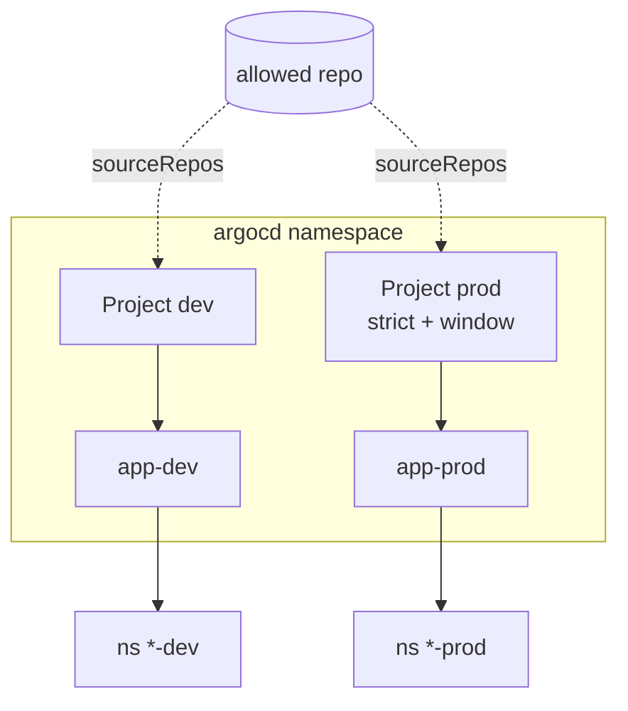

# 🛡️ 03 · Projects (AppProject)

> [!TIP]
> A Project is the **security fence** around apps. One project per environment is the rule.

## 1. What & why
Without projects, any app can deploy anywhere. A project limits **which repos**, **which clusters/namespaces**, **which kinds**, **when** (sync windows) and **who** (roles).

**Use case:** developers may sync only `*-dev`; prod accepts only the platform repo, only `*-prod`, never on business hours.

## 2. Architecture


## 3. Key values
| Key | Meaning | Example |
|---|---|---|
| `sourceRepos` | Repos apps may use | `https://github.com/org/gitops.git` (avoid `*`) |
| `destinations` | `server`/`name` + `namespace` allowed | `*-prod` |
| `clusterResourceWhitelist` | Cluster-wide kinds allowed | `Namespace` |
| `namespaceResourceBlacklist` | Kinds forbidden inside namespaces | `ResourceQuota` |
| `syncWindows` | When syncing is allowed/denied | `deny 09:00-17:00` |
| `roles` | Project-level permissions + SSO groups | `deployer` |
| `orphanedResources.warn` | Warn about unmanaged objects | `true` |

## 4. Choose your approach
| | A · YAML | B · CLI | C · UI |
|---|---|---|---|
| Repeatable / in Git | ✅ | ❌ | ❌ |
| Speed for a test | ok | fast | fastest |
| Use for | **production** | demos | learning |

## 5. Approach A · YAML (declarative)
<details>
<summary>📄 <b>project-dev.yaml</b> — Relaxed dev project.</summary>

```yaml
# ======================================================================
# FILE   : project-dev.yaml
# PURPOSE: Relaxed dev project.
# APPLY  : kubectl apply -f project-dev.yaml
# ======================================================================
apiVersion: argoproj.io/v1alpha1
kind: AppProject
metadata:
  name: myargoproject-dev            # apps choose it with spec.project
  namespace: argocd                  # always the argocd namespace
  finalizers:
    - resources-finalizer.argocd.argoproj.io   # blocks deleting the project while apps still use it
spec:
  description: Dev environment (relaxed)

  sourceRepos:                       # WHICH repos may be deployed
    - https://github.com/<org>/<gitops-repo>.git    # be specific. '*' = any repo (avoid)

  destinations:                      # WHERE apps may deploy
    - server: https://kubernetes.default.svc        # the same cluster Argo CD runs in
      namespace: "*-dev"             # only namespaces ending in -dev

  clusterResourceWhitelist:          # cluster-wide kinds allowed
    - group: ""
      kind: Namespace                # allow creating namespaces only (CreateNamespace=true needs it)

  orphanedResources:
    warn: true                       # warn about resources in these namespaces not managed by Argo CD
```

</details>
<details>
<summary>📄 <b>project-prod.yaml</b> — Strict prod: sync window, blocked kinds, deployer role.</summary>

```yaml
# ======================================================================
# FILE   : project-prod.yaml
# PURPOSE: Strict prod: sync window, blocked kinds, deployer role.
# APPLY  : kubectl apply -f project-prod.yaml
# ======================================================================
apiVersion: argoproj.io/v1alpha1
kind: AppProject
metadata:
  name: myargoproject-prod
  namespace: argocd
  finalizers:
    - resources-finalizer.argocd.argoproj.io
spec:
  description: Production (strict)

  sourceRepos:
    - https://github.com/<org>/<gitops-repo>.git

  destinations:
    - server: https://kubernetes.default.svc
      namespace: "*-prod"            # only -prod namespaces

  clusterResourceWhitelist:
    - group: ""
      kind: Namespace

  # Block everything dangerous that is NOT listed above is already denied.
  # Extra: never allow these namespaced kinds in this project
  namespaceResourceBlacklist:
    - group: ""
      kind: ResourceQuota            # example: only platform team manages quotas

  # ---------- WHEN syncing is allowed ----------
  syncWindows:
    - kind: deny                     # no automatic deploys on business hours Mon-Fri 09:00-17:00 (UTC)
      schedule: "0 9 * * 1-5"        # cron: start time
      duration: 8h                   # window length
      applications: ["*"]
      manualSync: true               # a human can still sync manually (emergency)

  # ---------- WHO can do what inside this project ----------
  roles:
    - name: deployer
      description: Can sync and see prod apps, nothing else
      policies:
        - p, proj:myargoproject-prod:deployer, applications, get,  myargoproject-prod/*, allow
        - p, proj:myargoproject-prod:deployer, applications, sync, myargoproject-prod/*, allow
      groups:
        - argocd-sre@example.com     # SSO group (see 10_sso_rbac_google)

  orphanedResources:
    warn: true
```

</details>

## 6. Approach B · CLI
<details>
<summary>📄 <b>project-cli.sh</b> — Create a project, windows, roles and tokens with the CLI.</summary>

```bash
#!/bin/sh
# ======================================================================
# FILE   : project-cli.sh
# PURPOSE: Create a project, windows, roles and tokens with the CLI.
# APPLY  : sh project-cli.sh
# ======================================================================
# Approach B: create and tune a project with the CLI (good for quick tests; use YAML for production)
argocd proj create myargoproject-dev -d https://kubernetes.default.svc,'*-dev' -s https://github.com/<org>/<gitops-repo>.git
argocd proj add-source myargoproject-dev https://github.com/<org>/another-repo.git
argocd proj add-destination myargoproject-dev https://kubernetes.default.svc 'extra-dev'
argocd proj allow-cluster-resource myargoproject-dev "" Namespace      # allow Namespace creation
argocd proj windows add myargoproject-prod --kind deny --schedule "0 9 * * 1-5" --duration 8h --applications '*' --manual-sync
argocd proj role create myargoproject-prod deployer
argocd proj role add-policy myargoproject-prod deployer --action sync --permission allow --object '*'
argocd proj role create-token myargoproject-prod deployer           # JWT for CI (see folder 12)
argocd proj list && argocd proj get myargoproject-prod
```

</details>

## 7. Approach C · UI
**Settings → Projects → + New Project** → name → fill *Source repositories*, *Destinations*, *Cluster resource allow list* → Create.

## 8. Verify
```bash
argocd proj list
argocd proj get myargoproject-prod
argocd proj windows list myargoproject-prod
```

## 9. Troubleshooting
| Symptom | Cause | Fix |
|---|---|---|
| `application repo ... is not permitted in project` | Repo not in `sourceRepos` | add it |
| `destination ... not permitted` | namespace/server mismatch | fix `destinations` |
| `resource ... is not permitted` | cluster-wide kind not whitelisted | add to `clusterResourceWhitelist` |
| Sync blocked | deny window active | `argocd proj windows list` |

## 10. Checklist
- [ ] One project per environment · [ ] no `'*'` in prod · [ ] sync window for prod · [ ] roles use SSO groups
