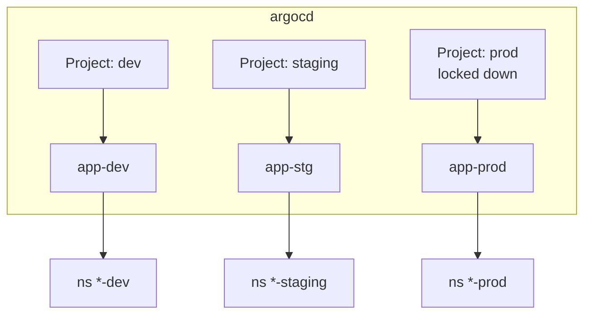

# 03 · Projects (AppProject)

> ### 🟢 Simple version
> **In one line:** A Project is a fence around apps: allowed repos and namespaces only.
> **Your goal:** Make one project for dev and a stricter one for prod.
> **You will:** kubectl apply both project files → Check with argocd proj list
> Need the full detail? Keep reading below. Otherwise jump to the files.


A **Project** is the security fence around apps. It limits:
1. **Which Git repos** apps may use (`sourceRepos`)
2. **Where** they may deploy (`destinations`)
3. **Which cluster-wide kinds** they may create (`clusterResourceWhitelist`)
4. **When** they may sync (`syncWindows`) and **who** can act (`roles`)



Rule of thumb: **one project per environment**. Always create Applications in a project (never `default` in production).

Files:
- [project-dev.yaml](project-dev.yaml) – relaxed
- [project-prod.yaml](project-prod.yaml) – strict, with sync window and roles

```bash
kubectl apply -f project-dev.yaml -f project-prod.yaml
argocd proj list
argocd proj get prod
```


---

## Files in this guide

| # | File | Purpose | What you change |
|---|---|---|---|
| 1 | [`project-dev.yaml`](project-dev.yaml) | Relaxed project for dev: one repo, only *-dev namespaces. | sourceRepos URL and destinations namespace pattern. |
| 2 | [`project-prod.yaml`](project-prod.yaml) | Strict project for prod: sync window, blocked kinds, deployer role. | sourceRepos, namespace pattern, group email, sync window times. |

---

## The files, with explanations

Every file has `#` comments on each important line. Replace anything in `<angle brackets>`.

### File 1: `project-dev.yaml`
**Purpose:** Relaxed project for dev: one repo, only *-dev namespaces.  
**What you change:** sourceRepos URL and destinations namespace pattern.  
**Apply:** `kubectl apply -f project-dev.yaml`

```yaml
# ======================================================================
# FILE   : project-dev.yaml
# PURPOSE: Relaxed project for dev: one repo, only *-dev namespaces.
# CHANGE : sourceRepos URL and destinations namespace pattern.
# APPLY  : kubectl apply -f project-dev.yaml
# ======================================================================
apiVersion: argoproj.io/v1alpha1
kind: AppProject
metadata:
  name: myargoproject-dev            # apps choose it with spec.project
  namespace: argocd                  # always the argocd namespace
  finalizers:
    - resources-finalizer.argocd.argoproj.io   # blocks deleting the project while apps still use it
spec:
  description: Dev environment (relaxed)

  sourceRepos:                       # WHICH repos may be deployed
    - https://github.com/<org>/<gitops-repo>.git    # be specific. '*' = any repo (avoid)

  destinations:                      # WHERE apps may deploy
    - server: https://kubernetes.default.svc        # the same cluster Argo CD runs in
      namespace: "*-dev"             # only namespaces ending in -dev

  clusterResourceWhitelist:          # cluster-wide kinds allowed
    - group: ""
      kind: Namespace                # allow creating namespaces only (CreateNamespace=true needs it)

  orphanedResources:
    warn: true                       # warn about resources in these namespaces not managed by Argo CD
```

### File 2: `project-prod.yaml`
**Purpose:** Strict project for prod: sync window, blocked kinds, deployer role.  
**What you change:** sourceRepos, namespace pattern, group email, sync window times.  
**Apply:** `kubectl apply -f project-prod.yaml`

```yaml
# ======================================================================
# FILE   : project-prod.yaml
# PURPOSE: Strict project for prod: sync window, blocked kinds, deployer role.
# CHANGE : sourceRepos, namespace pattern, group email, sync window times.
# APPLY  : kubectl apply -f project-prod.yaml
# ======================================================================
apiVersion: argoproj.io/v1alpha1
kind: AppProject
metadata:
  name: myargoproject-prod
  namespace: argocd
  finalizers:
    - resources-finalizer.argocd.argoproj.io
spec:
  description: Production (strict)

  sourceRepos:
    - https://github.com/<org>/<gitops-repo>.git

  destinations:
    - server: https://kubernetes.default.svc
      namespace: "*-prod"            # only -prod namespaces

  clusterResourceWhitelist:
    - group: ""
      kind: Namespace

  # Block everything dangerous that is NOT listed above is already denied.
  # Extra: never allow these namespaced kinds in this project
  namespaceResourceBlacklist:
    - group: ""
      kind: ResourceQuota            # example: only platform team manages quotas

  # ---------- WHEN syncing is allowed ----------
  syncWindows:
    - kind: deny                     # no automatic deploys on business hours Mon-Fri 09:00-17:00 (UTC)
      schedule: "0 9 * * 1-5"        # cron: start time
      duration: 8h                   # window length
      applications: ["*"]
      manualSync: true               # a human can still sync manually (emergency)

  # ---------- WHO can do what inside this project ----------
  roles:
    - name: deployer
      description: Can sync and see prod apps, nothing else
      policies:
        - p, proj:myargoproject-prod:deployer, applications, get,  myargoproject-prod/*, allow
        - p, proj:myargoproject-prod:deployer, applications, sync, myargoproject-prod/*, allow
      groups:
        - argocd-sre@example.com     # SSO group (see 10_sso_rbac_google)

  orphanedResources:
    warn: true
```

---

## Apply and Verify

```bash
kubectl -n argocd get appprojects
argocd proj list
argocd proj get myargoproject-prod
```

---

## Troubleshooting

| Symptom | Likely cause | Fix |
|---|---|---|
| app not permitted in project | repo/namespace/kind not allowed | Edit sourceRepos / destinations / clusterResourceWhitelist |
| Cannot delete project | Apps still use it | Move or delete the apps first |
| Sync blocked unexpectedly | A deny sync window is active | argocd proj windows list <project> |

---

## Checklist

- [ ] One project per environment
- [ ] No '*' repo/namespace in prod
- [ ] Namespace creation allowed only if CreateNamespace=true is used
- [ ] Roles use SSO groups, not users
