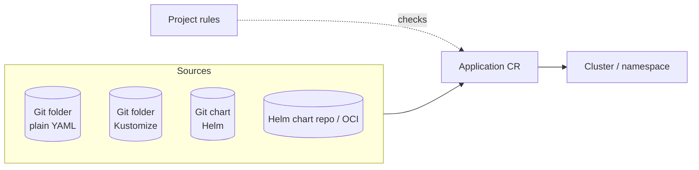
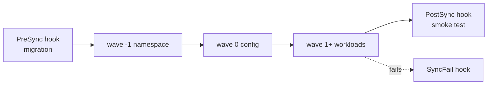

# 🚢 04 · Applications

> [!TIP]
> An **Application** = *source* (Git path or chart) + *destination* (cluster + namespace) + *sync policy*.

## 1. What & why
It is the unit Argo CD manages. **Use case:** "deploy folder `k8-manifest/web/overlays/prod` to namespace `web-prod` and keep it equal".

## 2. Architecture


## 3. Key values
| Key | Meaning | Example |
|---|---|---|
| `spec.project` | Fence that governs this app | `myargoproject-dev` |
| `source.repoURL` | Git or Helm repo | `https://github.com/org/gitops.git` |
| `source.targetRevision` | Branch / tag / commit / chart version | `main`, `v1.2.0`, `18.2.0` |
| `source.path` / `chart` | Folder or chart name | `k8-manifest/web` |
| `destination.server` or `.name` | Target cluster | `https://kubernetes.default.svc` |
| `destination.namespace` | Target namespace | `web-dev` |
| `syncPolicy.automated.prune` | Delete removed objects | `true` |
| `syncPolicy.automated.selfHeal` | Revert manual edits | `true` |
| `syncOptions` | Behaviour flags | `CreateNamespace=true`, `ServerSideApply=true` |
| `retry` | Retry failed sync with back-off | `limit: 3` |
| `ignoreDifferences` | Fields not to compare | HPA `/spec/replicas` |
| `finalizers` | Delete deployed objects with the app | `resources-finalizer.argocd.argoproj.io` |

## 4. Choose your approach

### 4.1 How to create the Application
| | UI | CLI | YAML (declarative) | ApplicationSet |
|---|---|---|---|---|
| In Git / repeatable | ❌ | ❌ (export possible) | ✅ | ✅ |
| Many apps at once | ❌ | ❌ | with App-of-Apps | ✅ |
| Use for | learning | tests, scripts | **production** | fleets ([16](../16_advanced/README.md)) |

### 4.2 What kind of source
| Source | File | When |
|---|---|---|
| Plain YAML folder | `application-plain.yaml` | simplest apps |
| Kustomize | `application-kustomize.yaml` | environments with overlays |
| Helm chart in your Git | `application-helm-git.yaml` | own charts + env values |
| Helm chart repo | `application-helm.yaml` | third-party charts |
| Chart + your values (multi-source) | `application-multisource.yaml` | third-party chart, own values, no fork |

### 4.3 Sync behaviour
| Policy | Use for |
|---|---|
| Automated + selfHeal + prune | dev, staging |
| Manual (no `automated`) | prod with human gate |
| Automated + sync window | prod with a safe schedule |

## 5. Approach YAML
<details>
<summary>📄 <b>application.yaml</b> — Full example: Kustomize path, auto-sync, retry, HPA ignore.</summary>

```yaml
# ======================================================================
# FILE   : application.yaml
# PURPOSE: Full example: Kustomize path, auto-sync, retry, HPA ignore.
# APPLY  : kubectl apply -f application.yaml
# ======================================================================
apiVersion: argoproj.io/v1alpha1
kind: Application                    # one app that Argo CD keeps in sync with Git
metadata:
  name: fcoos-insights               # name in the UI (Image Updater's namePattern must match this)
  namespace: argocd                  # Applications always live in the argocd namespace
  finalizers:
    - resources-finalizer.argocd.argoproj.io
    # deleting the Application also deletes everything it deployed. Remove this line to keep resources.
  labels:
    env: dev                         # labels help filtering in UI/CLI
spec:
  project: myargoproject-dev         # the Project (03_projects) that governs this app

  source:                            # WHERE the manifests are
    repoURL: https://github.com/<org>/<gitops-repo>.git   # must be connected (05_repositories) if private
    targetRevision: main             # branch, tag or commit. Prefer 'main' over HEAD for clarity
    path: k8-manifest                # folder in the repo (has kustomization.yaml)

  destination:                       # WHERE to deploy
    server: https://kubernetes.default.svc   # same cluster. Remote cluster: register it first
    namespace: fcoos-dev

  syncPolicy:
    automated:
      prune: true                    # delete resources removed from Git
      selfHeal: true                 # undo manual changes in the cluster
      allowEmpty: false              # never sync an empty path
    syncOptions:
      - CreateNamespace=true         # create the namespace if missing
      - PruneLast=true               # delete old resources last
      - PrunePropagationPolicy=foreground
      - ApplyOutOfSyncOnly=true      # only apply changed objects (fast for big apps)
    retry:
      limit: 3                       # retry a failed sync 3 times
      backoff:
        duration: 5s                 # 5s, 10s, 20s ...
        factor: 2
        maxDuration: 3m

  ignoreDifferences:                 # do not show these as OutOfSync
    - group: apps
      kind: Deployment
      jsonPointers:
        - /spec/replicas             # HPA changes replicas, so ignore it

  revisionHistoryLimit: 5            # keep last 5 syncs for rollback
```

</details>
<details>
<summary>📄 <b>application-plain.yaml</b> — Plain folder with include/exclude.</summary>

```yaml
# ======================================================================
# FILE   : application-plain.yaml
# PURPOSE: Plain folder with include/exclude.
# APPLY  : kubectl apply -f application-plain.yaml
# ======================================================================
# Plain YAML folder (no Helm/Kustomize). Every .yaml in the folder is applied.
apiVersion: argoproj.io/v1alpha1
kind: Application
metadata: {name: web-plain, namespace: argocd}
spec:
  project: myargoproject-dev
  source:
    repoURL: https://github.com/<org>/<gitops-repo>.git
    targetRevision: main
    path: k8-manifest/plain
    directory:
      recurse: true                   # also read sub-folders
      include: "*.yaml"               # only these files
      exclude: "*.test.yaml"          # skip these
  destination: {server: https://kubernetes.default.svc, namespace: web-dev}
  syncPolicy:
    automated: {prune: true, selfHeal: true}
    syncOptions: [CreateNamespace=true]
```

</details>
<details>
<summary>📄 <b>application-kustomize.yaml</b> — Kustomize overlay with optional overrides.</summary>

```yaml
# ======================================================================
# FILE   : application-kustomize.yaml
# PURPOSE: Kustomize overlay with optional overrides.
# APPLY  : kubectl apply -f application-kustomize.yaml
# ======================================================================
# Kustomize app: Argo CD auto-detects kustomization.yaml in the path.
apiVersion: argoproj.io/v1alpha1
kind: Application
metadata: {name: web-kustomize, namespace: argocd}
spec:
  project: myargoproject-dev
  source:
    repoURL: https://github.com/<org>/<gitops-repo>.git
    targetRevision: main
    path: k8-manifest/web/overlays/dev
    kustomize:                        # optional overrides (usually keep these in Git instead)
      namePrefix: dev-                # prefix all names
      images:
        - nginx=nginx:1.27            # replace an image tag
      commonLabels: {env: dev}
  destination: {server: https://kubernetes.default.svc, namespace: web-dev}
  syncPolicy:
    automated: {prune: true, selfHeal: true}
    syncOptions: [CreateNamespace=true]
```

</details>
<details>
<summary>📄 <b>application-helm-git.yaml</b> — Helm chart in Git + per-env values + parameter override.</summary>

```yaml
# ======================================================================
# FILE   : application-helm-git.yaml
# PURPOSE: Helm chart in Git + per-env values + parameter override.
# APPLY  : kubectl apply -f application-helm-git.yaml
# ======================================================================
# Helm chart that lives INSIDE your Git repo (path = chart folder), values per environment.
apiVersion: argoproj.io/v1alpha1
kind: Application
metadata: {name: web-helm-git, namespace: argocd}
spec:
  project: myargoproject-dev
  source:
    repoURL: https://github.com/<org>/<gitops-repo>.git
    targetRevision: main
    path: charts/web
    helm:
      releaseName: web
      valueFiles:
        - values.yaml                 # relative to the chart path
        - ../../envs/dev/values.yaml  # env override kept in Git
      parameters:
        - name: image.tag             # single override (Image Updater uses this with write-back: argocd)
          value: "007"
  destination: {server: https://kubernetes.default.svc, namespace: web-dev}
  syncPolicy:
    automated: {prune: true, selfHeal: true}
    syncOptions: [CreateNamespace=true]
```

</details>
<details>
<summary>📄 <b>application-helm.yaml</b> — Third-party Helm chart with value overrides.</summary>

```yaml
# ======================================================================
# FILE   : application-helm.yaml
# PURPOSE: Third-party Helm chart with value overrides.
# APPLY  : kubectl apply -f application-helm.yaml
# ======================================================================
# Deploy a Helm chart straight from a Helm repo with value overrides.
apiVersion: argoproj.io/v1alpha1
kind: Application
metadata:
  name: nginx-helm
  namespace: argocd
spec:
  project: myargoproject-dev
  source:
    repoURL: https://charts.bitnami.com/bitnami   # Helm repository URL
    chart: nginx                                   # chart name (use 'path' instead for a chart inside Git)
    targetRevision: 18.2.0                         # PIN the chart version in production
    helm:
      releaseName: nginx
      valuesObject:                                # inline overrides (or use valueFiles from Git)
        replicaCount: 2
        service:
          type: ClusterIP
  destination:
    server: https://kubernetes.default.svc
    namespace: nginx-dev
  syncPolicy:
    automated: {prune: true, selfHeal: true}
    syncOptions: [CreateNamespace=true]
```

</details>
<details>
<summary>📄 <b>application-multisource.yaml</b> — Public chart + your values file from Git.</summary>

```yaml
# ======================================================================
# FILE   : application-multisource.yaml
# PURPOSE: Public chart + your values file from Git.
# APPLY  : kubectl apply -f application-multisource.yaml
# ======================================================================
# Multiple sources: public Helm chart + YOUR values file from Git (clean separation, no chart copy).
apiVersion: argoproj.io/v1alpha1
kind: Application
metadata: {name: nginx-multisource, namespace: argocd}
spec:
  project: myargoproject-dev
  sources:
    - repoURL: https://charts.bitnami.com/bitnami
      chart: nginx
      targetRevision: 18.2.0          # pin the chart version
      helm:
        valueFiles:
          - $values/envs/dev/nginx-values.yaml   # $values = the source below
    - repoURL: https://github.com/<org>/<gitops-repo>.git
      targetRevision: main
      ref: values                     # name used in $values above
  destination: {server: https://kubernetes.default.svc, namespace: nginx-dev}
  syncPolicy:
    automated: {prune: true, selfHeal: true}
    syncOptions: [CreateNamespace=true]
```

</details>
<details>
<summary>📄 <b>application-manual-sync.yaml</b> — Production style, manual sync.</summary>

```yaml
# ======================================================================
# FILE   : application-manual-sync.yaml
# PURPOSE: Production style, manual sync.
# APPLY  : kubectl apply -f application-manual-sync.yaml
# ======================================================================
# Production style: NO automated block => a human (or pipeline) presses Sync.
# Add sync windows in the Project (folder 03) for extra safety.
apiVersion: argoproj.io/v1alpha1
kind: Application
metadata: {name: web-prod, namespace: argocd}
spec:
  project: myargoproject-prod
  source:
    repoURL: https://github.com/<org>/<gitops-repo>.git
    targetRevision: main
    path: k8-manifest/web/overlays/prod
  destination: {server: https://kubernetes.default.svc, namespace: web-prod}
  syncPolicy:
    syncOptions:
      - CreateNamespace=true
      - PruneLast=true
      - ApplyOutOfSyncOnly=true
  # Optional: pick which diffs to ignore
  ignoreDifferences:
    - group: apps
      kind: Deployment
      jsonPointers: [/spec/replicas]  # HPA owns replicas
```

</details>

## 6. Approach CLI
<details>
<summary>📄 <b>application-cli.sh</b> — Create from Git, from a Helm repo, and edit.</summary>

```bash
#!/bin/sh
# ======================================================================
# FILE   : application-cli.sh
# PURPOSE: Create from Git, from a Helm repo, and edit.
# APPLY  : sh application-cli.sh
# ======================================================================
# Approach: create apps with the CLI
# Git folder (plain/kustomize/helm auto-detected)
argocd app create web-cli \
  --repo https://github.com/<org>/<gitops-repo>.git --revision main --path k8-manifest/web \
  --dest-server https://kubernetes.default.svc --dest-namespace web-dev \
  --project myargoproject-dev \
  --sync-policy automated --auto-prune --self-heal --sync-option CreateNamespace=true

# Helm chart repo
argocd app create nginx-cli --repo https://charts.bitnami.com/bitnami --helm-chart nginx --revision 18.2.0 \
  --dest-server https://kubernetes.default.svc --dest-namespace nginx-dev --project myargoproject-dev \
  --helm-set replicaCount=2

# Edit later
argocd app set web-cli --sync-policy none                 # switch to manual
argocd app set web-cli --kustomize-image nginx=nginx:1.27
argocd app get web-cli -o yaml > web-cli.yaml             # export as YAML to commit to Git
```

</details>

## 7. Approach UI
**Applications → + New App** → name, project → Source (repo, revision, path) → Destination (cluster, namespace) → set *Sync policy* → **Create**. Use **Edit as YAML** and copy it to Git.

## 8. Ordering: sync waves & hooks

<details>
<summary>📄 <b>hooks-and-waves.yaml</b> — Namespace first, config next, migration PreSync, smoke test PostSync.</summary>

```yaml
# ======================================================================
# FILE   : hooks-and-waves.yaml
# PURPOSE: Namespace first, config next, migration PreSync, smoke test PostSync.
# APPLY  : put in the app folder in Git
# ======================================================================
# Ordering with sync waves + a PreSync hook (DB migration). Put these in your app folder.
apiVersion: v1
kind: Namespace
metadata:
  name: web-dev
  annotations:
    argocd.argoproj.io/sync-wave: "-1"          # wave -1: first
---
apiVersion: v1
kind: ConfigMap
metadata:
  name: web-config
  annotations:
    argocd.argoproj.io/sync-wave: "0"           # wave 0: config before the app
data: {LOG_LEVEL: info}
---
apiVersion: batch/v1
kind: Job
metadata:
  name: db-migrate
  annotations:
    argocd.argoproj.io/hook: PreSync            # runs BEFORE the sync
    argocd.argoproj.io/hook-delete-policy: HookSucceeded   # clean up when done
spec:
  template:
    spec:
      restartPolicy: Never
      containers:
        - name: migrate
          image: busybox:1.36
          command: [sh, -c, "echo running migrations"]
---
apiVersion: batch/v1
kind: Job
metadata:
  name: smoke-test
  annotations:
    argocd.argoproj.io/hook: PostSync           # after everything is healthy
    argocd.argoproj.io/hook-delete-policy: HookSucceeded
spec:
  template:
    spec:
      restartPolicy: Never
      containers:
        - name: test
          image: busybox:1.36
          command: [sh, -c, "echo smoke ok"]
```

</details>

## 9. Verify
```bash
argocd app get web-cli                 # Synced + Healthy
argocd app diff web-cli                # empty = same as Git
kubectl -n argocd get applications
```

## 10. Troubleshooting
| Symptom | Cause | Fix |
|---|---|---|
| `ComparisonError` | repo not connected / path wrong | [05](../05_repositories/README.md), check path |
| OutOfSync forever | HPA or controller edits a field | `ignoreDifferences` |
| `namespace not found` | missing | `CreateNamespace=true` |
| Delete app hangs | finalizer waiting | `argocd app terminate-op`, patch finalizers |
| CRD error first sync | order | wave + `SkipDryRunOnMissingResource=true` |

## 11. Checklist
- [ ] `spec.project` set · [ ] revision is a branch/tag · [ ] selfHeal+prune for non-prod · [ ] retry set · [ ] HPA ignore set · [ ] prod = manual or windowed
