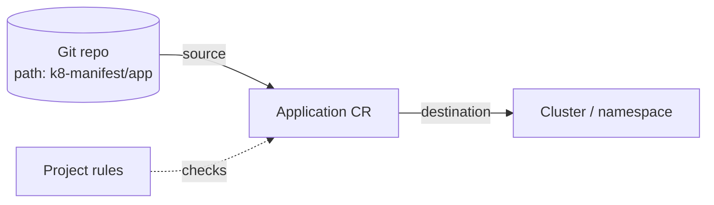

# 04 · Applications

> ### 🟢 Simple version
> **In one line:** An Application says: take this Git folder and deploy it here.
> **Your goal:** Create an app and choose auto or manual sync.
> **You will:** Edit repo URL and path → kubectl apply application.yaml → Watch it become Synced + Healthy
> Need the full detail? Keep reading below. Otherwise jump to the files.


An **Application** = *source (Git path)* + *destination (cluster/namespace)* + *sync policy*.



## Three ways to create an app
| Way | Best for | How |
|---|---|---|
| **UI** | learning | `+ NEW APP` → fill repo, path, cluster, namespace |
| **CLI** | quick tests | see below |
| **YAML (declarative)** | **production** | [application.yaml](application.yaml) + `kubectl apply` (or App-of-Apps) |

```bash
argocd app create demo \
  --repo https://github.com/<org>/<repo>.git --path k8-manifest/demo \
  --dest-server https://kubernetes.default.svc --dest-namespace demo-dev \
  --project myargoproject-dev --sync-policy automated --auto-prune --self-heal
argocd app list
argocd app get demo
```

## Sync policy explained (the important part)
| Setting | Meaning | Prod advice |
|---|---|---|
| `automated` | Sync by itself when Git changes | dev/stg: ON · prod: ON or manual (team choice) |
| `prune: true` | Delete what was removed from Git | ON (careful) |
| `selfHeal: true` | Revert manual `kubectl` edits | ON |
| `allowEmpty: false` | Don't sync an empty folder (protects from wipe) | keep false |
| `CreateNamespace=true` | Create namespace automatically | ON |
| `PruneLast=true` | Delete old things only after new ones are healthy | ON |
| `ServerSideApply=true` | Needed for huge CRDs | when needed |
| `retry` | Retry failed sync with backoff | ON |
| `ignoreDifferences` | Ignore fields changed by others (e.g. HPA `replicas`) | use for HPA |

## Source types
- **Plain YAML / Kustomize / Helm / Jsonnet** – Argo CD detects automatically from the path.
- Helm example: [application-helm.yaml](application-helm.yaml)

## Sync waves & hooks (ordering)
Use annotation `argocd.argoproj.io/sync-wave: "0"` (lower runs first). Typical: Namespace `-1`, ConfigMap/Secret `0`, DB `1`, app `2`.
Hooks: `argocd.argoproj.io/hook: PreSync` (DB migration job) / `PostSync` (smoke test) / `SyncFail`.
```yaml
metadata:
  annotations:
    argocd.argoproj.io/hook: PreSync
    argocd.argoproj.io/hook-delete-policy: HookSucceeded
```


---

## Files in this guide

| # | File | Purpose | What you change |
|---|---|---|---|
| 1 | [`application.yaml`](application.yaml) | The main Application: Git path to cluster namespace, with sync policy and retry. | name, project, repoURL, path, destination namespace. |
| 2 | [`application-helm.yaml`](application-helm.yaml) | Deploys a Helm chart from a chart repo with value overrides. | chart name, pinned version, values. |

---

## The files, with explanations

Every file has `#` comments on each important line. Replace anything in `<angle brackets>`.

### File 1: `application.yaml`
**Purpose:** The main Application: Git path to cluster namespace, with sync policy and retry.  
**What you change:** name, project, repoURL, path, destination namespace.  
**Apply:** `kubectl apply -f application.yaml`

```yaml
# ======================================================================
# FILE   : application.yaml
# PURPOSE: The main Application: Git path to cluster namespace, with sync policy and retry.
# CHANGE : name, project, repoURL, path, destination namespace.
# APPLY  : kubectl apply -f application.yaml
# ======================================================================
apiVersion: argoproj.io/v1alpha1
kind: Application                    # one app that Argo CD keeps in sync with Git
metadata:
  name: fcoos-insights               # name in the UI (Image Updater's namePattern must match this)
  namespace: argocd                  # Applications always live in the argocd namespace
  finalizers:
    - resources-finalizer.argocd.argoproj.io
    # deleting the Application also deletes everything it deployed. Remove this line to keep resources.
  labels:
    env: dev                         # labels help filtering in UI/CLI
spec:
  project: myargoproject-dev         # the Project (03_projects) that governs this app

  source:                            # WHERE the manifests are
    repoURL: https://github.com/<org>/<gitops-repo>.git   # must be connected (05_repositories) if private
    targetRevision: main             # branch, tag or commit. Prefer 'main' over HEAD for clarity
    path: k8-manifest                # folder in the repo (has kustomization.yaml)

  destination:                       # WHERE to deploy
    server: https://kubernetes.default.svc   # same cluster. Remote cluster: register it first
    namespace: fcoos-dev

  syncPolicy:
    automated:
      prune: true                    # delete resources removed from Git
      selfHeal: true                 # undo manual changes in the cluster
      allowEmpty: false              # never sync an empty path
    syncOptions:
      - CreateNamespace=true         # create the namespace if missing
      - PruneLast=true               # delete old resources last
      - PrunePropagationPolicy=foreground
      - ApplyOutOfSyncOnly=true      # only apply changed objects (fast for big apps)
    retry:
      limit: 3                       # retry a failed sync 3 times
      backoff:
        duration: 5s                 # 5s, 10s, 20s ...
        factor: 2
        maxDuration: 3m

  ignoreDifferences:                 # do not show these as OutOfSync
    - group: apps
      kind: Deployment
      jsonPointers:
        - /spec/replicas             # HPA changes replicas, so ignore it

  revisionHistoryLimit: 5            # keep last 5 syncs for rollback
```

### File 2: `application-helm.yaml`
**Purpose:** Deploys a Helm chart from a chart repo with value overrides.  
**What you change:** chart name, pinned version, values.  
**Apply:** `kubectl apply -f application-helm.yaml`

```yaml
# ======================================================================
# FILE   : application-helm.yaml
# PURPOSE: Deploys a Helm chart from a chart repo with value overrides.
# CHANGE : chart name, pinned version, values.
# APPLY  : kubectl apply -f application-helm.yaml
# ======================================================================
# Deploy a Helm chart straight from a Helm repo with value overrides.
apiVersion: argoproj.io/v1alpha1
kind: Application
metadata:
  name: nginx-helm
  namespace: argocd
spec:
  project: myargoproject-dev
  source:
    repoURL: https://charts.bitnami.com/bitnami   # Helm repository URL
    chart: nginx                                   # chart name (use 'path' instead for a chart inside Git)
    targetRevision: 18.2.0                         # PIN the chart version in production
    helm:
      releaseName: nginx
      valuesObject:                                # inline overrides (or use valueFiles from Git)
        replicaCount: 2
        service:
          type: ClusterIP
  destination:
    server: https://kubernetes.default.svc
    namespace: nginx-dev
  syncPolicy:
    automated: {prune: true, selfHeal: true}
    syncOptions: [CreateNamespace=true]
```

---

## Apply and Verify

```bash
kubectl -n argocd get applications
argocd app get fcoos-insights
argocd app diff fcoos-insights      # empty = in sync
argocd app sync fcoos-insights
```
Expected: **Synced** and **Healthy**.

---

## Troubleshooting

| Symptom | Likely cause | Fix |
|---|---|---|
| ComparisonError | Repo not connected or wrong path | Check folder 05 and the path |
| OutOfSync forever | HPA changes replicas | Add ignoreDifferences |
| namespace not found | Missing | Add CreateNamespace=true |

---

## Checklist

- [ ] spec.project set (not default)
- [ ] targetRevision is a branch or tag, not floating
- [ ] selfHeal + prune ON for dev/staging
- [ ] retry configured
- [ ] revisionHistoryLimit set
