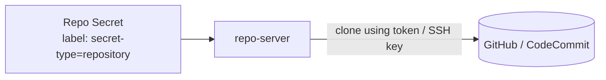

# 05 · Connecting Git repositories

> ### 🟢 Simple version
> **In one line:** Give Argo CD a read-only key so it can read your private repo.
> **Your goal:** Create a repo Secret with the special label.
> **You will:** Create a read-only token → Fill repo-secret.yaml → Apply it (never commit it)
> Need the full detail? Keep reading below. Otherwise jump to the files.


Public repos need nothing. **Private repos** need a credential Secret with the label
`argocd.argoproj.io/secret-type: repository`.



## Options
| Method | Use |
|---|---|
| HTTPS + token | simplest (GitHub PAT, fine-grained, **read-only** for Argo CD) |
| SSH key | no token expiry, good for prod |
| GitHub App | best for orgs (rate limits, no personal user) |
| Credential template (`repo-creds`) | one secret for *all* repos under a URL prefix |

See [repo-secret.yaml](repo-secret.yaml) (HTTPS) and [repo-creds-template.yaml](repo-creds-template.yaml).

## ⚠️ Security rules
1. **Never paste a real token in a chat, issue or Git.** If you did, **revoke it now** (GitHub → Settings → Developer settings → Tokens) and make a new one.
2. Give the token the **minimum scope**: Argo CD = read-only (`Contents: Read`). Image Updater needs write (separate token, see 07).
3. In Git, store secrets only encrypted: **Sealed Secrets**, **External Secrets Operator** (AWS Secrets Manager) or **SOPS**.

CLI alternative (stores the secret for you):
```bash
argocd repo add https://github.com/<org>/<repo>.git --username <user> --password <token> --project myargoproject-dev
argocd repo list
```


---

## Files in this guide

| # | File | Purpose | What you change |
|---|---|---|---|
| 1 | [`repo-secret.yaml`](repo-secret.yaml) | Login for ONE private repo (HTTPS + read-only token). | url, username, token. Never commit real values. |
| 2 | [`repo-creds-template.yaml`](repo-creds-template.yaml) | One credential for every repo starting with a URL prefix. | URL prefix, username, token. |

---

## The files, with explanations

Every file has `#` comments on each important line. Replace anything in `<angle brackets>`.

### File 1: `repo-secret.yaml`
**Purpose:** Login for ONE private repo (HTTPS + read-only token).  
**What you change:** url, username, token. Never commit real values.  
**Apply:** `kubectl apply -f repo-secret.yaml`

```yaml
# ======================================================================
# FILE   : repo-secret.yaml
# PURPOSE: Login for ONE private repo (HTTPS + read-only token).
# CHANGE : url, username, token. Never commit real values.
# APPLY  : kubectl apply -f repo-secret.yaml
# ======================================================================
# Tells Argo CD HOW to log in to ONE private Git repo.
# DO NOT commit real values. Use Sealed Secrets / External Secrets / SOPS.
apiVersion: v1
kind: Secret
metadata:
  name: repo-gitops                   # any name (lowercase, no underscores)
  namespace: argocd
  labels:
    argocd.argoproj.io/secret-type: repository   # THE KEY LABEL: without it Argo CD ignores this Secret
stringData:
  type: git                           # repository type
  name: gitops-repo                   # friendly name in the UI
  project: myargoproject-dev          # optional: only this project can use the repo. Remove = all projects
  url: https://github.com/<org>/<gitops-repo>.git   # must equal Application.spec.source.repoURL
  username: <github-username>
  password: <GITHUB_READ_ONLY_TOKEN>  # fine-grained PAT, Contents: read-only
  # insecure: "true"                  # only for self-signed TLS. NOT needed for GitHub
  # enableLfs: "true"                 # only if the repo uses Git LFS
```

### File 2: `repo-creds-template.yaml`
**Purpose:** One credential for every repo starting with a URL prefix.  
**What you change:** URL prefix, username, token.  
**Apply:** `kubectl apply -f repo-creds-template.yaml`

```yaml
# ======================================================================
# FILE   : repo-creds-template.yaml
# PURPOSE: One credential for every repo starting with a URL prefix.
# CHANGE : URL prefix, username, token.
# APPLY  : kubectl apply -f repo-creds-template.yaml
# ======================================================================
# ONE credential for every repo whose URL starts with the prefix below.
# Add each repo later in the UI/CLI without typing the password again.
apiVersion: v1
kind: Secret
metadata:
  name: github-org-creds
  namespace: argocd
  labels:
    argocd.argoproj.io/secret-type: repo-creds     # note: repo-creds (not repository)
stringData:
  type: git
  url: https://github.com/<org>                    # URL prefix
  username: <github-username>
  password: <GITHUB_READ_ONLY_TOKEN>
```

---

## Apply and Verify

```bash
argocd repo list          # Status should be Successful
kubectl -n argocd get secrets -l argocd.argoproj.io/secret-type=repository
```

---

## Troubleshooting

| Symptom | Likely cause | Fix |
|---|---|---|
| Status Failed | Wrong token or URL | Test: git ls-remote <url> with the same token |
| Secret ignored | Label missing | argocd.argoproj.io/secret-type: repository |
| URL mismatch | repoURL differs from Application | Make both identical, including .git |

---

## Checklist

- [ ] Token is read-only and fine-grained
- [ ] No token pasted in chat/Git
- [ ] Secrets sealed or from External Secrets
- [ ] Old exposed tokens revoked
