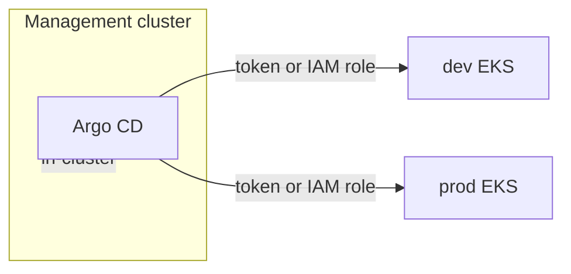

# 🌐 06 · Clusters (where apps are deployed)

> [!TIP]
> The cluster Argo CD runs in is always available as **`in-cluster`** (`https://kubernetes.default.svc`). Add others for hub-and-spoke.

## 1. What & why
**Use case:** one Argo CD in a management cluster deploys to dev, staging and prod clusters.

## 2. Architecture


## 3. Key values
| Key | Meaning | Example |
|---|---|---|
| `name` | Name used in `destination.name` | `prod-eks` |
| `server` | API server URL | `https://ABC.gr7.ap-south-1.eks.amazonaws.com` |
| `config.bearerToken` | ServiceAccount token | - |
| `config.awsAuthConfig` | IAM-based auth for EKS | role ARN |
| `config.tlsClientConfig.caData` | Cluster CA (base64) | - |
| `project` | Only this project may use the cluster | `myargoproject-prod` |

## 4. Choose your approach
| | A · CLI | B · Declarative Secret (token) | C · EKS IAM role |
|---|---|---|---|
| Effort | lowest | medium | medium (AWS setup) |
| Credentials | SA token created for you | SA token you manage | **no long-lived secret** |
| In Git | no | yes (encrypted) | yes (no secret inside) |
| Use for | start | GitOps for any cluster | production on EKS |

## 5. Approach A · CLI
<details>
<summary>📄 <b>cluster-cli.sh</b> — Add, list, scope and remove clusters.</summary>

```bash
#!/bin/sh
# ======================================================================
# FILE   : cluster-cli.sh
# PURPOSE: Add, list, scope and remove clusters.
# APPLY  : sh cluster-cli.sh
# ======================================================================
# Approach A: CLI (easiest). Uses your kubeconfig context; creates a ServiceAccount + token in the target cluster.
kubectl config get-contexts -o name                      # find the context name
argocd cluster add <context-name> --name prod-eks        # add
argocd cluster add <context-name> --name prod-eks --project myargoproject-prod --yes      # scoped to one project
argocd cluster list                                      # confirm
argocd cluster get prod-eks
argocd cluster rm prod-eks                               # remove (apps must be moved first)
# EKS tip: aws eks update-kubeconfig --name <eks> --region ap-south-1 --alias prod-eks   (creates the context)
```

</details>

## 6. Approach B · Declarative Secret
<details>
<summary>📄 <b>cluster-declarative.yaml</b> — Cluster as a Secret with bearer token.</summary>

```yaml
# ======================================================================
# FILE   : cluster-declarative.yaml
# PURPOSE: Cluster as a Secret with bearer token.
# APPLY  : kubectl apply -f cluster-declarative.yaml
# ======================================================================
# Approach B: register a remote cluster with a Secret (GitOps style). Token comes from a ServiceAccount in that cluster.
# In the REMOTE cluster:  kubectl create sa argocd-manager -n kube-system
#   + ClusterRoleBinding to cluster-admin (or a narrower role) + a token Secret for that SA.
apiVersion: v1
kind: Secret
metadata:
  name: cluster-prod-eks
  namespace: argocd
  labels:
    argocd.argoproj.io/secret-type: cluster       # makes it a cluster
stringData:
  name: prod-eks                                  # name used in Application.destination.name
  server: https://<EKS_API_ENDPOINT>              # remote API server URL
  # project: myargoproject-prod                   # scope: only this project may use the cluster
  config: |
    {
      "bearerToken": "<SERVICE_ACCOUNT_TOKEN>",
      "tlsClientConfig": {
        "insecure": false,
        "caData": "<BASE64_CA_CERT>"
      }
    }
```

</details>

## 7. Approach C · EKS with IAM
<details>
<summary>📄 <b>cluster-eks-iam.yaml</b> — IRSA role assumes a deployer role; no static token.</summary>

```yaml
# ======================================================================
# FILE   : cluster-eks-iam.yaml
# PURPOSE: IRSA role assumes a deployer role; no static token.
# APPLY  : kubectl apply -f cluster-eks-iam.yaml
# ======================================================================
# Approach C: EKS with IAM (no long-lived token). Argo CD's IAM role (IRSA) assumes a role that is mapped in the target cluster.
# Target cluster: add the role to aws-auth ConfigMap / EKS access entries as cluster admin (or narrower).
apiVersion: v1
kind: Secret
metadata:
  name: cluster-prod-eks-iam
  namespace: argocd
  labels:
    argocd.argoproj.io/secret-type: cluster
stringData:
  name: prod-eks
  server: https://<EKS_API_ENDPOINT>
  config: |
    {
      "awsAuthConfig": {
        "clusterName": "<eks-cluster-name>",
        "roleARN": "arn:aws:iam::<ACCOUNT_ID>:role/argocd-deployer"
      },
      "tlsClientConfig": {
        "insecure": false,
        "caData": "<BASE64_CA_CERT>"
      }
    }
# Needs: argocd-server and argocd-application-controller ServiceAccounts annotated with an IRSA role
# that is allowed to sts:AssumeRole on arn:aws:iam::<ACCOUNT_ID>:role/argocd-deployer.
```

</details>

## 8. Use it in an Application
```yaml
destination:
  name: prod-eks            # or:  server: https://<API>
  namespace: web-prod
```
Also allow it in the Project `destinations` ([03](../03_projects/README.md)).

## 9. Verify & troubleshoot
```bash
argocd cluster list        # STATUS Successful
```
| Symptom | Cause | Fix |
|---|---|---|
| `Unknown` / connection refused | API not reachable from Argo CD | network / security group |
| `Unauthorized` | token or IAM mapping wrong | recreate token / fix `aws-auth` |
| `x509` error | wrong CA | set `caData` |

## 10. Checklist
- [ ] Least-privilege role instead of cluster-admin where possible · [ ] prod cluster scoped to prod project · [ ] token rotation or IAM auth
