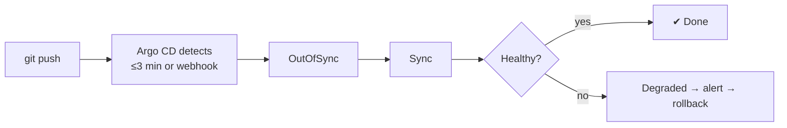
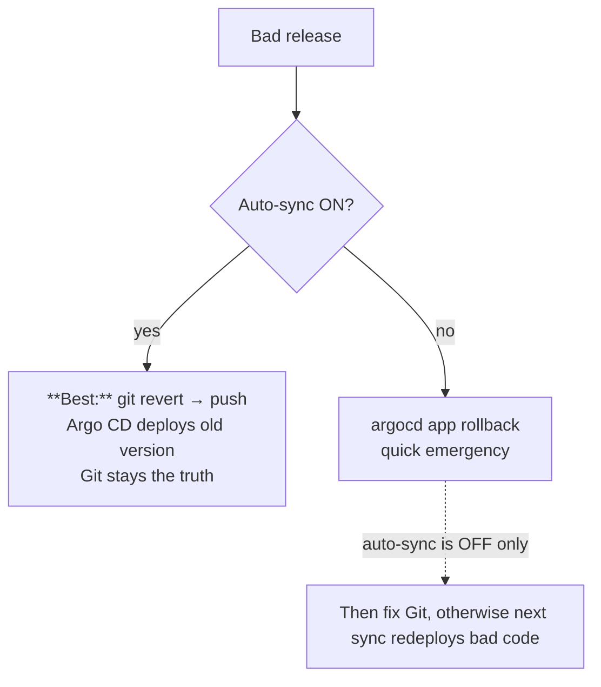

# 06 · Sync, Rollback & Command Cheat Sheet

> ### 🟢 Simple version
> **In one line:** How to deploy now, see history, and go back when something breaks.
> **Your goal:** Best rollback is git revert. Cheat sheet of every command.
> **You will:** argocd app sync → git revert + push to roll back
> Need the full detail? Keep reading below. Otherwise jump to the files.


## Deploy flow


## Rollback — two ways



1. **GitOps rollback (preferred, works always):**
   ```bash
   git revert <bad-commit-sha> && git push
   ```
   If you use Image Updater, also revert the commit it made (it commits tags to Git).
2. **Argo CD rollback (fast, emergency):**
   ```bash
   argocd app history fcoos-insights          # list revisions (ID, date, commit)
   argocd app set fcoos-insights --sync-policy none    # rollback is refused while auto-sync is on
   argocd app rollback fcoos-insights <ID>
   # ...fix Git, then turn auto-sync back on:
   argocd app set fcoos-insights --sync-policy automated --auto-prune --self-heal
   ```

## Cheat sheet
```bash
# ---- login ----
argocd login argocd.example.com --sso --grpc-web
argocd account get-user-info
argocd account can-i sync applications 'myargoproject-dev/*'

# ---- apps ----
argocd app list
argocd app get <app>                    # status, health, resources
argocd app diff <app>                   # Git vs live
argocd app sync <app>                   # deploy now
argocd app sync <app> --prune --force
argocd app sync <app> --resource apps:Deployment:ns/name   # sync ONE resource
argocd app wait <app> --health --timeout 300
argocd app history <app>
argocd app rollback <app> <ID>
argocd app logs <app> --follow
argocd app manifests <app>              # final rendered YAML
argocd app delete <app> --cascade       # also deletes deployed resources
argocd app terminate-op <app>           # stop a stuck sync
argocd app actions list <app> --kind Deployment
argocd app actions run <app> restart --kind Deployment --resource-name web

# ---- hard refresh (re-read Git, clear cache) ----
argocd app get <app> --hard-refresh

# ---- projects / repos / clusters ----
argocd proj list
argocd repo list
argocd repo add <url> --username u --password p
argocd cluster list
argocd cluster add <kube-context-name>  # register remote cluster

# ---- kubectl side ----
kubectl -n argocd get applications
kubectl -n argocd get appprojects
kubectl -n argocd logs deploy/argocd-repo-server
kubectl -n argocd logs statefulset/argocd-application-controller
kubectl -n argocd rollout restart deploy argocd-server
kubectl -n argocd patch app <app> --type merge -p '{"metadata":{"finalizers":null}}'   # unstick deletion
```

## Understanding status
| Sync status | Meaning |
|---|---|
| Synced | Cluster = Git |
| OutOfSync | Git changed, or someone edited the cluster |
| Unknown | Argo CD can't read Git / cluster |

| Health | Meaning |
|---|---|
| Healthy | all pods ready |
| Progressing | rollout in progress |
| Degraded | crash loop, failed probe, ImagePullBackOff |
| Missing | resource not in the cluster |
| Suspended | paused |
