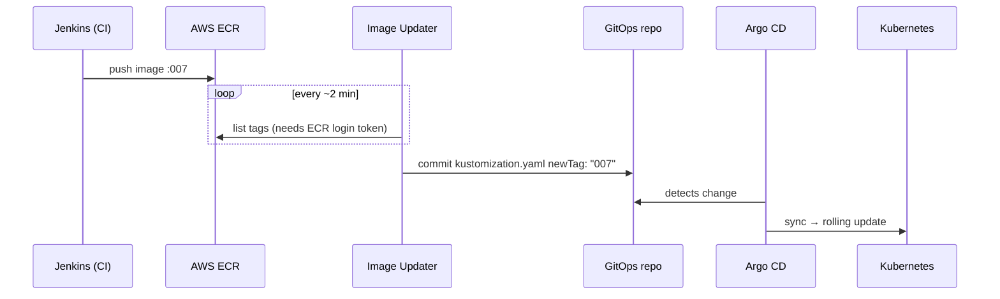

# 07 · Image Updater (AWS ECR → Git → Argo CD)

> ### 🟢 Simple version
> **In one line:** A robot watches ECR. New image tag appears, it writes the tag to Git, Argo CD deploys.
> **Your goal:** Set up 2 secrets, the token refresh script, and one ImageUpdater file.
> **You will:** Apply secrets → Run refresh script + cron → Apply registries config and imageupdater.yaml → Push an image and watch
> Need the full detail? Keep reading below. Otherwise jump to the files.


Goal: CI (Jenkins) pushes a new image tag to ECR → **Image Updater** sees it → writes the tag into Git → Argo CD deploys. No manual edits.



## Parts you must set up
| # | Part | File |
|---|---|---|
| 1 | Install Image Updater | `kubectl apply -n argocd -f https://raw.githubusercontent.com/argoproj-labs/argocd-image-updater/stable/config/install.yaml` (check the project README for your version) |
| 2 | Git write credentials | [secrets.yaml](secrets.yaml) |
| 3 | ECR credentials (AWS keys → token) | [secrets.yaml](secrets.yaml) + [refresh-ecr-secrets.sh](refresh-ecr-secrets.sh) |
| 4 | Registry config (tell it about ECR) | [registries-configmap.yaml](registries-configmap.yaml) |
| 5 | The `ImageUpdater` resource | [imageupdater.yaml](imageupdater.yaml) |
| 6 | Kustomization with `images:` | [kustomization-example.yaml](kustomization-example.yaml) |

> Tip (EKS): the ECR token expires in **12 h**. Better than a cron script: use **IAM Roles for Service Accounts (IRSA)** / EKS Pod Identity for the updater pod and a `credentials: ext:` script, or run the refresh as a Kubernetes **CronJob**. The cron script here is the simple, works-anywhere option.

## Update strategies
| Strategy | Picks | Use with |
|---|---|---|
| `semver` | highest version `v1.2.3` | release tags |
| `newest-build` | most recently pushed tag | Jenkins build numbers (`001`, `002`) |
| `digest` | new digest of a mutable tag (`latest`) | fixed tag |
| `alphabetical` | last in alphabetical order | date tags |

`allowTags: "regexp:^[0-9]{3}$"` restricts which tags are considered (stops `latest`, `test` etc. from deploying).

## Write-back: git vs argocd
| | `git` | `argocd` |
|---|---|---|
| Saved in Git | ✔ yes (real GitOps) | ✘ only live state |
| Survives app recreate | ✔ | ✘ |
| Needs Git write token | yes | no |
| Production | **use this** | testing only |

## Verify
```bash
kubectl -n argocd logs deploy/argocd-image-updater-controller -f
kubectl -n argocd get imageupdaters
git pull && git log -3        # see the "build: automatic update" commit
```

## Common problems
| Symptom | Fix |
|---|---|
| `no basic auth credentials` / 401 from ECR | token expired → run refresh script; check registry `credentials:` |
| Updater never commits | check tag regex, `namePattern` equals Application name, image has `newTag` entry in kustomization |
| `permission denied` pushing to Git | token lacks write scope, or branch protection blocks the bot |
| Wrong ECR region | the registry URL, secret and `aws ecr get-login-password --region` must all use the **same region/account** |
| Commit loops | make sure CI does not trigger on Image Updater commits |


---

## Files in this guide

| # | File | Purpose | What you change |
|---|---|---|---|
| 1 | [`secrets.yaml`](secrets.yaml) | Two Secrets: AWS keys (used by refresh script) and Git write login (used by Image Updater). | AWS keys, region, GitHub user and token. |
| 2 | [`refresh-ecr-secrets.sh`](refresh-ecr-secrets.sh) | Gets a new ECR token and rewrites two docker-registry Secrets (token lasts 12h). | ECR_REGISTRY, namespaces, secret names. |
| 3 | [`registries-configmap.yaml`](registries-configmap.yaml) | Tells Image Updater about your ECR registry and which Secret holds the login. | Account id and region. |
| 4 | [`imageupdater.yaml`](imageupdater.yaml) | The ImageUpdater resource: which apps/images, update strategy, git write-back. | Application namePattern, image names, tag regex, branch. |
| 5 | [`kustomization-example.yaml`](kustomization-example.yaml) | The kustomization.yaml in your app folder that Image Updater edits (images: newTag). | Image names, starting tags. |

---

## The files, with explanations

Every file has `#` comments on each important line. Replace anything in `<angle brackets>`.

### File 1: `secrets.yaml`
**Purpose:** Two Secrets: AWS keys (used by refresh script) and Git write login (used by Image Updater).  
**What you change:** AWS keys, region, GitHub user and token.  
**Apply:** `kubectl apply -f secrets.yaml (then delete the filled file)`

```yaml
# ======================================================================
# FILE   : secrets.yaml
# PURPOSE: Two Secrets: AWS keys (used by refresh script) and Git write login (used by Image Updater).
# CHANGE : AWS keys, region, GitHub user and token.
# APPLY  : kubectl apply -f secrets.yaml (then delete the filled file)
# ======================================================================
# Fill the values, apply, then DELETE the filled copy. Never commit real values.
# kubectl apply -f secrets.yaml
---
# SECRET A: AWS keys, used ONLY by the refresh script to ask ECR for a login token.
# IAM user policy needed: ecr:GetAuthorizationToken (+ ecr:BatchGetImage, ecr:DescribeImages, ecr:ListImages for the repos)
apiVersion: v1
kind: Secret
metadata:
  name: aws-ecr-credentials
  namespace: argocd
type: Opaque
stringData:
  AWS_ACCESS_KEY_ID: "<AKIA...>"
  AWS_SECRET_ACCESS_KEY: "<secret>"
  AWS_DEFAULT_REGION: ap-south-1       # region of YOUR ECR (must match the image URL)
---
# SECRET B: Git login so Image Updater can PUSH the new tag.
# Name must match writeBackConfig.method in imageupdater.yaml.
apiVersion: v1
kind: Secret
metadata:
  name: argocd-image-updater-git-creds
  namespace: argocd
type: Opaque
stringData:
  username: <github-username>
  password: <GITHUB_TOKEN_WITH_WRITE>  # fine-grained PAT: Contents: Read and write on the GitOps repo only
```

### File 2: `refresh-ecr-secrets.sh`
**Purpose:** Gets a new ECR token and rewrites two docker-registry Secrets (token lasts 12h).  
**What you change:** ECR_REGISTRY, namespaces, secret names.  
**Apply:** `bash refresh-ecr-secrets.sh  + cron every 6h`

```bash
#!/bin/bash
# ======================================================================
# FILE   : refresh-ecr-secrets.sh
# PURPOSE: Gets a new ECR token and rewrites two docker-registry Secrets (token lasts 12h).
# CHANGE : ECR_REGISTRY, namespaces, secret names.
# APPLY  : bash refresh-ecr-secrets.sh  + cron every 6h
# ======================================================================
# Refreshes ECR login tokens (they expire every 12h) into Kubernetes docker-registry Secrets.
# Run from cron every 6h (see bottom). Needs: kubectl, aws cli.
set -Eeuo pipefail

# ---------------- CONFIG: edit these ----------------
AWS_NAMESPACE="argocd"                 # where the AWS key secret lives
AWS_SECRET="aws-ecr-credentials"       # secret with AWS_ACCESS_KEY_ID etc. (secrets.yaml, Secret A)
ECR_REGISTRY="<ACCOUNT_ID>.dkr.ecr.ap-south-1.amazonaws.com"   # MUST match region/account of your images

ARGO_NAMESPACE="argocd"                # Image Updater reads this secret
ARGO_SECRET="argocd-image-updater-secret"
APP_NAMESPACE="fcoos"                  # app namespace; pods use this as imagePullSecret
APP_SECRET="ecr-pull-secret"
# -----------------------------------------------------

for cmd in kubectl aws base64; do
  command -v "$cmd" >/dev/null || { echo "ERROR: $cmd not found"; exit 1; }
done

get() { kubectl get secret "$AWS_SECRET" -n "$AWS_NAMESPACE" -o jsonpath="{.data.$1}" | base64 -d; }
export AWS_ACCESS_KEY_ID="$(get AWS_ACCESS_KEY_ID)"
export AWS_SECRET_ACCESS_KEY="$(get AWS_SECRET_ACCESS_KEY)"
export AWS_DEFAULT_REGION="$(get AWS_DEFAULT_REGION)"

[[ -n "$AWS_ACCESS_KEY_ID" && -n "$AWS_SECRET_ACCESS_KEY" && -n "$AWS_DEFAULT_REGION" ]] || { echo "ERROR: AWS values missing"; exit 1; }
trap 'unset AWS_ACCESS_KEY_ID AWS_SECRET_ACCESS_KEY AWS_DEFAULT_REGION ECR_TOKEN' EXIT

aws sts get-caller-identity >/dev/null && echo "AWS auth OK (region $AWS_DEFAULT_REGION)"
ECR_TOKEN="$(aws ecr get-login-password --region "$AWS_DEFAULT_REGION")"

update_ecr_secret() {                  # $1=namespace  $2=secret name
  kubectl create secret docker-registry "$2" -n "$1" \
    --docker-server="$ECR_REGISTRY" --docker-username=AWS --docker-password="$ECR_TOKEN" \
    --dry-run=client -o yaml | kubectl apply -f -
  echo "Updated: $1/$2"
}
update_ecr_secret "$ARGO_NAMESPACE" "$ARGO_SECRET"   # for Image Updater
update_ecr_secret "$APP_NAMESPACE"  "$APP_SECRET"    # for pods pulling images
echo "Done at $(date)"

# ---------------- SETUP ----------------
# mkdir -p ~/awsecr && chmod 700 ~/awsecr/refresh-ecr-secrets.sh
# bash ~/awsecr/refresh-ecr-secrets.sh                      # test once
# crontab -e   ->  0 */6 * * * /bin/bash ~/awsecr/refresh-ecr-secrets.sh >> ~/awsecr/refresh.log 2>&1
# Your Deployments must list:  imagePullSecrets: [{name: ecr-pull-secret}]
```

### File 3: `registries-configmap.yaml`
**Purpose:** Tells Image Updater about your ECR registry and which Secret holds the login.  
**What you change:** Account id and region.  
**Apply:** `kubectl apply -f registries-configmap.yaml`

```yaml
# ======================================================================
# FILE   : registries-configmap.yaml
# PURPOSE: Tells Image Updater about your ECR registry and which Secret holds the login.
# CHANGE : Account id and region.
# APPLY  : kubectl apply -f registries-configmap.yaml
# ======================================================================
# Tells Image Updater how to talk to your ECR registry.
# NOTE: ConfigMap name/keys can differ between Image Updater versions.
# Check the docs of the version you installed: https://argocd-image-updater.readthedocs.io/
apiVersion: v1
kind: ConfigMap
metadata:
  name: argocd-image-updater-config
  namespace: argocd
data:
  registries.conf: |
    registries:
      - name: ECR
        api_url: https://<ACCOUNT_ID>.dkr.ecr.ap-south-1.amazonaws.com   # same account + region as your images
        prefix: <ACCOUNT_ID>.dkr.ecr.ap-south-1.amazonaws.com
        ping: yes
        insecure: no
        # login token comes from the docker-registry Secret that refresh-ecr-secrets.sh keeps fresh
        credentials: pullsecret:argocd/argocd-image-updater-secret
        credsexpire: 10h               # re-read the secret before the 12h token expires
```

### File 4: `imageupdater.yaml`
**Purpose:** The ImageUpdater resource: which apps/images, update strategy, git write-back.  
**What you change:** Application namePattern, image names, tag regex, branch.  
**Apply:** `kubectl apply -f imageupdater.yaml`

```yaml
# ======================================================================
# FILE   : imageupdater.yaml
# PURPOSE: The ImageUpdater resource: which apps/images, update strategy, git write-back.
# CHANGE : Application namePattern, image names, tag regex, branch.
# APPLY  : kubectl apply -f imageupdater.yaml
# ======================================================================
apiVersion: argocd-image-updater.argoproj.io/v1alpha1
kind: ImageUpdater
metadata:
  name: fcoos-image-updater
  namespace: argocd
spec:
  namespace: argocd                    # namespace where the Applications live

  # ---------- WRITE-BACK: how the new tag is saved ----------
  writeBackConfig:
    method: "git:secret:argocd/argocd-image-updater-git-creds"   # git login secret (namespace/name)
    gitConfig:
      branch: main                     # branch Image Updater commits to
      writeBackTarget: kustomization   # edits the images: list of kustomization.yaml in the app path
  # Testing only (no Git commit):
  # writeBackConfig:
  #   method: argocd

  # ---------- DEFAULTS for every image ----------
  commonUpdateSettings:
    updateStrategy: newest-build       # semver | digest | newest-build | alphabetical
    forceUpdate: false
    allowTags: "regexp:^[0-9]{3}$"     # only 3-digit Jenkins tags 001..999

  # ---------- WHICH apps/images to watch ----------
  applicationRefs:
    - namePattern: fcoos-insights      # Application name (wildcards ok: "fcoos-*")
      images:
        - alias: fcoos-frontend        # any short unique name
          imageName: <ACCOUNT_ID>.dkr.ecr.ap-south-1.amazonaws.com/fcoos/frontend   # no tag
        - alias: fcoos-posts
          imageName: <ACCOUNT_ID>.dkr.ecr.ap-south-1.amazonaws.com/fcoos/posts
        - alias: fcoos-comments
          imageName: <ACCOUNT_ID>.dkr.ecr.ap-south-1.amazonaws.com/fcoos/comments
        - alias: fcoos-stats
          imageName: <ACCOUNT_ID>.dkr.ecr.ap-south-1.amazonaws.com/fcoos/stats
```

### File 5: `kustomization-example.yaml`
**Purpose:** The kustomization.yaml in your app folder that Image Updater edits (images: newTag).  
**What you change:** Image names, starting tags.  
**Apply:** `commit it into the app folder in Git`

```yaml
# ======================================================================
# FILE   : kustomization-example.yaml
# PURPOSE: The kustomization.yaml in your app folder that Image Updater edits (images: newTag).
# CHANGE : Image names, starting tags.
# APPLY  : commit it into the app folder in Git
# ======================================================================
# Lives in your app folder (k8-manifest/kustomization.yaml). Argo CD builds this folder.
apiVersion: kustomize.config.k8s.io/v1beta1
kind: Kustomization

resources:                 # only listed files get deployed
  - namespace.yaml
  - posts.yaml
  - comments.yaml
  - stats.yaml
  - frontend.yaml
  - ingress.yaml

# One entry per image in imageupdater.yaml (same name, NO tag in name).
# newTag is the starting value; with git write-back Image Updater edits it and commits.
# Keep the quotes: "001" must be a string, otherwise YAML turns it into the number 1.
images:
  - name: <ACCOUNT_ID>.dkr.ecr.ap-south-1.amazonaws.com/fcoos/frontend
    newTag: "001"
  - name: <ACCOUNT_ID>.dkr.ecr.ap-south-1.amazonaws.com/fcoos/posts
    newTag: "001"
  - name: <ACCOUNT_ID>.dkr.ecr.ap-south-1.amazonaws.com/fcoos/comments
    newTag: "001"
  - name: <ACCOUNT_ID>.dkr.ecr.ap-south-1.amazonaws.com/fcoos/stats
    newTag: "001"           # (original had a missing closing quote here)
```

---

## Apply and Verify

```bash
bash refresh-ecr-secrets.sh                      # token OK?
kubectl -n argocd logs deploy/argocd-image-updater-controller -f
git pull && git log -3                            # look for the automatic commit
argocd app get fcoos-insights
```
Test: push image tag 002 to ECR, wait a few minutes, watch the commit and the rollout.

---

## Troubleshooting

| Symptom | Likely cause | Fix |
|---|---|---|
| 401 from ECR | Token expired | Run refresh script; check cron log |
| Nothing happens | Regex or namePattern wrong | Tags must match ^[0-9]{3}$; name must equal the Application |
| push denied | Token has no write scope or branch protected | Give write token; allow bot on main |
| Wrong region | Account/region mismatch | Use the same region in URL, secret and aws cli |

---

## Checklist

- [ ] Git write token is a separate, least-privilege token
- [ ] Cron refresh tested and logged
- [ ] allowTags restricts tags
- [ ] CI does not trigger on bot commits
- [ ] git write-back (not argocd) in production
