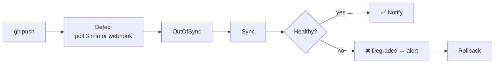
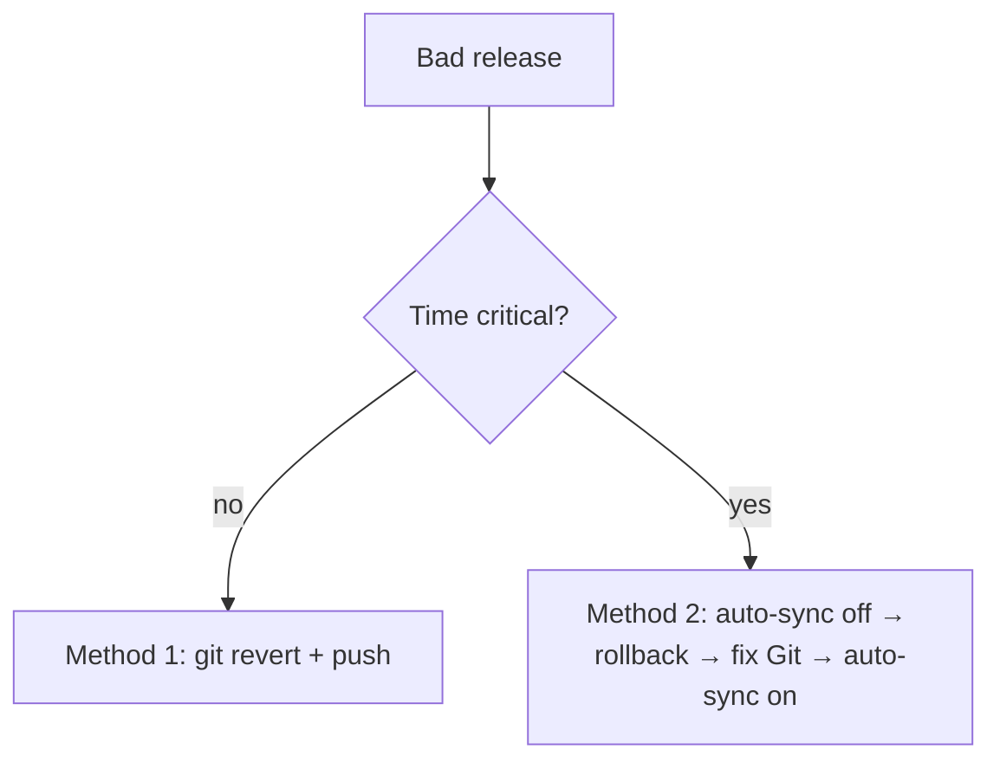

# 🔄 07 · Sync, Rollback & Operations

> [!TIP]
> Day-2 work: deploy, watch, roll back, trigger instantly. Pick the method that fits your safety level.

## 1. What & why
**Use case:** a release breaks prod at 2 AM. You need a fast, safe, auditable way back.

## 2. Flow


## 3. Choose your approach

### 3.1 How to deploy (sync)
| Method | How | Use for |
|---|---|---|
| Auto-sync | `syncPolicy.automated` | dev/staging |
| UI | **SYNC** button | humans, prod approval |
| CLI | `argocd app sync` | scripts |
| CI pipeline | token + CLI (`jenkins-sync-stage.groovy`) | pipeline-driven prod |
| Webhook | push event to `/api/webhook` | remove the 3-min delay |

### 3.2 How to roll back
| Method | Speed | Keeps Git true? | Needs auto-sync off? |
|---|---|---|---|
| **1 · `git revert`** | fast | ✅ yes | no |
| 2 · `argocd app rollback` | fastest | ❌ (Git still bad) | **yes** |
| 3 · pin revision | fast | partly | no |
| Argo Rollouts `abort/undo` | instant | n/a | no |



## 4. Key values
| Setting | Meaning | Example |
|---|---|---|
| `timeout.reconciliation` | Git poll interval | `180s` |
| `revisionHistoryLimit` | How many past revisions kept for rollback | `5` |
| webhook secret key | Secures webhook | `webhook.github.secret` |
| sync option `--dry-run` | Preview a sync | - |

## 5. Rollback playbook
<details>
<summary>📄 <b>rollback-playbook.sh</b> — Three rollback methods with commands.</summary>

```bash
#!/bin/sh
# ======================================================================
# FILE   : rollback-playbook.sh
# PURPOSE: Three rollback methods with commands.
# APPLY  : read, then run the one you need
# ======================================================================
# Three rollback methods. Pick by situation.

# ---------- METHOD 1 (BEST): Git revert. Git stays the truth. Works with auto-sync ON ----------
git log --oneline -5                                   # find the bad commit
git revert <bad-sha> && git push                       # Argo CD deploys the previous state
# If Image Updater wrote the bad tag, revert ITS commit (message "build: automatic update ...").
# To stop it from moving forward again, pin the tag (allowTags / ignoreTags) or pause the ImageUpdater.

# ---------- METHOD 2: Argo CD rollback (emergency). Auto-sync must be OFF first ----------
argocd app set <app> --sync-policy none
argocd app history <app>
argocd app rollback <app> <ID>
# ...then fix Git, then turn auto-sync back on:
argocd app set <app> --sync-policy automated --auto-prune --self-heal

# ---------- METHOD 3: Pin a known-good revision (no Git change) ----------
argocd app set <app> --revision <good-tag-or-sha>      # app now follows that revision
# later set it back:  argocd app set <app> --revision main

# ---------- Argo Rollouts users ----------
# kubectl argo rollouts abort <rollout>   |   kubectl argo rollouts undo <rollout>
```

</details>

## 6. Webhook (instant sync)
<details>
<summary>📄 <b>webhook-github.yaml</b> — GitHub/GitLab/Bitbucket webhook secret keys.</summary>

```yaml
# ======================================================================
# FILE   : webhook-github.yaml
# PURPOSE: GitHub/GitLab/Bitbucket webhook secret keys.
# APPLY  : kubectl -n argocd patch secret argocd-secret ...
# ======================================================================
# Instant sync on git push (instead of waiting ~3 minutes). Works with GitHub, GitLab, Bitbucket.
# 1) GitHub repo -> Settings -> Webhooks -> Add
#      Payload URL : https://argocd.example.com/api/webhook
#      Content type: application/json
#      Secret      : the same value as below
# 2) Patch the secret (do NOT kubectl apply a partial argocd-secret: use patch)
#      kubectl -n argocd patch secret argocd-secret --type merge -p '{"stringData":{"webhook.github.secret":"<RANDOM>"}}'
# Other keys: webhook.gitlab.secret, webhook.bitbucket.uuid, webhook.bitbucketserver.secret, webhook.azuredevops.password
apiVersion: v1
kind: Secret
metadata:
  name: argocd-secret
  namespace: argocd
stringData:
  webhook.github.secret: "<RANDOM_STRING>"
```

</details>

## 7. Pipeline-triggered sync
<details>
<summary>📄 <b>jenkins-sync-stage.groovy</b> — Jenkins stage that syncs and waits for health.</summary>

```yaml
# ======================================================================
# FILE   : jenkins-sync-stage.groovy
# PURPOSE: Jenkins stage that syncs and waits for health.
# APPLY  : put in your Jenkinsfile
# ======================================================================
// Approach: let the CI pipeline trigger and wait for the deploy (CLI + token, no UI).
// Token: argocd account generate-token --account ci-user   (or a project role token, see folder 12)
stage('Deploy via Argo CD') {
  environment {
    ARGOCD_SERVER     = 'argocd.example.com'
    ARGOCD_AUTH_TOKEN = credentials('argocd-ci-token')   // Jenkins credential
  }
  steps {
    sh '''
      argocd app set  fcoos-insights -p image.tag=${BUILD_NUMBER} --grpc-web   # only for Helm param override mode
      argocd app sync fcoos-insights --grpc-web
      argocd app wait fcoos-insights --health --timeout 300 --grpc-web
    '''
  }
}
// With Image Updater you usually do NOT need this stage: Jenkins only pushes the image.
```

</details>

## 8. Command cheat sheet
<details>
<summary>📄 <b>commands-cheatsheet.sh</b> — Most-used CLI and kubectl commands.</summary>

```bash
#!/bin/sh
# ======================================================================
# FILE   : commands-cheatsheet.sh
# PURPOSE: Most-used CLI and kubectl commands.
# ======================================================================
# Cheat sheet (read, do not run top to bottom)
# ---- login ----
argocd login argocd.example.com --sso --grpc-web
argocd account get-user-info
argocd account can-i sync applications 'myargoproject-dev/*'
# ---- look ----
argocd app list
argocd app get <app>                     # status, health, every resource
argocd app diff <app>                    # Git vs live
argocd app manifests <app>               # final rendered YAML
argocd app resources <app>
argocd app logs <app> --follow
argocd app history <app>                 # revisions (ID) for rollback
# ---- deploy ----
argocd app sync <app>
argocd app sync <app> --prune --force
argocd app sync <app> --resource apps:Deployment:<ns>/<name>      # one resource only
argocd app sync <app> --dry-run
argocd app wait <app> --health --timeout 300
argocd app get <app> --hard-refresh      # re-read Git, clear cache
# ---- change ----
argocd app set <app> --sync-policy none                    # manual
argocd app set <app> --sync-policy automated --auto-prune --self-heal
argocd app set <app> --revision <branch|tag|sha>
argocd app set <app> -p image.tag=008                      # Helm parameter override
# ---- operate pods (Argo CD resource actions) ----
argocd app actions list <app> --kind Deployment
argocd app actions run <app> restart --kind Deployment --resource-name web
# ---- stop / delete ----
argocd app terminate-op <app>
argocd app delete <app> --cascade        # also deletes deployed resources
# ---- rollback (see README for the right way) ----
argocd app rollback <app> <ID>
# ---- projects / repos / clusters ----
argocd proj list; argocd repo list; argocd cluster list
# ---- kubectl side ----
kubectl -n argocd get applications
kubectl -n argocd logs deploy/argocd-repo-server
kubectl -n argocd logs statefulset/argocd-application-controller
kubectl -n argocd patch app <app> --type merge -p '{"metadata":{"finalizers":null}}'   # unstick deletion
```

</details>

## 9. Status meanings
| Sync | Health |
|---|---|
| Synced = live equals Git | Healthy = all pods ready |
| OutOfSync = Git changed or someone edited the cluster | Progressing = rolling out |
| Unknown = cannot read Git/cluster | Degraded = crash loop, failed probes, ImagePullBackOff |

## 10. Troubleshooting
| Symptom | Cause | Fix |
|---|---|---|
| `rollback not allowed with auto-sync` | auto-sync on | `argocd app set --sync-policy none` first |
| Rolled back, then bad version returns | Git/Image Updater still has bad tag | revert in Git, pause updater |
| Sync stuck Running | hook/job hanging | `argocd app terminate-op` |
| Webhook no effect | secret mismatch / wrong URL | check delivery log in GitHub |
| Changes slow | polling | add webhook |

## 11. Checklist
- [ ] Team knows Method 1 · [ ] `revisionHistoryLimit` ≥ 5 · [ ] webhook configured · [ ] CI token scoped to needed apps ([12](../12_rbac/README.md))
