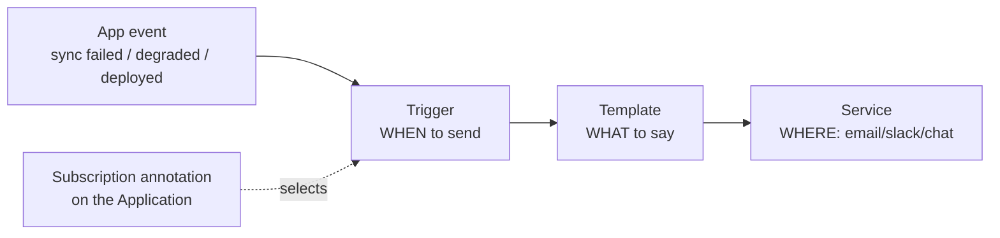

# 08 · Notifications (Email · Slack · Google Chat)

> ### 🟢 Simple version
> **In one line:** Argo CD sends a message to Slack, email or Google Chat when a deploy succeeds or fails.
> **Your goal:** Fill the secret, apply the config, add one annotation to your app.
> **You will:** Apply secret and cm → Annotate the Application → Test with a sync
> Need the full detail? Keep reading below. Otherwise jump to the files.




4 building blocks, all in `argocd-notifications-cm` (+ credentials in `argocd-notifications-secret`):
| Block | Meaning |
|---|---|
| **service** | channel + credential (`service.slack`, `service.email`, `service.webhook.googlechat`) |
| **template** | message text |
| **trigger** | condition that fires a template |
| **subscription** | annotation on an Application: *which* events go to *which* channel |

Files: [notifications-secret.yaml](notifications-secret.yaml) → [notifications-cm.yaml](notifications-cm.yaml) → annotate apps (below).

```bash
kubectl apply -f notifications-secret.yaml -f notifications-cm.yaml
kubectl -n argocd logs deploy/argocd-notifications-controller -f
```

## Subscribe an app (annotations on the Application)
```yaml
metadata:
  annotations:
    notifications.argoproj.io/subscribe.on-sync-succeeded.slack: devops-alerts
    notifications.argoproj.io/subscribe.on-health-degraded.slack: devops-alerts
    notifications.argoproj.io/subscribe.on-sync-failed.email: team@example.com
    notifications.argoproj.io/subscribe.on-sync-succeeded.googlechat: argocd-chat
```
Format: `subscribe.<trigger>.<service>: <recipient/channel>`.
Subscribe **all** apps of a project at once with `defaultTriggers` + `subscriptions` in the cm (see file).

## Debug
```bash
argocd admin notifications template notify app-deployed <app> --recipient slack:devops-alerts
argocd admin notifications trigger run on-sync-failed <app>
```


---

## Files in this guide

| # | File | Purpose | What you change |
|---|---|---|---|
| 1 | [`notifications-secret.yaml`](notifications-secret.yaml) | Passwords/tokens for Slack, Gmail and Google Chat. | Tokens, app password, webhook URL. |
| 2 | [`notifications-cm.yaml`](notifications-cm.yaml) | Services (where), templates (what), triggers (when), default subscriptions. | Channel names, message text, which triggers to enable. |

---

## The files, with explanations

Every file has `#` comments on each important line. Replace anything in `<angle brackets>`.

### File 1: `notifications-secret.yaml`
**Purpose:** Passwords/tokens for Slack, Gmail and Google Chat.  
**What you change:** Tokens, app password, webhook URL.  
**Apply:** `kubectl apply -f notifications-secret.yaml`

```yaml
# ======================================================================
# FILE   : notifications-secret.yaml
# PURPOSE: Passwords/tokens for Slack, Gmail and Google Chat.
# CHANGE : Tokens, app password, webhook URL.
# APPLY  : kubectl apply -f notifications-secret.yaml
# ======================================================================
# Credentials for notification services. Referenced in the cm as $key-name.
apiVersion: v1
kind: Secret
metadata:
  name: argocd-notifications-secret   # fixed name
  namespace: argocd
type: Opaque
stringData:
  slack-token: "<xoxb-...>"           # Slack Bot token (scopes: chat:write, chat:write.public). Invite the bot to the channel
  email-username: "alerts@example.com"
  email-password: "<app-password>"    # Gmail: use an App Password, not your login password
  googlechat-webhook: "https://chat.googleapis.com/v1/spaces/XXX/messages?key=...&token=..."  # Chat space webhook URL
```

### File 2: `notifications-cm.yaml`
**Purpose:** Services (where), templates (what), triggers (when), default subscriptions.  
**What you change:** Channel names, message text, which triggers to enable.  
**Apply:** `kubectl apply -f notifications-cm.yaml`

```yaml
# ======================================================================
# FILE   : notifications-cm.yaml
# PURPOSE: Services (where), templates (what), triggers (when), default subscriptions.
# CHANGE : Channel names, message text, which triggers to enable.
# APPLY  : kubectl apply -f notifications-cm.yaml
# ======================================================================
apiVersion: v1
kind: ConfigMap
metadata:
  name: argocd-notifications-cm       # fixed name
  namespace: argocd
data:
  # ================= SERVICES (where) =================
  service.slack: |
    token: $slack-token
  service.email.gmail: |
    host: smtp.gmail.com
    port: 465
    from: $email-username
    username: $email-username
    password: $email-password
  service.webhook.googlechat: |
    url: $googlechat-webhook
    headers:
      - name: Content-Type
        value: application/json

  # ================= TEMPLATES (what) =================
  template.app-deployed: |
    message: "✅ {{.app.metadata.name}} deployed (revision {{.app.status.sync.revision | trunc 7}}) to {{.app.spec.destination.namespace}}"
    slack:
      attachments: |
        [{"title":"{{.app.metadata.name}}","color":"#18be52","fields":[
          {"title":"Sync","value":"{{.app.status.sync.status}}","short":true},
          {"title":"Health","value":"{{.app.status.health.status}}","short":true}]}]
    email:
      subject: "Deployed: {{.app.metadata.name}}"
    webhook:
      googlechat:
        method: POST
        body: |
          {"text": "✅ {{.app.metadata.name}} deployed to {{.app.spec.destination.namespace}}"}

  template.app-failed: |
    message: "❌ {{.app.metadata.name}} sync FAILED: {{.app.status.operationState.message}}"
    slack:
      attachments: |
        [{"title":"{{.app.metadata.name}}","color":"#E96D76","text":"{{.app.status.operationState.message}}"}]
    email:
      subject: "FAILED: {{.app.metadata.name}}"
    webhook:
      googlechat:
        method: POST
        body: |
          {"text": "❌ {{.app.metadata.name}} sync failed: {{.app.status.operationState.message}}"}

  template.app-degraded: |
    message: "⚠️ {{.app.metadata.name}} is DEGRADED"
    slack:
      attachments: |
        [{"title":"{{.app.metadata.name}}","color":"#f4c030","text":"Health: {{.app.status.health.status}}"}]
    email:
      subject: "Degraded: {{.app.metadata.name}}"

  # ================= TRIGGERS (when) =================
  trigger.on-sync-succeeded: |
    - when: app.status.operationState.phase in ['Succeeded']
      send: [app-deployed]
  trigger.on-sync-failed: |
    - when: app.status.operationState.phase in ['Error', 'Failed']
      send: [app-failed]
  trigger.on-health-degraded: |
    - when: app.status.health.status == 'Degraded'
      send: [app-degraded]

  # ================= DEFAULT: all apps get failure alerts =================
  subscriptions: |
    - recipients: [slack:devops-alerts]
      triggers: [on-sync-failed, on-health-degraded]
```

---

## Apply and Verify

```bash
kubectl -n argocd logs deploy/argocd-notifications-controller -f
argocd admin notifications template notify app-deployed <app> --recipient slack:devops-alerts
argocd admin notifications trigger run on-sync-failed <app>
```

---

## Troubleshooting

| Symptom | Likely cause | Fix |
|---|---|---|
| No message | App has no subscribe annotation | Add notifications.argoproj.io/subscribe.<trigger>.<service> |
| Slack not_in_channel | Bot not invited | /invite the bot |
| Gmail auth error | Using normal password | Use an App Password |

---

## Checklist

- [ ] Failure and degraded alerts for all prod apps
- [ ] Tokens in Secret, not ConfigMap
- [ ] Tested with a deliberate failure
