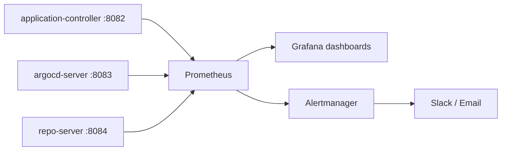

# 09 · Monitoring Argo CD (Prometheus + Grafana)

> ### 🟢 Simple version
> **In one line:** Graphs and alerts for Argo CD itself using Prometheus and Grafana.
> **Your goal:** Install the stack, apply two files, import dashboard 14584.
> **You will:** helm install monitoring → Apply servicemonitors + alert rules → Open Grafana
> Need the full detail? Keep reading below. Otherwise jump to the files.




## Steps
```bash
# 1. install the stack
helm repo add prometheus-community https://prometheus-community.github.io/helm-charts
helm install monitoring prometheus-community/kube-prometheus-stack -n monitoring --create-namespace

# 2. let Prometheus scrape Argo CD + add alerts
kubectl apply -f servicemonitors.yaml -f alert-rules.yaml

# 3. open Grafana (default login admin / prom-operator -> CHANGE IT)
kubectl -n monitoring port-forward svc/monitoring-grafana 3000:80
# Grafana -> Dashboards -> Import -> ID 14584 (Argo CD) -> select Prometheus
```
> Prometheus Operator must select the ServiceMonitors: label `release: monitoring` is used in the files (match your Helm release name).

## Top metrics
| Metric | Meaning |
|---|---|
| `argocd_app_info{sync_status,health_status}` | one series per app |
| `argocd_app_sync_total` | sync count (by phase) |
| `argocd_app_reconcile_bucket` | reconcile duration |
| `argocd_git_request_total` / `argocd_git_request_duration_seconds` | Git health |
| `argocd_cluster_api_resource_objects` | objects per cluster |
| `workqueue_depth{name=~"app_.*"}` | controller backlog |

PromQL examples:
```promql
count(argocd_app_info{sync_status="OutOfSync"})            # apps out of sync
count(argocd_app_info{health_status!="Healthy"})           # unhealthy apps
sum(rate(argocd_app_sync_total{phase!="Succeeded"}[10m]))  # failing syncs
```


---

## Files in this guide

| # | File | Purpose | What you change |
|---|---|---|---|
| 1 | [`servicemonitors.yaml`](servicemonitors.yaml) | Tells Prometheus to scrape the controller, server and repo-server metrics. | The release label must match your Prometheus Helm release name. |
| 2 | [`alert-rules.yaml`](alert-rules.yaml) | Alerts: OutOfSync 15m, Degraded, sync failures, Git fetch stopped. | Thresholds and severities. |

---

## The files, with explanations

Every file has `#` comments on each important line. Replace anything in `<angle brackets>`.

### File 1: `servicemonitors.yaml`
**Purpose:** Tells Prometheus to scrape the controller, server and repo-server metrics.  
**What you change:** The release label must match your Prometheus Helm release name.  
**Apply:** `kubectl apply -f servicemonitors.yaml`

```yaml
# ======================================================================
# FILE   : servicemonitors.yaml
# PURPOSE: Tells Prometheus to scrape the controller, server and repo-server metrics.
# CHANGE : The release label must match your Prometheus Helm release name.
# APPLY  : kubectl apply -f servicemonitors.yaml
# ======================================================================
# Tells Prometheus Operator to scrape the Argo CD metric ports.
# Alternatively set serviceMonitor.enabled: true in the Argo CD helm values.
apiVersion: monitoring.coreos.com/v1
kind: ServiceMonitor
metadata:
  name: argocd-metrics
  namespace: argocd
  labels:
    release: monitoring              # must match your kube-prometheus-stack release name
spec:
  selector:
    matchLabels:
      app.kubernetes.io/name: argocd-metrics          # controller metrics Service
  endpoints:
    - port: http-metrics
      interval: 30s
---
apiVersion: monitoring.coreos.com/v1
kind: ServiceMonitor
metadata:
  name: argocd-server-metrics
  namespace: argocd
  labels:
    release: monitoring
spec:
  selector:
    matchLabels:
      app.kubernetes.io/name: argocd-server-metrics
  endpoints:
    - port: http-metrics
      interval: 30s
---
apiVersion: monitoring.coreos.com/v1
kind: ServiceMonitor
metadata:
  name: argocd-repo-server-metrics
  namespace: argocd
  labels:
    release: monitoring
spec:
  selector:
    matchLabels:
      app.kubernetes.io/name: argocd-repo-server-metrics
  endpoints:
    - port: metrics
      interval: 30s
```

### File 2: `alert-rules.yaml`
**Purpose:** Alerts: OutOfSync 15m, Degraded, sync failures, Git fetch stopped.  
**What you change:** Thresholds and severities.  
**Apply:** `kubectl apply -f alert-rules.yaml`

```yaml
# ======================================================================
# FILE   : alert-rules.yaml
# PURPOSE: Alerts: OutOfSync 15m, Degraded, sync failures, Git fetch stopped.
# CHANGE : Thresholds and severities.
# APPLY  : kubectl apply -f alert-rules.yaml
# ======================================================================
apiVersion: monitoring.coreos.com/v1
kind: PrometheusRule
metadata:
  name: argocd-alerts
  namespace: argocd
  labels:
    release: monitoring
spec:
  groups:
    - name: argocd
      rules:
        - alert: ArgoAppOutOfSync
          expr: argocd_app_info{sync_status="OutOfSync"} == 1
          for: 15m                    # out of sync for 15 minutes
          labels: {severity: warning}
          annotations:
            summary: "{{ $labels.name }} is OutOfSync"
        - alert: ArgoAppUnhealthy
          expr: argocd_app_info{health_status=~"Degraded|Missing"} == 1
          for: 5m
          labels: {severity: critical}
          annotations:
            summary: "{{ $labels.name }} is {{ $labels.health_status }}"
        - alert: ArgoSyncFailing
          expr: increase(argocd_app_sync_total{phase=~"Error|Failed"}[10m]) > 0
          labels: {severity: critical}
          annotations:
            summary: "Sync failed for {{ $labels.name }}"
        - alert: ArgoRepoServerGitErrors
          expr: increase(argocd_git_request_total{request_type="fetch"}[10m]) == 0
          for: 30m
          labels: {severity: warning}
          annotations:
            summary: "Argo CD has not fetched Git for 30 min"
```

---

## Apply and Verify

```bash
kubectl -n monitoring port-forward svc/monitoring-grafana 3000:80
kubectl -n monitoring port-forward svc/monitoring-kube-prometheus-prometheus 9090
# Prometheus -> Status -> Targets: argocd targets must be UP
```
Grafana: import dashboard ID **14584**.

---

## Troubleshooting

| Symptom | Likely cause | Fix |
|---|---|---|
| Targets missing | ServiceMonitor label doesn't match | Match release: label |
| No argocd_* metrics | Metrics not enabled | Set controller/server/repoServer metrics.enabled in values.yaml |

---

## Checklist

- [ ] Targets UP
- [ ] Dashboard imported
- [ ] Alerts routed to chat/email
- [ ] Grafana default password changed
