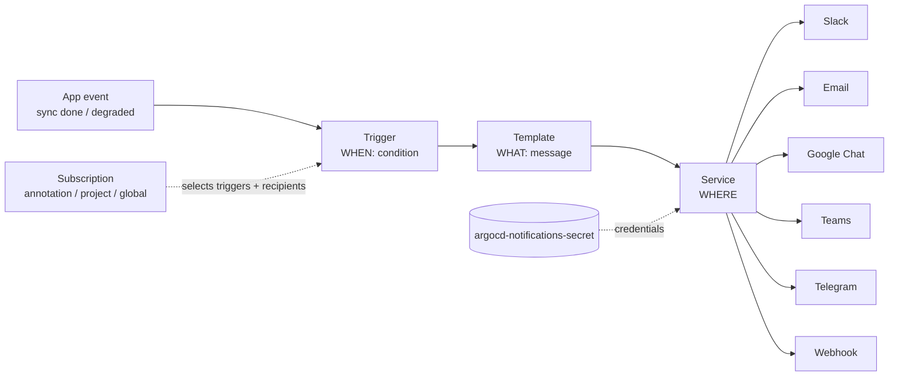

# 🔔 09 · Notifications

> [!TIP]
> Four building blocks: **Service** (where) + **Template** (what) + **Trigger** (when) + **Subscription** (who gets what). Learn these four and everything else is copy-paste.

## 1. What & why
**Use case:** a prod sync fails at night → SRE gets a Slack message and an email with the error text; developers get a "deployed" message in `#deploys`.

## 2. Architecture


## 3. Key values
| Where | Key | Meaning |
|---|---|---|
| `argocd-notifications-cm` | `service.<type>[.<name>]` | channel + credential |
| | `template.<name>` | message body per service |
| | `trigger.<name>` | list of `when:` conditions → `send:` templates |
| | `subscriptions` | global default recipients + triggers |
| Annotation | `notifications.argoproj.io/subscribe.<trigger>.<service>: <recipient>` | per app / project / appset |
| Secret | `argocd-notifications-secret` | tokens (`$slack-token` …) |

## 4. Choose your approach

### 4.1 Channel (service)
| Service | Needs | Recipient format |
|---|---|---|
| Slack | bot token, bot invited | channel name |
| Email (Gmail/SES) | SMTP user + app password | address |
| Google Chat | space webhook URL | empty |
| MS Teams | channel webhook URL | key from `recipientUrls` |
| Telegram | bot token | chat id |
| Generic webhook | URL (+ auth) | empty |

### 4.2 Subscription level
| Level | Scope | Where | Use for |
|---|---|---|---|
| Global | all apps | `subscriptions:` in cm | failure alerts for everything |
| **Project** | all apps in project | AppProject annotation | prod team channel |
| Application | one app | Application annotation | special app |
| ApplicationSet | generated apps | template annotation | fleets |

## 5. Install & credentials
<details>
<summary>📄 <b>install-notifications.sh</b> — Controller check and optional catalog install.</summary>

```bash
#!/bin/sh
# ======================================================================
# FILE   : install-notifications.sh
# PURPOSE: Controller check and optional catalog install.
# APPLY  : sh install-notifications.sh
# ======================================================================
# Notifications controller ships with Argo CD (Helm: notifications.enabled: true; manifest: included).
kubectl -n argocd get deploy argocd-notifications-controller
# Optional: install the community CATALOG (ready-made triggers + templates, e.g. on-sync-failed, app-deployed)
kubectl apply -n argocd --server-side --force-conflicts \
  -f https://raw.githubusercontent.com/argoproj/argo-cd/stable/notifications_catalog/install.yaml
# Helm users: set notifications.templates / notifications.triggers in values.yaml instead of editing the ConfigMap
```

</details>
<details>
<summary>📄 <b>notifications-secret.yaml</b> — Tokens for all services.</summary>

```yaml
# ======================================================================
# FILE   : notifications-secret.yaml
# PURPOSE: Tokens for all services.
# APPLY  : kubectl apply -f notifications-secret.yaml
# ======================================================================
# Credentials for every service. Referenced from the ConfigMap as $key-name. Never commit real values.
apiVersion: v1
kind: Secret
metadata:
  name: argocd-notifications-secret       # fixed name
  namespace: argocd
type: Opaque
stringData:
  slack-token: "<xoxb-...>"               # Slack bot token: scopes chat:write, chat:write.public; invite bot to channel
  email-username: "alerts@example.com"
  email-password: "<app-password>"        # Gmail: App Password (not your login password); SES: SMTP password
  googlechat-webhook: "https://chat.googleapis.com/v1/spaces/XXX/messages?key=..&token=.."
  teams-webhook: "https://<tenant>.webhook.office.com/webhookb2/..."
  telegram-token: "<bot-token>"
  generic-webhook-token: "<token>"
```

</details>

## 6. Services, templates, triggers
<details>
<summary>📄 <b>notifications-cm.yaml</b> — All services, 3 templates, 3 triggers, global subscription.</summary>

```yaml
# ======================================================================
# FILE   : notifications-cm.yaml
# PURPOSE: All services, 3 templates, 3 triggers, global subscription.
# APPLY  : kubectl apply -f notifications-cm.yaml
# ======================================================================
apiVersion: v1
kind: ConfigMap
metadata:
  name: argocd-notifications-cm           # fixed name
  namespace: argocd
data:
  # ===================== SERVICES = WHERE =====================
  service.slack: |
    token: $slack-token
  service.email.gmail: |                  # Gmail SMTP. SES: host email-smtp.<region>.amazonaws.com, port 587/465
    host: smtp.gmail.com
    port: 465
    from: $email-username
    username: $email-username
    password: $email-password
  service.webhook.googlechat: |           # Google Chat incoming webhook
    url: $googlechat-webhook
    headers:
      - {name: Content-Type, value: application/json}
  service.teams: |                        # Microsoft Teams
    recipientUrls:
      devops: $teams-webhook
  service.telegram: |
    token: $telegram-token
  service.webhook.generic: |              # any HTTP endpoint (PagerDuty, Opsgenie, your API)
    url: https://hooks.example.com/argocd
    headers:
      - {name: Authorization, value: Bearer $generic-webhook-token}

  # ===================== TEMPLATES = WHAT =====================
  template.app-deployed: |
    message: "✅ {{.app.metadata.name}} deployed to {{.app.spec.destination.namespace}} (rev {{.app.status.sync.revision | trunc 7}})"
    slack:
      attachments: |
        [{"title":"{{.app.metadata.name}}","color":"#18be52","fields":[
          {"title":"Sync","value":"{{.app.status.sync.status}}","short":true},
          {"title":"Health","value":"{{.app.status.health.status}}","short":true}]}]
    email:
      subject: "Deployed: {{.app.metadata.name}}"
    webhook:
      googlechat:
        method: POST
        body: |
          {"text": "✅ {{.app.metadata.name}} deployed to {{.app.spec.destination.namespace}}"}
    teams:
      title: "Deployed {{.app.metadata.name}}"
      themeColor: "#18be52"
      text: "Health: {{.app.status.health.status}}"
  template.app-failed: |
    message: "❌ {{.app.metadata.name}} sync FAILED: {{.app.status.operationState.message}}"
    slack:
      attachments: |
        [{"title":"{{.app.metadata.name}}","color":"#E96D76","text":"{{.app.status.operationState.message}}"}]
    email:
      subject: "FAILED: {{.app.metadata.name}}"
    webhook:
      googlechat:
        method: POST
        body: |
          {"text": "❌ {{.app.metadata.name}} sync failed: {{.app.status.operationState.message}}"}
    teams:
      title: "FAILED {{.app.metadata.name}}"
      themeColor: "#E96D76"
      text: "{{.app.status.operationState.message}}"
  template.app-degraded: |
    message: "⚠️ {{.app.metadata.name}} is DEGRADED"
    slack:
      attachments: |
        [{"title":"{{.app.metadata.name}}","color":"#f4c030","text":"Health: {{.app.status.health.status}}"}]

  # ===================== TRIGGERS = WHEN =====================
  trigger.on-sync-succeeded: |
    - when: app.status.operationState.phase in ['Succeeded']
      send: [app-deployed]
  trigger.on-sync-failed: |
    - when: app.status.operationState.phase in ['Error', 'Failed']
      send: [app-failed]
  trigger.on-health-degraded: |
    - when: app.status.health.status == 'Degraded'
      send: [app-degraded]

  # ============ GLOBAL SUBSCRIPTION: every app gets these (no annotation needed) ============
  subscriptions: |
    - recipients: [slack:devops-alerts]
      triggers: [on-sync-failed, on-health-degraded]
```

</details>

## 7. Subscriptions (pick the level)
<details>
<summary>📄 <b>subscribe-per-app.yaml</b> — Annotations on one Application (all channel types).</summary>

```yaml
# ======================================================================
# FILE   : subscribe-per-app.yaml
# PURPOSE: Annotations on one Application (all channel types).
# APPLY  : kubectl apply -f subscribe-per-app.yaml
# ======================================================================
# SUBSCRIPTION METHOD 1: annotations on ONE Application.
# Format: notifications.argoproj.io/subscribe.<trigger>.<service>: <recipient>
apiVersion: argoproj.io/v1alpha1
kind: Application
metadata:
  name: fcoos-insights
  namespace: argocd
  annotations:
    notifications.argoproj.io/subscribe.on-sync-succeeded.slack: deploys          # Slack channel
    notifications.argoproj.io/subscribe.on-sync-failed.slack: devops-alerts
    notifications.argoproj.io/subscribe.on-sync-failed.email.gmail: team@example.com   # email.<service-name>
    notifications.argoproj.io/subscribe.on-health-degraded.googlechat: ""          # webhook services: empty recipient
    notifications.argoproj.io/subscribe.on-sync-failed.teams: devops               # key from service.teams recipientUrls
spec:
  project: myargoproject-dev
  source: {repoURL: "https://github.com/<org>/<gitops-repo>.git", targetRevision: main, path: k8-manifest}
  destination: {server: "https://kubernetes.default.svc", namespace: fcoos}
```

</details>
<details>
<summary>📄 <b>subscribe-per-project.yaml</b> — Annotations on a Project: all its apps.</summary>

```yaml
# ======================================================================
# FILE   : subscribe-per-project.yaml
# PURPOSE: Annotations on a Project: all its apps.
# APPLY  : kubectl apply -f subscribe-per-project.yaml
# ======================================================================
# SUBSCRIPTION METHOD 2: annotations on an AppProject => EVERY app in the project is subscribed.
apiVersion: argoproj.io/v1alpha1
kind: AppProject
metadata:
  name: myargoproject-prod
  namespace: argocd
  annotations:
    notifications.argoproj.io/subscribe.on-sync-failed.slack: prod-alerts
    notifications.argoproj.io/subscribe.on-health-degraded.slack: prod-alerts
    notifications.argoproj.io/subscribe.on-sync-succeeded.slack: prod-deploys
spec:
  sourceRepos: ["https://github.com/<org>/<gitops-repo>.git"]
  destinations: [{server: "https://kubernetes.default.svc", namespace: "*-prod"}]
```

</details>
<details>
<summary>📄 <b>subscribe-applicationset.yaml</b> — Annotations in an ApplicationSet template.</summary>

```yaml
# ======================================================================
# FILE   : subscribe-applicationset.yaml
# PURPOSE: Annotations in an ApplicationSet template.
# APPLY  : kubectl apply -f subscribe-applicationset.yaml
# ======================================================================
# SUBSCRIPTION METHOD 3: put the annotations in an ApplicationSet template => all generated apps are subscribed.
apiVersion: argoproj.io/v1alpha1
kind: ApplicationSet
metadata: {name: all-apps, namespace: argocd}
spec:
  generators:
    - git:
        repoURL: https://github.com/<org>/<gitops-repo>.git
        revision: main
        directories: [{path: "k8-manifest/apps/*"}]
  template:
    metadata:
      name: "{{path.basename}}"
      annotations:
        notifications.argoproj.io/subscribe.on-sync-failed.slack: devops-alerts
    spec:
      project: myargoproject-dev
      source: {repoURL: "https://github.com/<org>/<gitops-repo>.git", targetRevision: main, path: "{{path}}"}
      destination: {server: "https://kubernetes.default.svc", namespace: "{{path.basename}}"}
```

</details>

## 8. Test
<details>
<summary>📄 <b>test-notifications.sh</b> — Send a template now, run a trigger, read logs.</summary>

```bash
#!/bin/sh
# ======================================================================
# FILE   : test-notifications.sh
# PURPOSE: Send a template now, run a trigger, read logs.
# APPLY  : sh test-notifications.sh
# ======================================================================
# Test without breaking anything
argocd admin notifications template notify app-deployed <app> --recipient slack:devops-alerts   # send a template now
argocd admin notifications trigger run on-sync-failed <app>                                      # evaluate a trigger
argocd admin notifications template get                                                          # list templates
kubectl -n argocd logs deploy/argocd-notifications-controller -f
```

</details>

## 9. Troubleshooting
| Symptom | Cause | Fix |
|---|---|---|
| No message | no subscription | add annotation or global `subscriptions` |
| Slack `not_in_channel` | bot not invited | `/invite @bot` |
| Slack `invalid_auth` | wrong token | check secret key name `slack-token` |
| Gmail auth error | normal password | use an App Password |
| Template error in logs | wrong field path | test with `argocd admin notifications template notify` |
| Duplicate messages | global + app subscription | keep only one level |

## 10. Checklist
- [ ] Failed + Degraded alerts for all prod apps · [ ] tokens only in the Secret · [ ] tested with a deliberate failure · [ ] one subscription level per trigger
