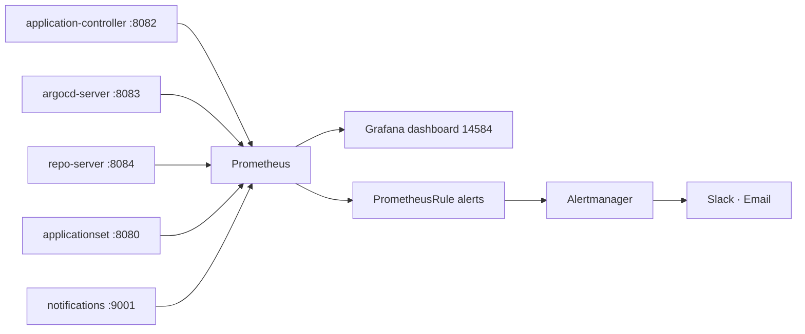

# 📈 10 · Monitoring Argo CD

> [!TIP]
> Metrics tell you *Argo CD is healthy*; notifications ([09](../09_notifications/README.md)) tell you *an app is unhealthy*. Use both.

## 1. What & why
**Use case:** page the on-call when apps stay OutOfSync >15 min, syncs fail, or Argo CD stops reading Git.

## 2. Architecture


## 3. Key metrics
| Metric | Meaning |
|---|---|
| `argocd_app_info{sync_status,health_status}` | one series per app |
| `argocd_app_sync_total{phase}` | sync results |
| `argocd_app_reconcile_*` | reconcile speed |
| `argocd_git_request_total` | Git calls (health of repo-server) |
| `argocd_cluster_api_resource_objects` | objects per cluster |
| `workqueue_depth` | controller backlog |

## 4. Choose your approach (scraping)
| | A · Helm values | B · ServiceMonitor files | C · Static scrape (no Operator) |
|---|---|---|---|
| Needs Prometheus Operator | yes | yes | no |
| Effort | lowest | low | medium |
| Use when | you install Argo CD with Helm | manifest/Kustomize install | classic Prometheus |

## 5. Install the stack
<details>
<summary>📄 <b>install-monitoring.sh</b> — kube-prometheus-stack and Grafana access.</summary>

```bash
#!/bin/sh
# ======================================================================
# FILE   : install-monitoring.sh
# PURPOSE: kube-prometheus-stack and Grafana access.
# APPLY  : sh install-monitoring.sh
# ======================================================================
# kube-prometheus-stack = Prometheus + Alertmanager + Grafana + Operator (CRDs: ServiceMonitor, PrometheusRule)
helm repo add prometheus-community https://prometheus-community.github.io/helm-charts
helm repo update
helm install monitoring prometheus-community/kube-prometheus-stack -n monitoring --create-namespace
kubectl -n monitoring get pods
# Grafana (default admin / prom-operator: CHANGE IT)
kubectl -n monitoring port-forward svc/monitoring-grafana 3000:80
# Dashboards -> Import -> ID 14584 (Argo CD) -> choose Prometheus
```

</details>

## 6. Approach A · Helm values
<details>
<summary>📄 <b>helm-values-metrics.yaml</b> — Enable metrics + ServiceMonitors in the Argo CD chart.</summary>

```yaml
# ======================================================================
# FILE   : helm-values-metrics.yaml
# PURPOSE: Enable metrics + ServiceMonitors in the Argo CD chart.
# APPLY  : merge into helm-values.yaml
# ======================================================================
# APPROACH A: let the Argo CD Helm chart create the ServiceMonitors itself.
# Add to helm-values.yaml (folder 02).
controller:
  metrics:
    enabled: true
    serviceMonitor:
      enabled: true
      additionalLabels: {release: monitoring}   # must match your Prometheus release label
server:
  metrics:
    enabled: true
    serviceMonitor: {enabled: true, additionalLabels: {release: monitoring}}
repoServer:
  metrics:
    enabled: true
    serviceMonitor: {enabled: true, additionalLabels: {release: monitoring}}
applicationSet:
  metrics:
    enabled: true
    serviceMonitor: {enabled: true, additionalLabels: {release: monitoring}}
notifications:
  metrics:
    enabled: true
    serviceMonitor: {enabled: true, additionalLabels: {release: monitoring}}
```

</details>

## 7. Approach B · ServiceMonitor files
<details>
<summary>📄 <b>servicemonitors.yaml</b> — ServiceMonitors for controller, server, repo-server.</summary>

```yaml
# ======================================================================
# FILE   : servicemonitors.yaml
# PURPOSE: ServiceMonitors for controller, server, repo-server.
# APPLY  : kubectl apply -f servicemonitors.yaml
# ======================================================================
# Tells Prometheus Operator to scrape the Argo CD metric ports.
# Alternatively set serviceMonitor.enabled: true in the Argo CD helm values.
apiVersion: monitoring.coreos.com/v1
kind: ServiceMonitor
metadata:
  name: argocd-metrics
  namespace: argocd
  labels:
    release: monitoring              # must match your kube-prometheus-stack release name
spec:
  selector:
    matchLabels:
      app.kubernetes.io/name: argocd-metrics          # controller metrics Service
  endpoints:
    - port: http-metrics
      interval: 30s
---
apiVersion: monitoring.coreos.com/v1
kind: ServiceMonitor
metadata:
  name: argocd-server-metrics
  namespace: argocd
  labels:
    release: monitoring
spec:
  selector:
    matchLabels:
      app.kubernetes.io/name: argocd-server-metrics
  endpoints:
    - port: http-metrics
      interval: 30s
---
apiVersion: monitoring.coreos.com/v1
kind: ServiceMonitor
metadata:
  name: argocd-repo-server-metrics
  namespace: argocd
  labels:
    release: monitoring
spec:
  selector:
    matchLabels:
      app.kubernetes.io/name: argocd-repo-server-metrics
  endpoints:
    - port: metrics
      interval: 30s
```

</details>

## 8. Approach C · Static scrape
<details>
<summary>📄 <b>prometheus-static-scrape.yaml</b> — scrape_configs for plain Prometheus.</summary>

```yaml
# ======================================================================
# FILE   : prometheus-static-scrape.yaml
# PURPOSE: scrape_configs for plain Prometheus.
# APPLY  : add to prometheus.yml
# ======================================================================
# APPROACH C: plain Prometheus WITHOUT the Operator: add these jobs to prometheus.yml (scrape_configs).
# Metrics ports: controller 8082, server 8083, repo-server 8084, applicationset 8080, notifications 9001.
scrape_configs:
  - job_name: argocd-application-controller
    metrics_path: /metrics
    static_configs:
      - targets: ["argocd-metrics.argocd.svc:8082"]
  - job_name: argocd-server
    static_configs:
      - targets: ["argocd-server-metrics.argocd.svc:8083"]
  - job_name: argocd-repo-server
    static_configs:
      - targets: ["argocd-repo-server.argocd.svc:8084"]
  - job_name: argocd-notifications
    static_configs:
      - targets: ["argocd-notifications-controller-metrics.argocd.svc:9001"]
```

</details>

## 9. Alerts and routing
<details>
<summary>📄 <b>alert-rules.yaml</b> — OutOfSync, Degraded, sync failure, Git fetch stopped.</summary>

```yaml
# ======================================================================
# FILE   : alert-rules.yaml
# PURPOSE: OutOfSync, Degraded, sync failure, Git fetch stopped.
# APPLY  : kubectl apply -f alert-rules.yaml
# ======================================================================
apiVersion: monitoring.coreos.com/v1
kind: PrometheusRule
metadata:
  name: argocd-alerts
  namespace: argocd
  labels:
    release: monitoring
spec:
  groups:
    - name: argocd
      rules:
        - alert: ArgoAppOutOfSync
          expr: argocd_app_info{sync_status="OutOfSync"} == 1
          for: 15m                    # out of sync for 15 minutes
          labels: {severity: warning}
          annotations:
            summary: "{{ $labels.name }} is OutOfSync"
        - alert: ArgoAppUnhealthy
          expr: argocd_app_info{health_status=~"Degraded|Missing"} == 1
          for: 5m
          labels: {severity: critical}
          annotations:
            summary: "{{ $labels.name }} is {{ $labels.health_status }}"
        - alert: ArgoSyncFailing
          expr: increase(argocd_app_sync_total{phase=~"Error|Failed"}[10m]) > 0
          labels: {severity: critical}
          annotations:
            summary: "Sync failed for {{ $labels.name }}"
        - alert: ArgoRepoServerGitErrors
          expr: increase(argocd_git_request_total{request_type="fetch"}[10m]) == 0
          for: 30m
          labels: {severity: warning}
          annotations:
            summary: "Argo CD has not fetched Git for 30 min"
```

</details>
<details>
<summary>📄 <b>alertmanager-route.yaml</b> — Critical → Slack + email; warning → Slack.</summary>

```yaml
# ======================================================================
# FILE   : alertmanager-route.yaml
# PURPOSE: Critical → Slack + email; warning → Slack.
# APPLY  : kubectl apply -f alertmanager-route.yaml
# ======================================================================
# Where do Prometheus alerts GO? Alertmanager config (kube-prometheus-stack: alertmanager.config in helm values,
# or an AlertmanagerConfig object). Example: critical -> Slack + email, warning -> Slack only.
apiVersion: monitoring.coreos.com/v1alpha1
kind: AlertmanagerConfig
metadata:
  name: argocd-routes
  namespace: argocd
  labels: {alertmanagerConfig: main}
spec:
  route:
    receiver: slack-warning
    groupBy: [alertname, name]
    routes:
      - matchers: [{name: severity, value: critical}]
        receiver: slack-critical
  receivers:
    - name: slack-warning
      slackConfigs:
        - channel: "#devops-alerts"
          apiURL: {name: slack-webhook, key: url}     # Secret with the Slack webhook URL
          sendResolved: true
    - name: slack-critical
      slackConfigs:
        - channel: "#prod-incidents"
          apiURL: {name: slack-webhook, key: url}
          sendResolved: true
      emailConfigs:
        - to: oncall@example.com
          from: alerts@example.com
          smarthost: smtp.gmail.com:587
          authUsername: alerts@example.com
          authPassword: {name: smtp-secret, key: password}
```

</details>

## 10. Queries to try
<details>
<summary>📄 <b>promql-cheatsheet.promql</b> — Useful PromQL.</summary>

```promql
# ======================================================================
# FILE   : promql-cheatsheet.promql
# PURPOSE: Useful PromQL.
# APPLY  : paste into Prometheus/Grafana
# ======================================================================
count(argocd_app_info{sync_status="OutOfSync"})                              # apps out of sync
count(argocd_app_info{health_status!="Healthy"})                             # apps not healthy
sum by (name) (increase(argocd_app_sync_total{phase!="Succeeded"}[1h]))      # failed syncs per app
histogram_quantile(0.95, sum by (le) (rate(argocd_app_reconcile_bucket[5m])))   # reconcile p95
sum(rate(argocd_git_request_total[5m])) by (request_type)                    # Git request rate
workqueue_depth{name=~"app_.*"}                                              # controller backlog
```

</details>

## 11. Verify & troubleshoot
Prometheus → **Status → Targets**: argocd targets **UP**. Grafana → import **14584**.
| Symptom | Cause | Fix |
|---|---|---|
| Targets missing | ServiceMonitor label ≠ Prometheus selector | match `release:` label |
| No `argocd_*` metrics | metrics disabled | `*.metrics.enabled: true` |
| Alerts never fire | rule not loaded | label `release:` on PrometheusRule |
| Alert fires, no message | Alertmanager route | check `alertmanager-route.yaml` |

## 12. Checklist
- [ ] Targets UP · [ ] dashboard imported · [ ] alerts routed · [ ] Grafana password changed
