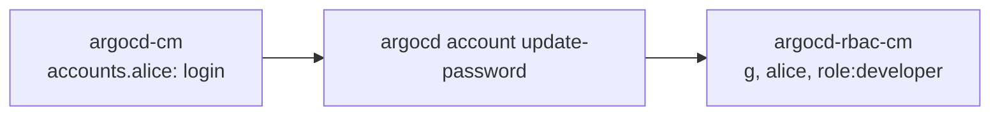
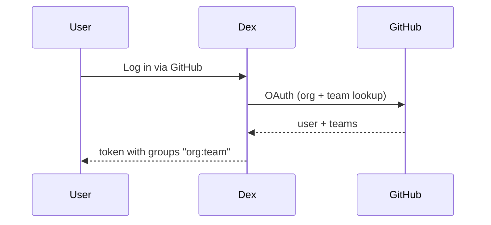

# 14 · Local users & GitHub SSO (when you don't use Google)

> ### 🟢 Simple version
> **In one line:** Other ways to log in: local users, robot tokens, or GitHub.
> **Your goal:** Pick ONE: Google (folder 10), GitHub (here), or local users.
> **You will:** Choose method → Apply the YAML → Give a role
> Need the full detail? Keep reading below. Otherwise jump to the files.


| Option | Use when |
|---|---|
| **Local users** | tiny team, CI robots (API tokens) |
| **GitHub SSO** | team already lives in a GitHub org |
| **Google SSO** | Workspace company → see [10](../10_sso_rbac_google/README.md) |

## A. Local users

1. Apply [local-users-cm.yaml](local-users-cm.yaml).
2. Set a password (admin must do it):
   ```bash
   argocd account update-password --account alice --new-password '<strong>' --current-password '<admin-pass>'
   ```
3. Give a role in `argocd-rbac-cm`: `g, alice, role:developer` (roles from folder 10).
4. CI token (no login): `argocd account generate-token --account ci-user` → store in the CI secret store.
5. List: `argocd account list`.

Capabilities: `login` = UI/CLI login, `apiKey` = can create tokens. Give robots **apiKey only**.

## B. GitHub SSO (via Dex)

1. GitHub → Org → Settings → Developer settings → **OAuth Apps** → New. Callback: `https://argocd.example.com/api/dex/callback`.
2. Put the client ID and secret in [github-sso.yaml](github-sso.yaml) (it holds the Secret, connector ConfigMap and RBAC), then apply it.
3. RBAC groups look like `my-org:devops-team` (org:team-slug).
4. `kubectl -n argocd rollout restart deploy argocd-dex-server argocd-server`
5. Important: team membership must be visible to the OAuth app (org → third-party access policy → approve the app).


---

## Files in this guide

| # | File | Purpose | What you change |
|---|---|---|---|
| 1 | [`local-users-cm.yaml`](local-users-cm.yaml) | Defines local accounts: human login, login-only, and robot token-only. | Account names and capabilities. |
| 2 | [`github-sso.yaml`](github-sso.yaml) | GitHub login: OAuth secret, Dex connector, and team-based RBAC. | GitHub org, team slugs, OAuth client id/secret. |

---

## The files, with explanations

Every file has `#` comments on each important line. Replace anything in `<angle brackets>`.

### File 1: `local-users-cm.yaml`
**Purpose:** Defines local accounts: human login, login-only, and robot token-only.  
**What you change:** Account names and capabilities.  
**Apply:** `kubectl apply -f local-users-cm.yaml`

```yaml
# ======================================================================
# FILE   : local-users-cm.yaml
# PURPOSE: Defines local accounts: human login, login-only, and robot token-only.
# CHANGE : Account names and capabilities.
# APPLY  : kubectl apply -f local-users-cm.yaml
# ======================================================================
apiVersion: v1
kind: ConfigMap
metadata:
  name: argocd-cm
  namespace: argocd
  labels:
    app.kubernetes.io/name: argocd-cm
    app.kubernetes.io/part-of: argocd
data:
  accounts.alice: apiKey, login     # human: UI/CLI login + may create tokens
  accounts.bob: login               # human: login only
  accounts.ci-user: apiKey          # robot: token only, cannot log in to the UI
  # accounts.alice.enabled: "false" # disable an account (offboarding)
```

### File 2: `github-sso.yaml`
**Purpose:** GitHub login: OAuth secret, Dex connector, and team-based RBAC.  
**What you change:** GitHub org, team slugs, OAuth client id/secret.  
**Apply:** `see file comments (patch the secret safely)`

```yaml
# ======================================================================
# FILE   : github-sso.yaml
# PURPOSE: GitHub login: OAuth secret, Dex connector, and team-based RBAC.
# CHANGE : GitHub org, team slugs, OAuth client id/secret.
# APPLY  : see file comments (patch the secret safely)
# ======================================================================
# Secret (credentials) + ConfigMap (connector). Do not commit real values.
apiVersion: v1
kind: Secret
metadata:
  name: argocd-secret               # Argo CD's built-in secret; keys here are visible to dex as $dex.<key>
  namespace: argocd
  labels:
    app.kubernetes.io/part-of: argocd
type: Opaque
stringData:
  dex.github.clientID: "<GITHUB_OAUTH_CLIENT_ID>"
  dex.github.clientSecret: "<GITHUB_OAUTH_CLIENT_SECRET>"
  # CAUTION: with `kubectl apply` a partial argocd-secret can hide existing keys (admin.password, server.secretkey).
  # Safer: kubectl -n argocd patch secret argocd-secret --type merge -p '{"stringData":{"dex.github.clientID":"..","dex.github.clientSecret":".."}}'
---
apiVersion: v1
kind: ConfigMap
metadata:
  name: argocd-cm
  namespace: argocd
  labels:
    app.kubernetes.io/name: argocd-cm
    app.kubernetes.io/part-of: argocd
data:
  url: https://argocd.example.com
  dex.config: |
    connectors:
      - type: github
        id: github
        name: GitHub                 # login button text
        config:
          clientID: $dex.github.clientID
          clientSecret: $dex.github.clientSecret
          orgs:
            - name: my-org           # only members of this org may log in
          loadAllGroups: false       # true = also return teams (needed for team based RBAC)
          teamNameField: slug        # group looks like  my-org:devops-team
---
# RBAC for GitHub teams
apiVersion: v1
kind: ConfigMap
metadata:
  name: argocd-rbac-cm
  namespace: argocd
data:
  scopes: "[groups, email]"
  policy.default: role:readonly      # everyone logged in can view; change to "" for stricter
  policy.csv: |
    g, my-org:devops-team, role:admin
    g, my-org:developers,  role:readonly
```

---

## Apply and Verify

```bash
argocd account list
argocd account can-i sync applications '*/*'
kubectl -n argocd rollout restart deploy argocd-dex-server argocd-server
```

---

## Troubleshooting

| Symptom | Likely cause | Fix |
|---|---|---|
| GitHub login shows no teams | App not approved by org | Org settings: approve the OAuth app |
| Local user cannot log in | Password not set | argocd account update-password --account <name> |

---

## Checklist

- [ ] Robots have apiKey only
- [ ] Local users disabled when SSO is live
- [ ] Teams mapped to roles
