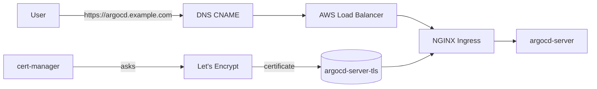

# 15 · HTTPS on EKS with NGINX Ingress + cert-manager (Let's Encrypt)

> ### 🟢 Simple version
> **In one line:** Get a free https padlock for your Argo CD address.
> **Your goal:** Install ingress + cert-manager, point DNS, wait 5-10 min.
> **You will:** Install ingress-nginx → Install cert-manager → Apply issuer + ingress → Add DNS CNAME
> Need the full detail? Keep reading below. Otherwise jump to the files.




## Steps
```bash
# 0. (optional) create cluster
eksctl create cluster --name argocd-cluster --region ap-south-1 --nodes 2 --node-type t3.medium

# 1. Argo CD (see 02_installation)  — use values with server.insecure: true

# 2. NGINX ingress controller
helm upgrade --install ingress-nginx ingress-nginx --repo https://kubernetes.github.io/ingress-nginx \
  -n ingress-nginx --create-namespace

# 3. cert-manager (CRDs included)
helm repo add jetstack https://charts.jetstack.io && helm repo update
helm upgrade --install cert-manager jetstack/cert-manager -n cert-manager --create-namespace --set crds.enabled=true
kubectl -n cert-manager wait --for=condition=ready pod -l app.kubernetes.io/instance=cert-manager --timeout=300s

# 4. Issuer + Ingress (edit email and domain first)
kubectl apply -f letsencrypt-issuer.yaml
kubectl apply -f argocd-ingress.yaml

# 5. Get the load balancer name and create DNS CNAME  argocd.example.com -> <that name>
kubectl get svc -n ingress-nginx ingress-nginx-controller

# 6. Check the certificate (5-10 min is normal)
kubectl get certificate -n argocd
kubectl describe certificate argocd-server-tls -n argocd
```
Tip: test with `letsencrypt-staging` first to avoid Let's Encrypt rate limits.

## If the certificate stays Pending
DNS not pointing to the LB yet · port 80 blocked (HTTP-01 needs it) · wrong ingressClass · check `kubectl logs -n cert-manager deploy/cert-manager`.

## Cleanup
`eksctl delete cluster --name argocd-cluster --region ap-south-1`


---

## Files in this guide

| # | File | Purpose | What you change |
|---|---|---|---|
| 1 | [`letsencrypt-issuer.yaml`](letsencrypt-issuer.yaml) | ClusterIssuer: how cert-manager gets free certificates (HTTP-01). | Your email. Use the staging server first. |
| 2 | [`argocd-ingress.yaml`](argocd-ingress.yaml) | Ingress for Argo CD with TLS from cert-manager. | Host name. |

---

## The files, with explanations

Every file has `#` comments on each important line. Replace anything in `<angle brackets>`.

### File 1: `letsencrypt-issuer.yaml`
**Purpose:** ClusterIssuer: how cert-manager gets free certificates (HTTP-01).  
**What you change:** Your email. Use the staging server first.  
**Apply:** `kubectl apply -f letsencrypt-issuer.yaml`

```yaml
# ======================================================================
# FILE   : letsencrypt-issuer.yaml
# PURPOSE: ClusterIssuer: how cert-manager gets free certificates (HTTP-01).
# CHANGE : Your email. Use the staging server first.
# APPLY  : kubectl apply -f letsencrypt-issuer.yaml
# ======================================================================
# ClusterIssuer = how cert-manager gets certificates (HTTP-01 challenge via NGINX).
apiVersion: cert-manager.io/v1
kind: ClusterIssuer
metadata:
  name: letsencrypt-prod
spec:
  acme:
    server: https://acme-v02.api.letsencrypt.org/directory      # staging: https://acme-staging-v02.api.letsencrypt.org/directory
    email: you@example.com                                       # expiry warnings go here
    privateKeySecretRef:
      name: letsencrypt-prod-key                                 # account key stored here
    solvers:
      - http01:
          ingress:
            ingressClassName: nginx
```

### File 2: `argocd-ingress.yaml`
**Purpose:** Ingress for Argo CD with TLS from cert-manager.  
**What you change:** Host name.  
**Apply:** `kubectl apply -f argocd-ingress.yaml`

```yaml
# ======================================================================
# FILE   : argocd-ingress.yaml
# PURPOSE: Ingress for Argo CD with TLS from cert-manager.
# CHANGE : Host name.
# APPLY  : kubectl apply -f argocd-ingress.yaml
# ======================================================================
apiVersion: networking.k8s.io/v1
kind: Ingress
metadata:
  name: argocd-server
  namespace: argocd
  annotations:
    cert-manager.io/cluster-issuer: letsencrypt-prod
    nginx.ingress.kubernetes.io/ssl-redirect: "true"
    nginx.ingress.kubernetes.io/backend-protocol: "HTTP"         # Argo CD runs with server.insecure: true
    nginx.ingress.kubernetes.io/proxy-body-size: "50m"
spec:
  ingressClassName: nginx
  rules:
    - host: argocd.example.com
      http:
        paths:
          - path: /
            pathType: Prefix
            backend:
              service:
                name: argocd-server
                port:
                  number: 80
  tls:
    - hosts: [argocd.example.com]
      secretName: argocd-server-tls                              # cert-manager creates it
# CLI behind this ingress: argocd login argocd.example.com --grpc-web
```

---

## Apply and Verify

```bash
kubectl get clusterissuer
kubectl get certificate -n argocd        # READY True
kubectl describe certificate argocd-server-tls -n argocd
curl -I https://argocd.example.com
```

---

## Troubleshooting

| Symptom | Likely cause | Fix |
|---|---|---|
| Certificate Pending | DNS not pointing to LB, or port 80 blocked | Fix DNS/security group; check cert-manager logs |
| Rate limit | Too many prod attempts | Use staging issuer to test |

---

## Checklist

- [ ] DNS CNAME set
- [ ] Port 80 and 443 open
- [ ] Auto-renew works (cert-manager)
- [ ] Tested with staging issuer first
