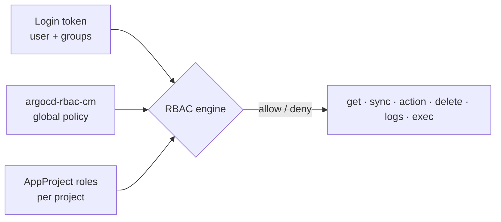

# 🛂 12 · RBAC (authorization)

> [!TIP]
> **Golden rule:** attach permissions to **groups**, never to people. Add or remove people in your identity provider and access follows, with no YAML change.

## 1. What & why
After login ([11](../11_authentication_sso/README.md)), Argo CD checks your **groups** against RBAC rules.
**Use case:** developers deploy to dev only; SREs sync everywhere; juniors can never delete; CI can only sync one project.

## 2. Architecture

Order of thinking: `deny` always wins → matching `allow` → otherwise `policy.default`.

## 3. Key values
| Key | Meaning | Example |
|---|---|---|
| `policy.default` | Role for users with no rule | `""` (none) or `role:readonly` |
| `scopes` | Token claim holding groups | `[groups]`, `[email]`, `[groups, email]` |
| `p, role, resource, action, object, effect` | Permission | `p, role:sre, applications, sync, */*, allow` |
| `g, subject, role` | Bind group/user to role | `g, argocd-sre@example.com, role:sre` |
| Resources | `applications`, `applicationsets`, `clusters`, `projects`, `repositories`, `accounts`, `certificates`, `gpgkeys`, `logs`, `exec` | |
| Actions | `get create update delete sync override action/<…>` | `action/apps/Deployment/restart` |
| Object | `<project>/<app>`, or `*` for non-app resources | `myargoproject-dev/*` |
| Built-in roles | `role:admin`, `role:readonly` | |

> [!NOTE]
> Argo CD 3.x: `logs` and sub-resource actions need explicit permissions (`logs, get` is included in the examples), and `update`/`delete` no longer cascade to sub-resources. Test after upgrading.

## 4. Permission matrix used in the examples
| Role | View | Sync dev | Sync prod | Restart | Logs | Delete | Create |
|---|---|---|---|---|---|---|---|
| `role:admin` (devops) | ✅ | ✅ | ✅ | ✅ | ✅ | ✅ | ✅ |
| `role:sre` | ✅ | ✅ | ✅ | ✅ | ✅ | ❌ | ❌ |
| `role:junior-devops` | ✅ | ✅ | ❌ | dev only | ✅ | ❌ (deny) | ❌ |
| `role:developer` | ✅ | ✅ | ❌ | dev only | dev only | ❌ | ❌ |
| no group | login refused / nothing | | | | | | |

## 5. Choose your approach
| | A · Global (`argocd-rbac-cm`) | B · Project roles | C · Local users / tokens | D · Provider variants |
|---|---|---|---|---|
| Managed by | platform team | project owners | platform team | - |
| Scope | whole Argo CD | one project | users/robots | Google groups · GitHub teams · email · Azure GUID |
| Best for | org-wide roles | delegating prod rules, CI tokens | bots, small teams | match your SSO |

## 6. Approach A · Global policy
<details>
<summary>📄 <b>rbac-global-google-groups.yaml</b> — Roles sre / junior-devops / developer bound to Google groups.</summary>

```yaml
# ======================================================================
# FILE   : rbac-global-google-groups.yaml
# PURPOSE: Roles sre / junior-devops / developer bound to Google groups.
# APPLY  : kubectl apply -f rbac-global-google-groups.yaml
# ======================================================================
# APPROACH A: GLOBAL RBAC in argocd-rbac-cm with Google Workspace groups (from Dex).
# Policy line : p, <role>, <resource>, <action>, <project>/<application>, <allow|deny>
# Group line  : g, <group-or-user>, <role>
apiVersion: v1
kind: ConfigMap
metadata:
  name: argocd-rbac-cm                    # fixed name
  namespace: argocd
  labels: {app.kubernetes.io/name: argocd-rbac-cm, app.kubernetes.io/part-of: argocd}
data:
  policy.default: ""                      # no mapped group = NO access. (role:readonly = everyone can look)
  scopes: "[groups]"                      # token claim that holds groups. Direct OIDC Google: "[email]"
  policy.csv: |
    # ---------- SRE: operate everything, change nothing structural ----------
    p, role:sre, applications, get,      */*, allow
    p, role:sre, applications, sync,     */*, allow
    p, role:sre, applications, action/*, */*, allow          # restart etc.
    p, role:sre, logs,         get,      */*, allow          # Argo CD 3: logs need their own permission
    p, role:sre, projects,     get,      *,   allow
    p, role:sre, clusters,     get,      *,   allow
    p, role:sre, repositories, get,      *,   allow

    # ---------- Junior DevOps: view all, act on dev only, never delete ----------
    p, role:junior-devops, applications, get,      */*,                  allow
    p, role:junior-devops, applications, sync,     myargoproject-dev/*,  allow
    p, role:junior-devops, applications, action/*, myargoproject-dev/*,  allow
    p, role:junior-devops, applications, delete,   */*,                  deny   # deny always wins
    p, role:junior-devops, logs,         get,      */*,                  allow
    p, role:junior-devops, projects,     get,      *,                    allow

    # ---------- Developer: see all, deploy dev only, logs for dev only ----------
    p, role:developer, applications, get,  */*,                 allow
    p, role:developer, applications, sync, myargoproject-dev/*, allow
    p, role:developer, applications, action/apps/Deployment/restart, myargoproject-dev/*, allow
    p, role:developer, logs,         get,  myargoproject-dev/*, allow
    p, role:developer, projects,     get,  *,                   allow

    # ---------- Group bindings (Google groups arrive as e-mail addresses) ----------
    g, argocd-devops@example.com,        role:admin       # built-in: everything
    g, argocd-sre@example.com,           role:sre
    g, argocd-junior-devops@example.com, role:junior-devops
    g, argocd-developers@example.com,    role:developer
```

</details>

## 7. Approach B · Project roles and CI tokens
<details>
<summary>📄 <b>rbac-project-roles.yaml</b> — Roles inside the AppProject with SSO groups.</summary>

```yaml
# ======================================================================
# FILE   : rbac-project-roles.yaml
# PURPOSE: Roles inside the AppProject with SSO groups.
# APPLY  : kubectl apply -f rbac-project-roles.yaml
# ======================================================================
# APPROACH B: RBAC INSIDE A PROJECT (AppProject.spec.roles). The team that owns the project manages its own roles.
# Role name becomes   proj:<project>:<role>   and it can be bound to SSO groups or to JWT tokens.
apiVersion: argoproj.io/v1alpha1
kind: AppProject
metadata:
  name: myargoproject-prod
  namespace: argocd
spec:
  sourceRepos: ["https://github.com/<org>/<gitops-repo>.git"]
  destinations: [{server: "https://kubernetes.default.svc", namespace: "*-prod"}]
  roles:
    - name: deployer
      description: sync prod apps, nothing else
      policies:
        - p, proj:myargoproject-prod:deployer, applications, get,  myargoproject-prod/*, allow
        - p, proj:myargoproject-prod:deployer, applications, sync, myargoproject-prod/*, allow
      groups:
        - argocd-sre@example.com             # SSO group that gets this role
    - name: ci-bot
      description: used by the pipeline (JWT token, see rbac-ci-token.sh)
      policies:
        - p, proj:myargoproject-prod:ci-bot, applications, get,  myargoproject-prod/*, allow
        - p, proj:myargoproject-prod:ci-bot, applications, sync, myargoproject-prod/*, allow
```

</details>
<details>
<summary>📄 <b>rbac-ci-token.sh</b> — JWT token for CI bound to a project role.</summary>

```bash
#!/bin/sh
# ======================================================================
# FILE   : rbac-ci-token.sh
# PURPOSE: JWT token for CI bound to a project role.
# APPLY  : sh rbac-ci-token.sh
# ======================================================================
# CI access with the LEAST privilege: a token bound to a project role (not an admin, not a human account).
argocd proj role create-token myargoproject-prod ci-bot --expires-in 90d     # prints a JWT
# In Jenkins / GitHub Actions:
#   export ARGOCD_SERVER=argocd.example.com
#   export ARGOCD_AUTH_TOKEN=<jwt>
#   argocd app sync fcoos-insights --grpc-web
argocd proj role list-tokens myargoproject-prod ci-bot
argocd proj role delete-token myargoproject-prod ci-bot <iat>                # revoke
# Alternative: local account token -> argocd account generate-token --account ci-user (folder 11)
```

</details>

## 8. Approach C · Local users
<details>
<summary>📄 <b>rbac-local-users.yaml</b> — Bind account names and a robot.</summary>

```yaml
# ======================================================================
# FILE   : rbac-local-users.yaml
# PURPOSE: Bind account names and a robot.
# APPLY  : kubectl apply -f rbac-local-users.yaml
# ======================================================================
# APPROACH: RBAC for LOCAL accounts (folder 11, approach E). Subject is the account name.
apiVersion: v1
kind: ConfigMap
metadata:
  name: argocd-rbac-cm
  namespace: argocd
data:
  policy.default: ""
  policy.csv: |
    g, alice,   role:admin
    g, bob,     role:readonly
    # robot that may only sync one project
    p, ci-user, applications, get,  myargoproject-dev/*, allow
    p, ci-user, applications, sync, myargoproject-dev/*, allow
```yaml
# ======================================================================
# FILE   : rbac-github-teams.yaml
# PURPOSE: GitHub teams as org:team.
# APPLY  : kubectl apply -f rbac-github-teams.yaml
# ======================================================================
# APPROACH: RBAC for GitHub TEAMS. Group string = <org>:<team-slug>. Reuses roles from rbac-global-google-groups.yaml.
apiVersion: v1
kind: ConfigMap
metadata:
  name: argocd-rbac-cm
  namespace: argocd
data:
  scopes: "[groups, email]"
  policy.default: role:readonly           # everyone logged in may look; change to "" for stricter
  policy.csv: |
    g, my-org:devops-team,  role:admin
    g, my-org:developers,   role:developer      # define role:developer as in the Google example
```

</details>
<details>
<summary>📄 <b>rbac-oidc-email.yaml</b> — E-mail based (Google direct OIDC) and Azure GUID example.</summary>

```yaml
# ======================================================================
# FILE   : rbac-oidc-email.yaml
# PURPOSE: E-mail based (Google direct OIDC) and Azure GUID example.
# APPLY  : kubectl apply -f rbac-oidc-email.yaml
# ======================================================================
# APPROACH: Google DIRECT OIDC has no groups => bind individual E-MAILS (or Keycloak/Okta/Azure group claims).
apiVersion: v1
kind: ConfigMap
metadata:
  name: argocd-rbac-cm
  namespace: argocd
data:
  scopes: "[email]"                       # use "[groups]" for Keycloak/Okta; Azure groups are GUIDs
  policy.default: ""
  policy.csv: |
    g, alice@example.com,   role:admin
    g, bob@example.com,     role:readonly
    # Azure AD example (group object id):  g, 7c9f0a8e-1111-2222-3333-444455556666, role:admin
```

</details>

## 10. Daily operations (no YAML, no restart)
| Task | Do |
|---|---|
| New SRE | add to the `argocd-sre` group |
| Developer → SRE | move between groups |
| Leaver | remove from all groups **and** disable the account |
| New team | create group + `p,` and `g,` lines |

Groups are copied into the token **at login**: after a change the user must log out and in. A removed user can keep access until the session expires.

## 11. Test before applying
<details>
<summary>📄 <b>rbac-test.sh</b> — can-i, validate offline, simulate a role.</summary>

```bash
#!/bin/sh
# ======================================================================
# FILE   : rbac-test.sh
# PURPOSE: can-i, validate offline, simulate a role.
# APPLY  : sh rbac-test.sh
# ======================================================================
# TEST BEFORE YOU APPLY. 1) as the logged-in user
argocd account can-i sync applications 'myargoproject-dev/web'      # yes/no
argocd account can-i sync applications 'myargoproject-prod/web'
argocd account can-i delete applications 'myargoproject-dev/web'
argocd account get-user-info                                        # shows groups in YOUR token

# 2) offline, against a file or the live ConfigMap (no login needed)
kubectl -n argocd get cm argocd-rbac-cm -o jsonpath='{.data.policy\.csv}' > policy.csv
argocd admin settings rbac validate --policy-file policy.csv
argocd admin settings rbac can role:developer sync 'myargoproject-prod/web' --policy-file policy.csv
argocd admin settings rbac can argocd-sre@example.com sync 'myargoproject-prod/web' --policy-file policy.csv --default-role ''
```

</details>

## 12. Troubleshooting
| Symptom | Cause | Fix |
|---|---|---|
| Login works, UI empty | group string ≠ `g,` line | `argocd account get-user-info`, copy exact text (case!) |
| `permission denied` | missing `p,` line | add policy, re-login |
| Can see but not logs | Argo CD 3 `logs` permission | add `logs, get` |
| Change has no effect | old token | log out and in |
| Prod synced by developer | `policy.default` too open or `*/*` | tighten, test with `rbac can` |

## 13. Checklist
- [ ] `policy.default: ""` · [ ] groups only (no individuals) · [ ] ≥ 2 admins · [ ] CI uses a project-role token · [ ] every role tested with `can-i` · [ ] offboarding disables the account
