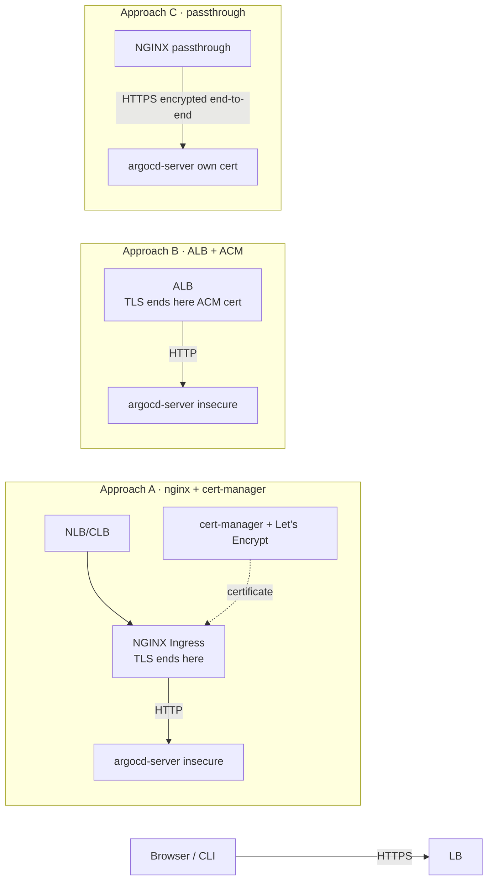
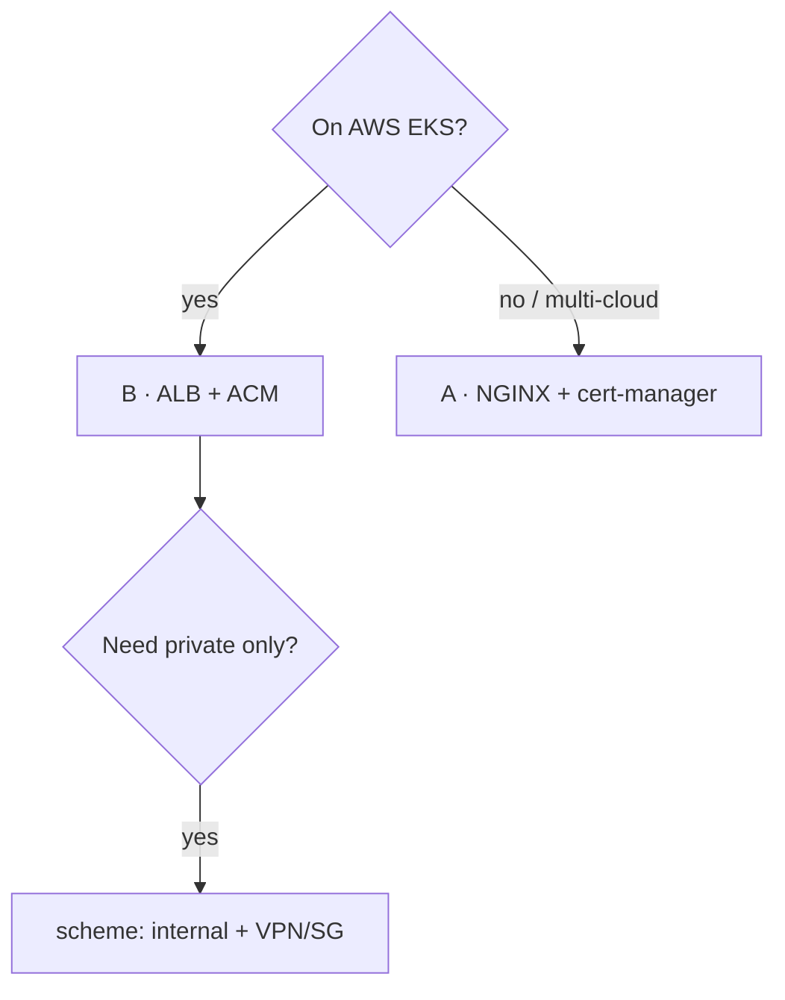

# 🌍 13 · Exposure & HTTPS

> [!TIP]
> Decide **who** can reach Argo CD (internet, VPN, nobody) and **where TLS ends** (ALB, ingress, Argo CD itself).

## 1. What & why
**Use case:** engineers open `https://argocd.example.com` with a valid certificate; the CLI works too; the page is limited to the office/VPN.

## 2. Architecture (where TLS ends)


## 3. Key values
| Key | Meaning | Example |
|---|---|---|
| `server.insecure` | Server speaks HTTP (TLS ends earlier) | `true` for A, B, D+ACM |
| `url` in `argocd-cm` | Public URL | `https://argocd.example.com` |
| `cert-manager.io/cluster-issuer` | Auto certificate | `letsencrypt-prod` |
| `alb.ingress.kubernetes.io/certificate-arn` | ACM certificate | ARN |
| `nginx.ingress.kubernetes.io/ssl-passthrough` | Forward TLS untouched | `"true"` |
| `--grpc-web` (CLI) | CLI over plain HTTPS if gRPC is blocked | always safe |

## 4. Choose your approach
| | A · NGINX + cert-manager | B · AWS ALB + ACM | C · NGINX passthrough | D · LoadBalancer Service | E · Port-forward |
|---|---|---|---|---|---|
| Free certificates | ✅ Let's Encrypt | ✅ ACM (AWS only) | via cert-manager | ACM on NLB or self-signed | self-signed |
| Works off AWS | ✅ | ❌ | ✅ | cloud only | ✅ |
| gRPC CLI | `--grpc-web` | `--grpc-web` | ✅ native | ✅ | ✅ |
| Extra pods | ingress + cert-manager | none (managed ALB) | ingress | none | none |
| Best for | **any cluster** | **EKS production** | strict end-to-end TLS | quick demo | admins, first install |



## 5. Approach A · NGINX + cert-manager
<details>
<summary>📄 <b>install-nginx-certmanager.sh</b> — Install ingress-nginx, cert-manager, issuer, ingress.</summary>

```bash
#!/bin/sh
# ======================================================================
# FILE   : install-nginx-certmanager.sh
# PURPOSE: Install ingress-nginx, cert-manager, issuer, ingress.
# APPLY  : sh install-nginx-certmanager.sh
# ======================================================================
# Approach A prerequisites (EKS or any cluster)
helm upgrade --install ingress-nginx ingress-nginx --repo https://kubernetes.github.io/ingress-nginx -n ingress-nginx --create-namespace
helm repo add jetstack https://charts.jetstack.io && helm repo update
helm upgrade --install cert-manager jetstack/cert-manager -n cert-manager --create-namespace --set crds.enabled=true
kubectl -n cert-manager wait --for=condition=ready pod -l app.kubernetes.io/instance=cert-manager --timeout=300s
kubectl apply -f clusterissuer-letsencrypt.yaml
kubectl apply -f ingress-nginx-certmanager.yaml
kubectl get svc -n ingress-nginx ingress-nginx-controller        # copy EXTERNAL-IP / hostname -> DNS CNAME/A record
kubectl get certificate -n argocd -w                              # READY True in 1-10 min
```

</details>
<details>
<summary>📄 <b>clusterissuer-letsencrypt.yaml</b> — Let's Encrypt issuer (use staging server first).</summary>

```yaml
# ======================================================================
# FILE   : clusterissuer-letsencrypt.yaml
# PURPOSE: Let's Encrypt issuer (use staging server first).
# APPLY  : kubectl apply -f clusterissuer-letsencrypt.yaml
# ======================================================================
# ClusterIssuer = how cert-manager gets certificates (HTTP-01 challenge via NGINX).
apiVersion: cert-manager.io/v1
kind: ClusterIssuer
metadata:
  name: letsencrypt-prod
spec:
  acme:
    server: https://acme-v02.api.letsencrypt.org/directory      # staging: https://acme-staging-v02.api.letsencrypt.org/directory
    email: you@example.com                                       # expiry warnings go here
    privateKeySecretRef:
      name: letsencrypt-prod-key                                 # account key stored here
    solvers:
      - http01:
          ingress:
            ingressClassName: nginx
```

</details>
<details>
<summary>📄 <b>ingress-nginx-certmanager.yaml</b> — Ingress with auto TLS.</summary>

```yaml
# ======================================================================
# FILE   : ingress-nginx-certmanager.yaml
# PURPOSE: Ingress with auto TLS.
# APPLY  : kubectl apply -f ingress-nginx-certmanager.yaml
# ======================================================================
apiVersion: networking.k8s.io/v1
kind: Ingress
metadata:
  name: argocd-server
  namespace: argocd
  annotations:
    cert-manager.io/cluster-issuer: letsencrypt-prod
    nginx.ingress.kubernetes.io/ssl-redirect: "true"
    nginx.ingress.kubernetes.io/backend-protocol: "HTTP"         # Argo CD runs with server.insecure: true
    nginx.ingress.kubernetes.io/proxy-body-size: "50m"
spec:
  ingressClassName: nginx
  rules:
    - host: argocd.example.com
      http:
        paths:
          - path: /
            pathType: Prefix
            backend:
              service:
                name: argocd-server
                port:
                  number: 80
  tls:
    - hosts: [argocd.example.com]
      secretName: argocd-server-tls                              # cert-manager creates it
# CLI behind this ingress: argocd login argocd.example.com --grpc-web
```

</details>

## 6. Approach B · AWS ALB + ACM
<details>
<summary>📄 <b>ingress-alb-acm.yaml</b> — ALB ingress with ACM certificate, redirect, CIDR limits.</summary>

```yaml
# ======================================================================
# FILE   : ingress-alb-acm.yaml
# PURPOSE: ALB ingress with ACM certificate, redirect, CIDR limits.
# APPLY  : kubectl apply -f ingress-alb-acm.yaml
# ======================================================================
# APPROACH B: AWS Load Balancer Controller + ACM certificate (no cert-manager, no nginx).
# Needs: AWS Load Balancer Controller installed, an ACM certificate for argocd.example.com (DNS-validated),
#        Argo CD with server.insecure: true (ALB terminates TLS, talks HTTP to the pod).
apiVersion: networking.k8s.io/v1
kind: Ingress
metadata:
  name: argocd-server
  namespace: argocd
  annotations:
    alb.ingress.kubernetes.io/scheme: internet-facing            # or "internal" for VPN-only access
    alb.ingress.kubernetes.io/target-type: ip
    alb.ingress.kubernetes.io/listen-ports: '[{"HTTP":80},{"HTTPS":443}]'
    alb.ingress.kubernetes.io/ssl-redirect: "443"                # http -> https
    alb.ingress.kubernetes.io/certificate-arn: arn:aws:acm:ap-south-1:<ACCOUNT_ID>:certificate/<ID>
    alb.ingress.kubernetes.io/backend-protocol: HTTP
    alb.ingress.kubernetes.io/healthcheck-path: /healthz
    # alb.ingress.kubernetes.io/inbound-cidrs: 203.0.113.0/24    # restrict who can reach it
    # alb.ingress.kubernetes.io/group.name: shared-alb           # share one ALB between apps (saves cost)
spec:
  ingressClassName: alb
  rules:
    - host: argocd.example.com
      http:
        paths:
          - path: /
            pathType: Prefix
            backend:
              service: {name: argocd-server, port: {number: 80}}
# Then create a Route 53 record argocd.example.com -> the ALB DNS name (alias).
# CLI through ALB: use  argocd login argocd.example.com --grpc-web   (simple), or a second GRPC ingress:
```

</details>

## 7. Approach C · TLS passthrough
<details>
<summary>📄 <b>ingress-nginx-passthrough.yaml</b> — End-to-end TLS, native gRPC.</summary>

```yaml
# ======================================================================
# FILE   : ingress-nginx-passthrough.yaml
# PURPOSE: End-to-end TLS, native gRPC.
# APPLY  : kubectl apply -f ingress-nginx-passthrough.yaml
# ======================================================================
# APPROACH C: TLS PASSTHROUGH. Argo CD serves its OWN certificate; nginx just forwards the encrypted traffic.
# Works with gRPC CLI natively (no --grpc-web). Do NOT set server.insecure here.
# Requires ingress-nginx started with  --enable-ssl-passthrough  (Helm: controller.extraArgs.enable-ssl-passthrough: "")
apiVersion: networking.k8s.io/v1
kind: Ingress
metadata:
  name: argocd-server
  namespace: argocd
  annotations:
    nginx.ingress.kubernetes.io/ssl-passthrough: "true"
    nginx.ingress.kubernetes.io/backend-protocol: HTTPS
spec:
  ingressClassName: nginx
  rules:
    - host: argocd.example.com
      http:
        paths:
          - path: /
            pathType: Prefix
            backend:
              service: {name: argocd-server, port: {name: https}}
  # Certificate: Argo CD uses argocd-server-tls secret if present (cert-manager Certificate) else a self-signed one.
```

</details>

## 8. Approach D · LoadBalancer Service
<details>
<summary>📄 <b>service-loadbalancer.yaml</b> — NLB with optional ACM TLS and source ranges.</summary>

```yaml
# ======================================================================
# FILE   : service-loadbalancer.yaml
# PURPOSE: NLB with optional ACM TLS and source ranges.
# APPLY  : kubectl apply -f service-loadbalancer.yaml
# ======================================================================
# APPROACH D: simplest cloud exposure: a Service of type LoadBalancer (NLB on AWS). No ingress, no cert-manager.
# TLS: Argo CD's own self-signed cert, or terminate TLS on the NLB with an ACM certificate (annotations below).
apiVersion: v1
kind: Service
metadata:
  name: argocd-server-lb
  namespace: argocd
  annotations:
    service.beta.kubernetes.io/aws-load-balancer-type: external
    service.beta.kubernetes.io/aws-load-balancer-nlb-target-type: ip
    service.beta.kubernetes.io/aws-load-balancer-scheme: internet-facing
    # TLS on NLB with ACM:
    # service.beta.kubernetes.io/aws-load-balancer-ssl-cert: arn:aws:acm:ap-south-1:<ACCOUNT_ID>:certificate/<ID>
    # service.beta.kubernetes.io/aws-load-balancer-ssl-ports: "443"
    # service.beta.kubernetes.io/aws-load-balancer-backend-protocol: tcp
spec:
  type: LoadBalancer
  selector:
    app.kubernetes.io/name: argocd-server
  ports:
    - {name: https, port: 443, targetPort: 8080}
  # loadBalancerSourceRanges: ["203.0.113.0/24"]      # restrict by IP
```

</details>

## 9. Approach E · Port-forward / core mode
<details>
<summary>📄 <b>port-forward.sh</b> — Private access without exposure.</summary>

```bash
#!/bin/sh
# ======================================================================
# FILE   : port-forward.sh
# PURPOSE: Private access without exposure.
# APPLY  : sh port-forward.sh
# ======================================================================
# APPROACH E: no exposure at all (private access for admins / first install)
kubectl -n argocd port-forward svc/argocd-server 8080:443        # UI: https://localhost:8080  (accept the self-signed cert)
argocd login localhost:8080 --username admin --insecure
# or without port-forward: argocd login --core      (talks to the Kubernetes API, no Argo CD server needed)
```

</details>

## 10. Verify
```bash
kubectl get ingress -n argocd
kubectl get certificate -n argocd              # approach A: READY True
curl -I https://argocd.example.com             # 200 + valid certificate
argocd login argocd.example.com --grpc-web
```

## 11. Troubleshooting
| Symptom | Cause | Fix |
|---|---|---|
| Redirect loop | server also redirects to HTTPS | `server.insecure: true` |
| Certificate Pending | DNS not pointing / port 80 closed | fix DNS, open 80 for HTTP-01 |
| Let's Encrypt rate limit | too many prod attempts | test with the staging issuer |
| ALB 502 / unhealthy | wrong backend protocol / health path | `backend-protocol: HTTP`, `/healthz` |
| CLI `connection reset` | gRPC blocked | `--grpc-web` |

## 12. Checklist
- [ ] HTTPS valid and auto-renewing · [ ] `url` matches the public address · [ ] access limited (CIDR/VPN) · [ ] CLI tested
