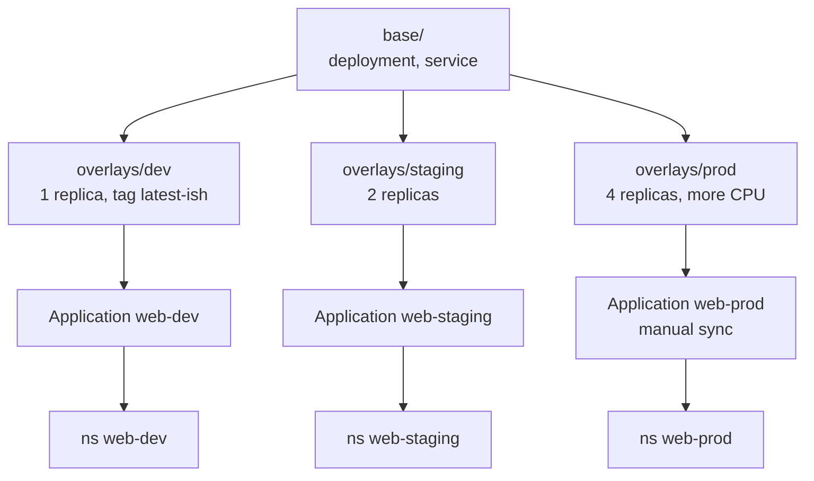
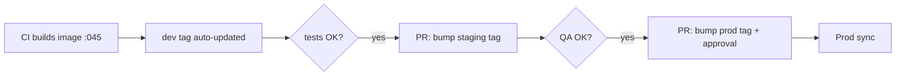

# 16 · Multi-environment (dev → staging → prod) with Kustomize

> ### 🟢 Simple version
> **In one line:** Same app, three environments, with small differences each.
> **Your goal:** base = common files, overlays = what differs in dev/staging/prod.
> **You will:** Edit overlay tag → Dev auto, prod needs a PR and a manual sync
> Need the full detail? Keep reading below. Otherwise jump to the files.


One set of manifests (**base**) + small per-environment changes (**overlays**).



## Promotion flow (safe real-time pattern)

- **dev:** Image Updater auto-commits.
- **staging/prod:** a **pull request** changes `newTag` in `overlays/<env>/kustomization.yaml` (reviewed, auditable, easy to revert).

## Files
- `base/` + `overlays/{dev,staging,prod}/` — the manifests
- [applications.yaml](applications.yaml) — the three Applications
- [multicluster-app.yaml](multicluster-app.yaml) — prod on a different cluster

Preview locally: `kubectl kustomize overlays/prod` (or `kustomize build`).
Layout in Git alternative: separate repo per environment, or branch per environment (not recommended: folders are simpler).


---

## Files in this guide

| # | File | Purpose | What you change |
|---|---|---|---|
| 1 | [`base/kustomization.yaml`](base/kustomization.yaml) | Base: list of shared files. | Add new shared files here. |
| 2 | [`base/deployment.yaml`](base/deployment.yaml) | Shared Deployment without environment-specific values. | Container, probes, resources. |
| 3 | [`base/service.yaml`](base/service.yaml) | Shared Service. | Ports. |
| 4 | [`overlays/dev/kustomization.yaml`](overlays/dev/kustomization.yaml) | Dev: namespace web-dev, 1 replica, image tag. | Tag and replicas. |
| 5 | [`overlays/staging/kustomization.yaml`](overlays/staging/kustomization.yaml) | Staging: namespace web-staging, 2 replicas. | Tag and replicas. |
| 6 | [`overlays/prod/kustomization.yaml`](overlays/prod/kustomization.yaml) | Prod: namespace web-prod, 4 replicas, more CPU. Change newTag via PR. | Tag, replicas, limits. |
| 7 | [`applications.yaml`](applications.yaml) | Three Applications (dev auto, staging auto, prod manual sync). | repoURL, project names, paths. |
| 8 | [`multicluster-app.yaml`](multicluster-app.yaml) | Prod deployed to a separate registered cluster. | Cluster name from argocd cluster list. |

---

## The files, with explanations

Every file has `#` comments on each important line. Replace anything in `<angle brackets>`.

### File 1: `base/kustomization.yaml`
**Purpose:** Base: list of shared files.  
**What you change:** Add new shared files here.  
**Apply:** `(used through overlays)`

```yaml
# ======================================================================
# FILE   : kustomization.yaml
# PURPOSE: Base: list of shared files.
# CHANGE : Add new shared files here.
# APPLY  : (used through overlays)
# ======================================================================
apiVersion: kustomize.config.k8s.io/v1beta1
kind: Kustomization
resources:
  - deployment.yaml
  - service.yaml
```

### File 2: `base/deployment.yaml`
**Purpose:** Shared Deployment without environment-specific values.  
**What you change:** Container, probes, resources.  
**Apply:** `(used through overlays)`

```yaml
# ======================================================================
# FILE   : deployment.yaml
# PURPOSE: Shared Deployment without environment-specific values.
# CHANGE : Container, probes, resources.
# APPLY  : (used through overlays)
# ======================================================================
apiVersion: apps/v1
kind: Deployment
metadata:
  name: web
spec:
  replicas: 1                         # overlays change this
  selector:
    matchLabels: {app: web}
  template:
    metadata:
      labels: {app: web}
    spec:
      containers:
        - name: web
          image: nginx                # tag set by each overlay
          ports: [{containerPort: 80}]
          resources:
            requests: {cpu: 50m, memory: 64Mi}
            limits: {cpu: 200m, memory: 128Mi}
```

### File 3: `base/service.yaml`
**Purpose:** Shared Service.  
**What you change:** Ports.  
**Apply:** `(used through overlays)`

```yaml
# ======================================================================
# FILE   : service.yaml
# PURPOSE: Shared Service.
# CHANGE : Ports.
# APPLY  : (used through overlays)
# ======================================================================
apiVersion: v1
kind: Service
metadata:
  name: web
spec:
  selector: {app: web}
  ports: [{port: 80, targetPort: 80}]
```

### File 4: `overlays/dev/kustomization.yaml`
**Purpose:** Dev: namespace web-dev, 1 replica, image tag.  
**What you change:** Tag and replicas.  
**Apply:** `kubectl kustomize overlays/dev`

```yaml
# ======================================================================
# FILE   : kustomization.yaml
# PURPOSE: Dev: namespace web-dev, 1 replica, image tag.
# CHANGE : Tag and replicas.
# APPLY  : kubectl kustomize overlays/dev
# ======================================================================
apiVersion: kustomize.config.k8s.io/v1beta1
kind: Kustomization
namespace: web-dev                        # every resource goes to this namespace
resources:
  - ../../base                        # start from the shared base
images:
  - name: nginx
    newTag: "1.27"                    # promote by changing THIS line (via PR for staging/prod)
patches:
  - target: {kind: Deployment, name: web}
    patch: |-
      - op: replace
        path: /spec/replicas
        value: 1
```

### File 5: `overlays/staging/kustomization.yaml`
**Purpose:** Staging: namespace web-staging, 2 replicas.  
**What you change:** Tag and replicas.  
**Apply:** `kubectl kustomize overlays/staging`

```yaml
# ======================================================================
# FILE   : kustomization.yaml
# PURPOSE: Staging: namespace web-staging, 2 replicas.
# CHANGE : Tag and replicas.
# APPLY  : kubectl kustomize overlays/staging
# ======================================================================
apiVersion: kustomize.config.k8s.io/v1beta1
kind: Kustomization
namespace: web-staging                        # every resource goes to this namespace
resources:
  - ../../base                        # start from the shared base
images:
  - name: nginx
    newTag: "1.27"                    # promote by changing THIS line (via PR for staging/prod)
patches:
  - target: {kind: Deployment, name: web}
    patch: |-
      - op: replace
        path: /spec/replicas
        value: 2
```

### File 6: `overlays/prod/kustomization.yaml`
**Purpose:** Prod: namespace web-prod, 4 replicas, more CPU. Change newTag via PR.  
**What you change:** Tag, replicas, limits.  
**Apply:** `kubectl kustomize overlays/prod`

```yaml
# ======================================================================
# FILE   : kustomization.yaml
# PURPOSE: Prod: namespace web-prod, 4 replicas, more CPU. Change newTag via PR.
# CHANGE : Tag, replicas, limits.
# APPLY  : kubectl kustomize overlays/prod
# ======================================================================
apiVersion: kustomize.config.k8s.io/v1beta1
kind: Kustomization
namespace: web-prod                        # every resource goes to this namespace
resources:
  - ../../base                        # start from the shared base
images:
  - name: nginx
    newTag: "1.26"                    # promote by changing THIS line (via PR for staging/prod)
patches:
  - target: {kind: Deployment, name: web}
    patch: |-
      - op: replace
        path: /spec/replicas
        value: 4
  - target: {kind: Deployment, name: web}
    patch: |-
      - op: replace
        path: /spec/template/spec/containers/0/resources/limits/cpu
        value: 500m                   # prod gets more CPU
```

### File 7: `applications.yaml`
**Purpose:** Three Applications (dev auto, staging auto, prod manual sync).  
**What you change:** repoURL, project names, paths.  
**Apply:** `kubectl apply -f applications.yaml`

```yaml
# ======================================================================
# FILE   : applications.yaml
# PURPOSE: Three Applications (dev auto, staging auto, prod manual sync).
# CHANGE : repoURL, project names, paths.
# APPLY  : kubectl apply -f applications.yaml
# ======================================================================
# Three Applications, one per environment. Same repo, different overlay folder.
apiVersion: argoproj.io/v1alpha1
kind: Application
metadata: {name: web-dev, namespace: argocd}
spec:
  project: myargoproject-dev
  source:
    repoURL: https://github.com/<org>/<gitops-repo>.git
    targetRevision: main
    path: 13_multi_environment/overlays/dev       # adjust to your repo path
  destination: {server: https://kubernetes.default.svc, namespace: web-dev}
  syncPolicy:
    automated: {prune: true, selfHeal: true}      # dev: fully automatic
    syncOptions: [CreateNamespace=true]
---
apiVersion: argoproj.io/v1alpha1
kind: Application
metadata: {name: web-staging, namespace: argocd}
spec:
  project: myargoproject-dev
  source:
    repoURL: https://github.com/<org>/<gitops-repo>.git
    targetRevision: main
    path: 13_multi_environment/overlays/staging
  destination: {server: https://kubernetes.default.svc, namespace: web-staging}
  syncPolicy:
    automated: {prune: true, selfHeal: true}
    syncOptions: [CreateNamespace=true]
---
apiVersion: argoproj.io/v1alpha1
kind: Application
metadata: {name: web-prod, namespace: argocd}
spec:
  project: myargoproject-prod
  source:
    repoURL: https://github.com/<org>/<gitops-repo>.git
    targetRevision: main
    path: 13_multi_environment/overlays/prod
  destination: {server: https://kubernetes.default.svc, namespace: web-prod}
  syncPolicy:                                     # prod: NO automated block = a human clicks Sync
    syncOptions: [CreateNamespace=true]
```

### File 8: `multicluster-app.yaml`
**Purpose:** Prod deployed to a separate registered cluster.  
**What you change:** Cluster name from argocd cluster list.  
**Apply:** `kubectl apply -f multicluster-app.yaml`

```yaml
# ======================================================================
# FILE   : multicluster-app.yaml
# PURPOSE: Prod deployed to a separate registered cluster.
# CHANGE : Cluster name from argocd cluster list.
# APPLY  : kubectl apply -f multicluster-app.yaml
# ======================================================================
# Prod deployed to a SEPARATE cluster.
# 1) Register it:   argocd cluster add <kube-context> --name prod-eks
# 2) Check name:    argocd cluster list
# 3) Allow it in the Project's destinations.
apiVersion: argoproj.io/v1alpha1
kind: Application
metadata: {name: web-prod-eks, namespace: argocd}
spec:
  project: myargoproject-prod
  source:
    repoURL: https://github.com/<org>/<gitops-repo>.git
    targetRevision: main
    path: 13_multi_environment/overlays/prod
  destination:
    name: prod-eks                    # cluster name from `argocd cluster list` (or use server: <url>)
    namespace: web-prod
  syncPolicy:
    syncOptions: [CreateNamespace=true]
```

---

## Apply and Verify

```bash
kubectl kustomize overlays/prod | head -40       # preview the final YAML
argocd app list
argocd app sync web-prod                           # prod is manual
```

---

## Troubleshooting

| Symptom | Likely cause | Fix |
|---|---|---|
| Wrong image in prod | newTag not promoted | Edit overlays/prod newTag via PR |
| Cluster not found | Not registered | argocd cluster add <context> --name prod-eks |

---

## Checklist

- [ ] Prod promoted only by PR
- [ ] Prod sync manual or windowed
- [ ] Base has no env-specific values
