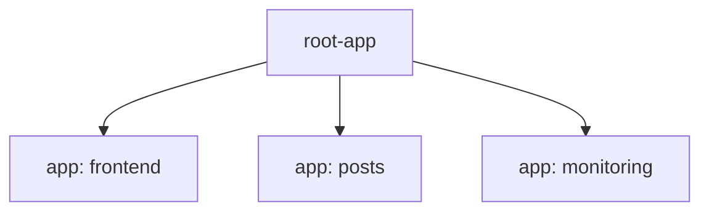

# 11 · Advanced (real-time production topics)

> ### 🟢 Simple version
> **In one line:** Extra tools for big setups: one app that creates all apps, safe releases, backups.
> **Your goal:** Use these after the basics work.
> **You will:** App-of-Apps → ApplicationSet → Canary/Blue-Green → Backup
> Need the full detail? Keep reading below. Otherwise jump to the files.


## 1. App-of-Apps — one root app creates all apps

[root-app.yaml](root-app.yaml) points at a Git folder full of Application YAMLs. Add a file = new app. Bootstrap a whole cluster with one `kubectl apply`.

## 2. ApplicationSet — one template, many apps/clusters
[applicationset.yaml](applicationset.yaml): generates one app per folder (`git` generator), per cluster (`clusters`) or per list item.

## 3. Multi-cluster
```bash
kubectl config get-contexts
argocd cluster add <context-name> --name prod-eks     # creates a ServiceAccount in the target cluster
argocd cluster list
```
Then use `destination.name: prod-eks` in the Application and allow it in the Project.

## 4. Progressive delivery — Argo Rollouts
Blue/Green or Canary instead of plain Deployments.
```bash
kubectl create namespace argo-rollouts
kubectl apply -n argo-rollouts -f https://github.com/argoproj/argo-rollouts/releases/latest/download/install.yaml
```
See [rollout-canary.yaml](rollout-canary.yaml) and [rollout-bluegreen.yaml](rollout-bluegreen.yaml).

| Strategy | Good for | Rollback speed | Extra cost |
|---|---|---|---|
| Canary | gradual, watch metrics | fast | low |
| Blue/Green | all-or-nothing switch, test first | instant | 2x pods during release |

Argo CD note: tell Argo CD to ignore the Rollout `replicas` if an HPA scales it. Commands: `kubectl argo rollouts get rollout web -w`, `... promote web`, `... abort web`.

## 5. Webhooks (instant sync instead of 3-min polling)
GitHub repo → Settings → Webhooks → Payload URL `https://argocd.example.com/api/webhook`, content type JSON, secret = value stored in `argocd-secret` key `webhook.github.secret`.

## 6. High availability & scaling
- Use HA install (`manifests/ha/install.yaml`) or Helm `replicas: 2-3` for server and repo-server.
- Many apps (>1000): shard controller (`controller.replicas` + `ARGOCD_CONTROLLER_REPLICAS`), raise `--status-processors` / `--operation-processors`.
- Set resource requests/limits on all Argo CD pods and use a PodDisruptionBudget.

## 7. Backup & disaster recovery
```bash
argocd admin export -n argocd > argocd-backup-$(date +%F).yaml     # apps, projects, settings
argocd admin import -n argocd - < argocd-backup-2026-01-01.yaml
```
Because everything is in Git, DR = install Argo CD + apply the root app. Also back up secrets (Sealed Secrets key!).

## 8. Secrets in GitOps (never plain text)
| Tool | Idea |
|---|---|
| **Sealed Secrets** | encrypt with `kubeseal`, commit the SealedSecret |
| **External Secrets Operator** | Git has a reference; value comes from AWS Secrets Manager |
| **SOPS + KSOPS** | encrypted files decrypted by Argo CD |

## 9. Upgrade Argo CD
Read release notes → `helm upgrade` one minor version at a time → check `argocd version` and app health. Test in a non-prod cluster first.


---

## Files in this guide

| # | File | Purpose | What you change |
|---|---|---|---|
| 1 | [`root-app.yaml`](root-app.yaml) | App-of-Apps: one app that creates all other Applications from a Git folder. | repoURL and path. |
| 2 | [`applicationset.yaml`](applicationset.yaml) | Generates one Application per folder in Git. | repo, folder pattern, project. |
| 3 | [`rollout-canary.yaml`](rollout-canary.yaml) | Canary release: 20% then 50% then 100% with pauses. | Image, steps. |
| 4 | [`rollout-bluegreen.yaml`](rollout-bluegreen.yaml) | Blue/Green: preview Service, manual promote. | Image, service names. |

---

## The files, with explanations

Every file has `#` comments on each important line. Replace anything in `<angle brackets>`.

### File 1: `root-app.yaml`
**Purpose:** App-of-Apps: one app that creates all other Applications from a Git folder.  
**What you change:** repoURL and path.  
**Apply:** `kubectl apply -f root-app.yaml`

```yaml
# ======================================================================
# FILE   : root-app.yaml
# PURPOSE: App-of-Apps: one app that creates all other Applications from a Git folder.
# CHANGE : repoURL and path.
# APPLY  : kubectl apply -f root-app.yaml
# ======================================================================
# The ONE app you apply by hand. It deploys every other Application from Git.
apiVersion: argoproj.io/v1alpha1
kind: Application
metadata:
  name: root-app
  namespace: argocd
  finalizers: [resources-finalizer.argocd.argoproj.io]
spec:
  project: default
  source:
    repoURL: https://github.com/<org>/<gitops-repo>.git
    targetRevision: main
    path: argocd/apps                   # folder holding Application YAMLs
    directory:
      recurse: true
  destination:
    server: https://kubernetes.default.svc
    namespace: argocd                   # child Applications are created here
  syncPolicy:
    automated: {prune: true, selfHeal: true}
```

### File 2: `applicationset.yaml`
**Purpose:** Generates one Application per folder in Git.  
**What you change:** repo, folder pattern, project.  
**Apply:** `kubectl apply -f applicationset.yaml`

```yaml
# ======================================================================
# FILE   : applicationset.yaml
# PURPOSE: Generates one Application per folder in Git.
# CHANGE : repo, folder pattern, project.
# APPLY  : kubectl apply -f applicationset.yaml
# ======================================================================
# Creates one Application for every folder under k8-manifest/apps/* in Git.
apiVersion: argoproj.io/v1alpha1
kind: ApplicationSet
metadata:
  name: all-apps
  namespace: argocd
spec:
  generators:
    - git:
        repoURL: https://github.com/<org>/<gitops-repo>.git
        revision: main
        directories:
          - path: k8-manifest/apps/*    # each sub-folder = one app
  template:
    metadata:
      name: "{{path.basename}}"         # folder name becomes app name
    spec:
      project: myargoproject-dev
      source:
        repoURL: https://github.com/<org>/<gitops-repo>.git
        targetRevision: main
        path: "{{path}}"
      destination:
        server: https://kubernetes.default.svc
        namespace: "{{path.basename}}-dev"
      syncPolicy:
        automated: {prune: true, selfHeal: true}
        syncOptions: [CreateNamespace=true]
# Other generators: list (fixed items), clusters (every registered cluster), matrix (combine two).
```

### File 3: `rollout-canary.yaml`
**Purpose:** Canary release: 20% then 50% then 100% with pauses.  
**What you change:** Image, steps.  
**Apply:** `kubectl apply -f rollout-canary.yaml`

```yaml
# ======================================================================
# FILE   : rollout-canary.yaml
# PURPOSE: Canary release: 20% then 50% then 100% with pauses.
# CHANGE : Image, steps.
# APPLY  : kubectl apply -f rollout-canary.yaml
# ======================================================================
# Canary release: 20% -> pause -> 50% -> pause -> 100%. Replaces a Deployment.
apiVersion: argoproj.io/v1alpha1
kind: Rollout
metadata:
  name: web
spec:
  replicas: 4
  selector:
    matchLabels: {app: web}
  template:
    metadata:
      labels: {app: web}
    spec:
      containers:
        - name: web
          image: nginx:1.27
          ports: [{containerPort: 80}]
  strategy:
    canary:
      steps:
        - setWeight: 20
        - pause: {duration: 2m}        # watch metrics/logs; or "pause: {}" = wait for manual promote
        - setWeight: 50
        - pause: {duration: 2m}
        # then 100% automatically. Abort = instant rollback to stable.
```

### File 4: `rollout-bluegreen.yaml`
**Purpose:** Blue/Green: preview Service, manual promote.  
**What you change:** Image, service names.  
**Apply:** `kubectl apply -f rollout-bluegreen.yaml`

```yaml
# ======================================================================
# FILE   : rollout-bluegreen.yaml
# PURPOSE: Blue/Green: preview Service, manual promote.
# CHANGE : Image, service names.
# APPLY  : kubectl apply -f rollout-bluegreen.yaml
# ======================================================================
# Blue/Green: new version (green) starts next to the live one (blue).
# Test it through the preview Service, then promote = instant switch. Abort = nothing changed.
apiVersion: argoproj.io/v1alpha1
kind: Rollout
metadata:
  name: web-bg
spec:
  replicas: 3
  selector:
    matchLabels: {app: web-bg}
  template:
    metadata:
      labels: {app: web-bg}
    spec:
      containers:
        - name: web
          image: nginx:1.27
          ports: [{containerPort: 80}]
  strategy:
    blueGreen:
      activeService: web-bg-active       # live traffic (must exist, see below)
      previewService: web-bg-preview     # test traffic to the new version
      autoPromotionEnabled: false        # a human promotes: kubectl argo rollouts promote web-bg
      scaleDownDelaySeconds: 300         # keep old pods 5 min for fast rollback
---
apiVersion: v1
kind: Service
metadata:
  name: web-bg-active
spec:
  selector: {app: web-bg}                # Rollouts adds a hash label to point at the right ReplicaSet
  ports: [{port: 80, targetPort: 80}]
---
apiVersion: v1
kind: Service
metadata:
  name: web-bg-preview
spec:
  selector: {app: web-bg}
  ports: [{port: 80, targetPort: 80}]
```

---

## Apply and Verify

```bash
kubectl argo rollouts get rollout web -w
kubectl argo rollouts promote web
kubectl argo rollouts abort web
argocd app list | grep root-app
```

---

## Troubleshooting

| Symptom | Likely cause | Fix |
|---|---|---|
| Rollout stuck paused | Waiting for manual promote | kubectl argo rollouts promote <name> |
| Apps not created | Wrong path in root app | Check directory.recurse and path |

---

## Checklist

- [ ] Rollouts plugin installed
- [ ] Backup scheduled (argocd admin export)
- [ ] HA replicas set
