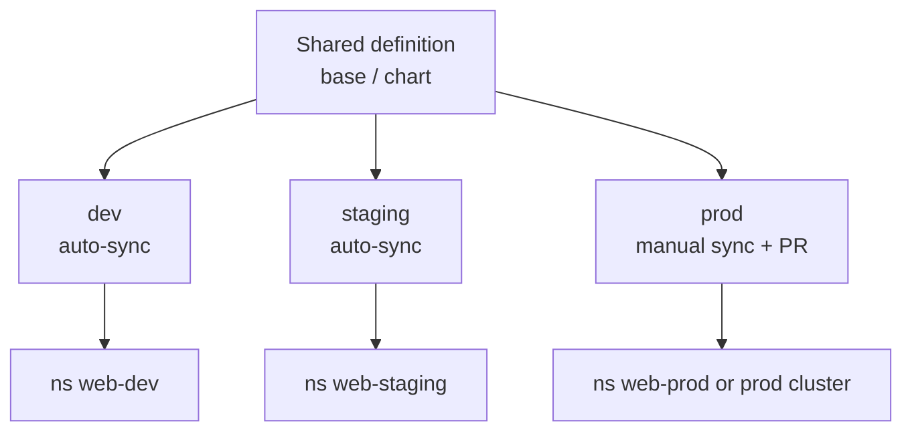
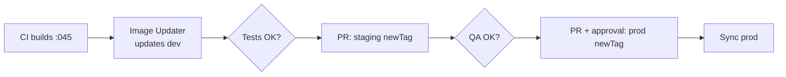

# 🧱 14 · Multi-environment (dev → staging → prod)

> [!TIP]
> Same app, three environments, **small differences** (replicas, tag, host). Promote by changing **one line in Git** through a pull request.

## 1. What & why
**Use case:** a build is tested automatically in dev, then in staging, then released to prod after approval.

## 2. Architecture



## 3. Key values
| Where | Key | Meaning |
|---|---|---|
| overlay `kustomization.yaml` | `namespace`, `images[].newTag`, `patches` | per-env namespace, **tag to promote**, replicas/limits |
| Helm | `valueFiles` order | later file wins |
| ApplicationSet | `generators.list.elements` | one entry per environment |
| Application | no `automated` block | manual sync gate for prod |
| Project | `destinations` | dev project cannot touch `*-prod` |

## 4. Choose your approach
| | A · Kustomize overlays | B · Helm values per env | C · ApplicationSet list | D · Branch per env |
|---|---|---|---|---|
| Layout | `base/` + `overlays/<env>` | `values.yaml` + `envs/<env>.yaml` | one generator for all envs | `dev`/`staging`/`main` branches |
| Promotion | edit `newTag` (PR) | edit `image.tag` (PR) | same as A/B | merge branch to branch |
| Drift risk | low | low | low | **high** (branches diverge) |
| Best for | plain YAML apps | Helm shops | many envs/clusters | not recommended |

## 5. Approach A · Kustomize overlays
<details>
<summary>📄 <b>kustomize/base/kustomization.yaml</b> — Base: shared file list.</summary>

```yaml
# ======================================================================
# FILE   : kustomize/base/kustomization.yaml
# PURPOSE: Base: shared file list.
# ======================================================================
apiVersion: kustomize.config.k8s.io/v1beta1
kind: Kustomization
resources:
  - deployment.yaml
  - service.yaml
```

</details>
<details>
<summary>📄 <b>kustomize/base/deployment.yaml</b> — Base Deployment without env values.</summary>

```yaml
# ======================================================================
# FILE   : kustomize/base/deployment.yaml
# PURPOSE: Base Deployment without env values.
# ======================================================================
apiVersion: apps/v1
kind: Deployment
metadata:
  name: web
spec:
  replicas: 1                         # overlays change this
  selector:
    matchLabels: {app: web}
  template:
    metadata:
      labels: {app: web}
    spec:
      containers:
        - name: web
          image: nginx                # tag set by each overlay
          ports: [{containerPort: 80}]
          resources:
            requests: {cpu: 50m, memory: 64Mi}
            limits: {cpu: 200m, memory: 128Mi}
```

</details>
<details>
<summary>📄 <b>kustomize/base/service.yaml</b> — Base Service.</summary>

```yaml
# ======================================================================
# FILE   : kustomize/base/service.yaml
# PURPOSE: Base Service.
# ======================================================================
apiVersion: v1
kind: Service
metadata:
  name: web
spec:
  selector: {app: web}
  ports: [{port: 80, targetPort: 80}]
```

</details>
<details>
<summary>📄 <b>kustomize/overlays/dev/kustomization.yaml</b> — dev: 1 replica, namespace web-dev.</summary>

```yaml
# ======================================================================
# FILE   : kustomize/overlays/dev/kustomization.yaml
# PURPOSE: dev: 1 replica, namespace web-dev.
# APPLY  : kubectl kustomize kustomize/overlays/dev
# ======================================================================
apiVersion: kustomize.config.k8s.io/v1beta1
kind: Kustomization
namespace: web-dev                        # every resource goes to this namespace
resources:
  - ../../base                        # start from the shared base
images:
  - name: nginx
    newTag: "1.27"                    # promote by changing THIS line (via PR for staging/prod)
patches:
  - target: {kind: Deployment, name: web}
    patch: |-
      - op: replace
        path: /spec/replicas
        value: 1
```

</details>
<details>
<summary>📄 <b>kustomize/overlays/staging/kustomization.yaml</b> — staging: 2 replicas.</summary>

```yaml
# ======================================================================
# FILE   : kustomize/overlays/staging/kustomization.yaml
# PURPOSE: staging: 2 replicas.
# APPLY  : kubectl kustomize kustomize/overlays/staging
# ======================================================================
apiVersion: kustomize.config.k8s.io/v1beta1
kind: Kustomization
namespace: web-staging                        # every resource goes to this namespace
resources:
  - ../../base                        # start from the shared base
images:
  - name: nginx
    newTag: "1.27"                    # promote by changing THIS line (via PR for staging/prod)
patches:
  - target: {kind: Deployment, name: web}
    patch: |-
      - op: replace
        path: /spec/replicas
        value: 2
```

</details>
<details>
<summary>📄 <b>kustomize/overlays/prod/kustomization.yaml</b> — prod: 4 replicas, more CPU. Promote by newTag.</summary>

```yaml
# ======================================================================
# FILE   : kustomize/overlays/prod/kustomization.yaml
# PURPOSE: prod: 4 replicas, more CPU. Promote by newTag.
# APPLY  : kubectl kustomize kustomize/overlays/prod
# ======================================================================
apiVersion: kustomize.config.k8s.io/v1beta1
kind: Kustomization
namespace: web-prod                        # every resource goes to this namespace
resources:
  - ../../base                        # start from the shared base
images:
  - name: nginx
    newTag: "1.26"                    # promote by changing THIS line (via PR for staging/prod)
patches:
  - target: {kind: Deployment, name: web}
    patch: |-
      - op: replace
        path: /spec/replicas
        value: 4
  - target: {kind: Deployment, name: web}
    patch: |-
      - op: replace
        path: /spec/template/spec/containers/0/resources/limits/cpu
        value: 500m                   # prod gets more CPU
```

</details>
<details>
<summary>📄 <b>app-kustomize-envs.yaml</b> — Three Applications: dev/staging auto, prod manual.</summary>

```yaml
# ======================================================================
# FILE   : app-kustomize-envs.yaml
# PURPOSE: Three Applications: dev/staging auto, prod manual.
# APPLY  : kubectl apply -f app-kustomize-envs.yaml
# ======================================================================
# APPROACH A: three Applications, one per Kustomize overlay.
apiVersion: argoproj.io/v1alpha1
kind: Application
metadata: {name: web-dev, namespace: argocd}
spec:
  project: myargoproject-dev
  source: {repoURL: "https://github.com/<org>/<gitops-repo>.git", targetRevision: main, path: k8-manifest/web/overlays/dev}
  destination: {server: "https://kubernetes.default.svc", namespace: web-dev}
  syncPolicy:
    automated: {prune: true, selfHeal: true}               # dev: fully automatic
    syncOptions: [CreateNamespace=true]
---
apiVersion: argoproj.io/v1alpha1
kind: Application
metadata: {name: web-staging, namespace: argocd}
spec:
  project: myargoproject-dev
  source: {repoURL: "https://github.com/<org>/<gitops-repo>.git", targetRevision: main, path: k8-manifest/web/overlays/staging}
  destination: {server: "https://kubernetes.default.svc", namespace: web-staging}
  syncPolicy:
    automated: {prune: true, selfHeal: true}
    syncOptions: [CreateNamespace=true]
---
apiVersion: argoproj.io/v1alpha1
kind: Application
metadata: {name: web-prod, namespace: argocd}
spec:
  project: myargoproject-prod
  source: {repoURL: "https://github.com/<org>/<gitops-repo>.git", targetRevision: main, path: k8-manifest/web/overlays/prod}
  destination: {server: "https://kubernetes.default.svc", namespace: web-prod}
  syncPolicy:                                              # prod: NO automated block = human presses Sync
    syncOptions: [CreateNamespace=true]
```

</details>

## 6. Approach B · Helm values per environment
<details>
<summary>📄 <b>helm/values.yaml</b> — Shared layer.</summary>

```yaml
# ======================================================================
# FILE   : helm/values.yaml
# PURPOSE: Shared layer.
# ======================================================================
# Shared Helm values (the chart defaults live in charts/web/values.yaml; this is the common layer)
replicaCount: 1
image: {repository: nginx, tag: "1.27"}
resources:
  requests: {cpu: 50m, memory: 64Mi}
  limits: {cpu: 200m, memory: 128Mi}
```

</details>
<details>
<summary>📄 <b>helm/envs/dev.yaml</b> — dev overrides.</summary>

```yaml
# ======================================================================
# FILE   : helm/envs/dev.yaml
# PURPOSE: dev overrides.
# ======================================================================
replicaCount: 1                      # dev: small
ingress: {host: web-dev.example.com}
```

</details>
<details>
<summary>📄 <b>helm/envs/prod.yaml</b> — prod overrides and image tag.</summary>

```yaml
# ======================================================================
# FILE   : helm/envs/prod.yaml
# PURPOSE: prod overrides and image tag.
# ======================================================================
replicaCount: 4                      # prod: bigger
image: {tag: "1.26"}                 # promote by editing this line via PR
resources:
  limits: {cpu: 500m, memory: 256Mi}
ingress: {host: web.example.com}
```

</details>
<details>
<summary>📄 <b>app-helm-envs.yaml</b> — Application using shared + env value files.</summary>

```yaml
# ======================================================================
# FILE   : app-helm-envs.yaml
# PURPOSE: Application using shared + env value files.
# APPLY  : kubectl apply -f app-helm-envs.yaml
# ======================================================================
# APPROACH B: ONE Helm chart, a values file per environment.
apiVersion: argoproj.io/v1alpha1
kind: Application
metadata: {name: web-helm-prod, namespace: argocd}
spec:
  project: myargoproject-prod
  source:
    repoURL: https://github.com/<org>/<gitops-repo>.git
    targetRevision: main
    path: charts/web
    helm:
      valueFiles:
        - ../../envs/values.yaml       # shared
        - ../../envs/prod.yaml         # env specific (last wins)
  destination: {server: "https://kubernetes.default.svc", namespace: web-prod}
  syncPolicy:
    syncOptions: [CreateNamespace=true]
```

</details>

## 7. Approach C · ApplicationSet (list generator)
<details>
<summary>📄 <b>applicationset-environments.yaml</b> — One definition creates all environments; prod stays manual.</summary>

```yaml
# ======================================================================
# FILE   : applicationset-environments.yaml
# PURPOSE: One definition creates all environments; prod stays manual.
# APPLY  : kubectl apply -f applicationset-environments.yaml
# ======================================================================
# APPROACH C: ONE ApplicationSet creates dev, staging and prod from a list. Add an environment = add a list line.
apiVersion: argoproj.io/v1alpha1
kind: ApplicationSet
metadata: {name: web-envs, namespace: argocd}
spec:
  goTemplate: true
  generators:
    - list:
        elements:
          - {env: dev,     project: myargoproject-dev,  cluster: https://kubernetes.default.svc, auto: "true"}
          - {env: staging, project: myargoproject-dev,  cluster: https://kubernetes.default.svc, auto: "true"}
          - {env: prod,    project: myargoproject-prod, cluster: https://kubernetes.default.svc, auto: "false"}
  template:
    metadata:
      name: "web-{{.env}}"
    spec:
      project: "{{.project}}"
      source:
        repoURL: https://github.com/<org>/<gitops-repo>.git
        targetRevision: main
        path: "k8-manifest/web/overlays/{{.env}}"
      destination: {server: "{{.cluster}}", namespace: "web-{{.env}}"}
      syncPolicy:
        syncOptions: [CreateNamespace=true]
  # Make prod manual: ApplicationSet cannot conditionally omit 'automated' simply, so use templatePatch:
  templatePatch: |
    {{- if eq .auto "true" }}
    spec:
      syncPolicy:
        automated: {prune: true, selfHeal: true}
    {{- end }}
```

</details>

## 8. Promotion by pull request
<details>
<summary>📄 <b>promotion-pr.sh</b> — Change one line, open a PR, approve, sync.</summary>

```bash
#!/bin/sh
# ======================================================================
# FILE   : promotion-pr.sh
# PURPOSE: Change one line, open a PR, approve, sync.
# APPLY  : sh promotion-pr.sh
# ======================================================================
# PROMOTION = a pull request that changes ONE line (the image tag) in the next environment.
# dev is updated by Image Updater (folder 08). Staging/prod are promoted by humans or a pipeline:
git checkout -b promote-prod-007
sed -i 's/newTag: ".*"/newTag: "007"/' k8-manifest/web/overlays/prod/kustomization.yaml     # Helm: edit envs/prod.yaml image.tag
git commit -am "promote web 007 to prod" && git push -u origin promote-prod-007
gh pr create --title "Promote web 007 to prod" --body "Verified in staging" --base main        # review + approval -> merge -> Sync prod
```

</details>

## 9. Prod on a separate cluster
<details>
<summary>📄 <b>app-multicluster.yaml</b> — Prod deployed to a registered remote cluster.</summary>

```yaml
# ======================================================================
# FILE   : app-multicluster.yaml
# PURPOSE: Prod deployed to a registered remote cluster.
# APPLY  : kubectl apply -f app-multicluster.yaml
# ======================================================================
# Prod deployed to a SEPARATE cluster.
# 1) Register it:   argocd cluster add <kube-context> --name prod-eks
# 2) Check name:    argocd cluster list
# 3) Allow it in the Project's destinations.
apiVersion: argoproj.io/v1alpha1
kind: Application
metadata: {name: web-prod-eks, namespace: argocd}
spec:
  project: myargoproject-prod
  source:
    repoURL: https://github.com/<org>/<gitops-repo>.git
    targetRevision: main
    path: 13_multi_environment/overlays/prod
  destination:
    name: prod-eks                    # cluster name from `argocd cluster list` (or use server: <url>)
    namespace: web-prod
  syncPolicy:
    syncOptions: [CreateNamespace=true]
```

</details>

## 10. Verify
```bash
kubectl kustomize kustomize/overlays/prod | head -40     # preview final YAML
argocd app list
argocd app sync web-prod                                 # prod is manual
```

## 11. Troubleshooting
| Symptom | Cause | Fix |
|---|---|---|
| Wrong image in prod | tag not promoted | PR changing prod `newTag` |
| Overlay path not found | wrong `path` | check repo layout |
| Cluster not found | not registered | [06](../06_clusters/README.md) |
| ApplicationSet creates nothing | generator empty / template error | `kubectl -n argocd describe applicationset web-envs` |

## 12. Checklist
- [ ] Prod promoted only by approved PR · [ ] prod manual or window · [ ] base has no env-specific values · [ ] separate projects for dev and prod
