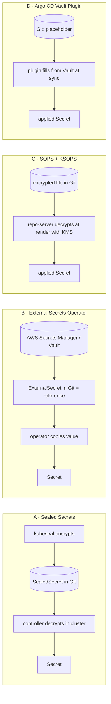
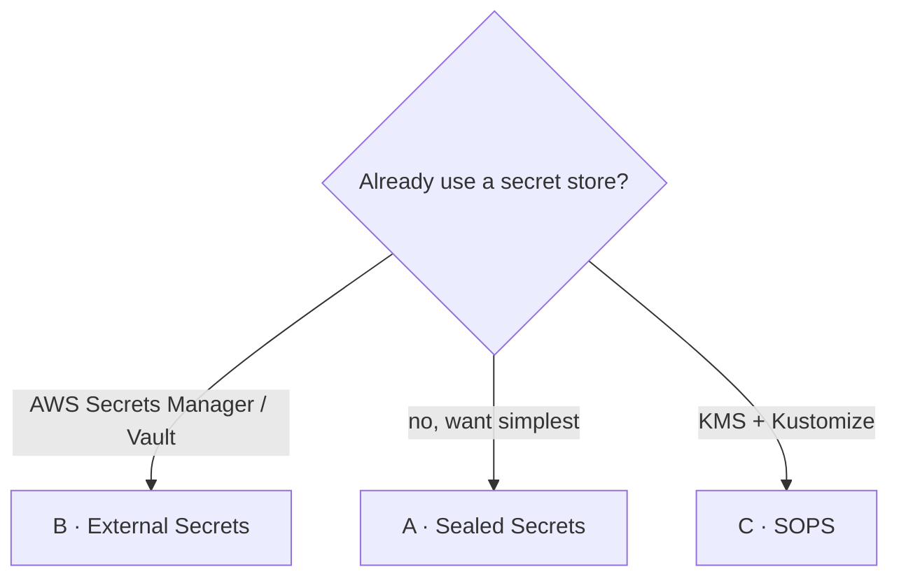

# 🗝️ 15 · Secrets Management

> [!WARNING]
> **Never commit plain secrets (passwords, tokens, AWS keys, SSO keys) to Git.** Git history is forever. Anything pasted in chat or committed must be revoked.

## 1. What & why
GitOps stores everything in Git, but secrets cannot be plain text. You store them **encrypted** or as **references** to a secret store.

## 2. Architecture


## 3. Choose your approach
| | A · Sealed Secrets | B · External Secrets | C · SOPS + KSOPS | D · Vault plugin |
|---|---|---|---|---|
| Real value lives | encrypted in Git | AWS SM / Vault / GCP | encrypted in Git | Vault / AWS SM |
| Rotation | re-seal + commit | change in store, auto refresh | re-encrypt + commit | change in store |
| Needs | controller | operator + IAM (IRSA) | KMS key + plugin | plugin + Vault |
| Works with Argo CD natively | ✅ (just a CRD) | ✅ (just a CRD) | needs repo-server setup | needs repo-server setup |
| Best for | simple, small teams | **AWS/EKS teams (recommended)** | KMS-centric teams | Vault shops |



## 4. Key values
| Item | Meaning |
|---|---|
| `SealedSecret.spec.encryptedData` | ciphertext, safe in Git; bound to cluster + namespace + name |
| `ExternalSecret.spec.refreshInterval` | how often the value is re-read |
| `ExternalSecret.spec.secretStoreRef` | which store |
| `ClusterSecretStore.spec.provider.aws` | AWS service/region/auth (IRSA) |
| `.sops.yaml` `kms` + `encrypted_regex` | which key / which fields |
| `avp.kubernetes.io/path` | secret location for the plugin |

## 5. Approach A · Sealed Secrets
<details>
<summary>📄 <b>sealed-secrets-howto.sh</b> — Install controller, kubeseal, back up the key.</summary>

```bash
#!/bin/bash
# ======================================================================
# FILE   : sealed-secret-howto.sh
# PURPOSE: Commands to install and use Sealed Secrets.
# CHANGE : Secret names and values (locally only).
# APPLY  : run the commands step by step
# ======================================================================
# HOW TO USE SEALED SECRETS (commands, run them one by one; this is a guide, not a script to run blindly)
# 1) Install the controller in the cluster
helm repo add sealed-secrets https://bitnami-labs.github.io/sealed-secrets
helm install sealed-secrets sealed-secrets/sealed-secrets -n kube-system

# 2) Install the kubeseal CLI on your laptop (see https://github.com/bitnami-labs/sealed-secrets/releases)

# 3) Make a normal Secret file locally (DO NOT commit it) ...
kubectl create secret generic repo-gitops -n argocd \
  --from-literal=username=<user> --from-literal=password=<token> \
  --dry-run=client -o yaml > /tmp/secret.yaml

# 4) ... encrypt it. The output is SAFE to commit to Git
kubeseal --format yaml < /tmp/secret.yaml > sealed-repo-gitops.yaml
rm /tmp/secret.yaml

# 5) Commit sealed-repo-gitops.yaml. The controller creates the real Secret in the cluster.
# IMPORTANT: back up the controller key, otherwise you cannot decrypt after a rebuild:
kubectl -n kube-system get secret -l sealedsecrets.bitnami.com/sealed-secrets-key -o yaml > sealed-secrets-key-BACKUP.yaml   # store offline!
```

</details>
<details>
<summary>📄 <b>sealed-secret-example.yaml</b> — What you commit to Git.</summary>

```yaml
# ======================================================================
# FILE   : sealed-secret-example.yaml
# PURPOSE: What you commit to Git.
# APPLY  : kubectl apply -f sealed-secret-example.yaml
# ======================================================================
# APPROACH A result: what you commit to Git (safe, encrypted for ONE cluster). The controller turns it into a real Secret.
apiVersion: bitnami.com/v1alpha1
kind: SealedSecret
metadata:
  name: repo-gitops
  namespace: argocd
spec:
  encryptedData:
    username: AgBy3i4OJSWK+PiTySYZZA9rO43cGDEq...      # produced by kubeseal
    password: AgBy3i4OJSWK+PiTySYZZA9rO43cGDEq...
  template:
    metadata:
      name: repo-gitops
      namespace: argocd
      labels:
        argocd.argoproj.io/secret-type: repository       # label on the FINAL secret
    type: Opaque
```

</details>

## 6. Approach B · External Secrets Operator (AWS Secrets Manager)
<details>
<summary>📄 <b>external-secrets-aws.yaml</b> — ClusterSecretStore with IRSA + ExternalSecret creating an Argo CD repo Secret.</summary>

```yaml
# ======================================================================
# FILE   : external-secrets-aws.yaml
# PURPOSE: ClusterSecretStore with IRSA + ExternalSecret creating an Argo CD repo Secret.
# APPLY  : kubectl apply -f external-secrets-aws.yaml
# ======================================================================
# EXTERNAL SECRETS OPERATOR + AWS SECRETS MANAGER
# Install: helm repo add external-secrets https://charts.external-secrets.io
#          helm install external-secrets external-secrets/external-secrets -n external-secrets --create-namespace
# AWS side: create a secret named  argocd/github-repo  with JSON {"username":"..","password":".."}
# Give the operator an IAM role (IRSA) with secretsmanager:GetSecretValue on that secret.

# 1) SecretStore: HOW to reach AWS Secrets Manager
apiVersion: external-secrets.io/v1beta1
kind: ClusterSecretStore
metadata:
  name: aws-secrets-manager           # referenced by ExternalSecret below
spec:
  provider:
    aws:
      service: SecretsManager
      region: ap-south-1              # region where the secret lives
      auth:
        jwt:
          serviceAccountRef:          # uses IRSA: the ServiceAccount is annotated with the IAM role
            name: external-secrets
            namespace: external-secrets
---
# 2) ExternalSecret: WHAT to copy and WHAT Kubernetes Secret to create
apiVersion: external-secrets.io/v1beta1
kind: ExternalSecret
metadata:
  name: repo-gitops
  namespace: argocd
spec:
  refreshInterval: 1h                 # re-read AWS every hour (rotation is automatic)
  secretStoreRef:
    kind: ClusterSecretStore
    name: aws-secrets-manager
  target:
    name: repo-gitops                 # the Kubernetes Secret that will be created
    creationPolicy: Owner
    template:
      metadata:
        labels:
          argocd.argoproj.io/secret-type: repository   # makes Argo CD treat it as a repo credential
      data:
        type: git
        url: https://github.com/<org>/<gitops-repo>.git
        username: "{{ .username }}"   # filled from AWS
        password: "{{ .password }}"
  data:
    - secretKey: username
      remoteRef: {key: argocd/github-repo, property: username}
    - secretKey: password
      remoteRef: {key: argocd/github-repo, property: password}
```

</details>

## 7. Approach C · SOPS + KSOPS
<details>
<summary>📄 <b>sops-ksops.yaml</b> — Encrypt with KMS, decrypt in repo-server.</summary>

```yaml
# ======================================================================
# FILE   : sops-ksops.yaml
# PURPOSE: Encrypt with KMS, decrypt in repo-server.
# APPLY  : follow comments
# ======================================================================
# APPROACH C: SOPS (+ AWS KMS) with KSOPS in Kustomize. Secrets are encrypted FILES in Git; Argo CD decrypts at render time.
# 1) .sops.yaml in the repo root:
#      creation_rules:
#        - path_regex: .*secret.*\.yaml$
#          encrypted_regex: ^(data|stringData)$
#          kms: arn:aws:kms:ap-south-1:<ACCOUNT_ID>:key/<KEY_ID>
# 2) sops --encrypt --in-place secret.yaml        (Git now holds ciphertext)
# 3) Argo CD repo-server needs the KSOPS plugin/binary and IAM permission kms:Decrypt (IRSA).
# 4) In the app folder, kustomization.yaml:
apiVersion: viaduct.ai/v1
kind: ksops
metadata:
  name: secret-generator
  annotations:
    config.kubernetes.io/function: |
      exec:
        path: ksops
files:
  - ./secret.enc.yaml                 # the SOPS-encrypted Secret
---
# and in kustomization.yaml:
#   generators:
#     - secret-generator.yaml
```

</details>

## 8. Approach D · Vault plugin
<details>
<summary>📄 <b>argocd-vault-plugin-note.yaml</b> — Placeholders filled at sync time.</summary>

```yaml
# ======================================================================
# FILE   : argocd-vault-plugin-note.yaml
# PURPOSE: Placeholders filled at sync time.
# APPLY  : follow comments
# ======================================================================
# APPROACH D: HashiCorp Vault / AWS Secrets Manager placeholders rendered by the argocd-vault-plugin (AVP) at sync time.
# Manifest in Git contains only a PLACEHOLDER; AVP (run as a config-management plugin in repo-server) fills the real value.
apiVersion: v1
kind: Secret
metadata:
  name: db-credentials
  namespace: web-prod
  annotations:
    avp.kubernetes.io/path: "secret/data/web/prod"       # Vault path
type: Opaque
stringData:
  password: <password>                                   # replaced by AVP from Vault key "password"
# AWS Secrets Manager form:  avp.kubernetes.io/path: "web/prod/db"  and  password: <password>
# The Application uses:  source.plugin.name: argocd-vault-plugin   (plugin installed as a sidecar of repo-server)
```

</details>

## 9. What must be protected in THIS guide
| Secret | File | Use |
|---|---|---|
| GitHub token / SSH key / App key | [05](../05_repositories/README.md) | B (External Secrets) or A |
| Git write token for Image Updater | [08](../08_image_updater/README.md) | B or A |
| AWS keys (if you use keys) | [08](../08_image_updater/README.md) | prefer IRSA: no key at all |
| SSO client secrets, Google SA key | [11](../11_authentication_sso/README.md) | B or A |
| Notification tokens | [09](../09_notifications/README.md) | B or A |

## 10. Troubleshooting
| Symptom | Cause | Fix |
|---|---|---|
| SealedSecret not decrypting | wrong cluster/namespace/name or lost key | re-seal for the target; restore key backup |
| ExternalSecret `SecretSyncedError` | IAM role cannot read secret | fix IRSA policy |
| KSOPS error in repo-server | plugin/KMS permission missing | install KSOPS, grant `kms:Decrypt` |
| Secret ignored by Argo CD | label missing in `template.metadata.labels` | add `secret-type` label to the final Secret |

## 11. Checklist
- [ ] No plaintext secret in Git history · [ ] key backup stored offline · [ ] rotation plan · [ ] secrets per environment · [ ] one approach used everywhere
