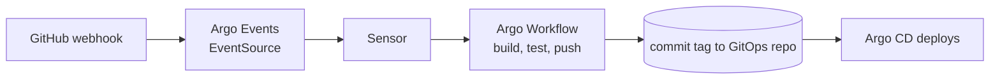

# 17 · Argo Workflows & Argo Events (optional, CI-style automation)

> ### 🟢 Simple version
> **In one line:** Optional. Run build or test jobs inside Kubernetes.
> **Your goal:** You can skip this because Jenkins already does CI.
> **You will:** Install → Run hello-world
> Need the full detail? Keep reading below. Otherwise jump to the files.


Argo CD = **deploy**. Workflows = **run jobs** (build, test, migrate). Events = **trigger** on webhooks/queues.



## Install (lab)
```bash
kubectl create namespace argo
kubectl apply -n argo -f https://github.com/argoproj/argo-workflows/releases/latest/download/quick-start-minimal.yaml
kubectl -n argo port-forward svc/argo-server 2746:2746          # https://localhost:2746

kubectl create namespace argo-events
kubectl apply -f https://github.com/argoproj/argo-events/releases/latest/download/install.yaml
```
For production pin versions instead of `latest` and secure the server with SSO.

## Commands
```bash
argo submit -n argo --watch hello-world.yaml
argo list -n argo
argo logs -n argo @latest
argo retry -n argo <name>
argo delete -n argo --all
```
Files: [hello-world.yaml](hello-world.yaml) · [dag-example.yaml](dag-example.yaml) · [cron-workflow.yaml](cron-workflow.yaml)

If you already use Jenkins for CI (as in your setup) you can skip this folder; it is here for completeness.


---

## Files in this guide

| # | File | Purpose | What you change |
|---|---|---|---|
| 1 | [`hello-world.yaml`](hello-world.yaml) | First Argo Workflow: prints a message. | Nothing. |
| 2 | [`dag-example.yaml`](dag-example.yaml) | Parallel steps with dependencies. | Tasks and images. |
| 3 | [`cron-workflow.yaml`](cron-workflow.yaml) | Scheduled job at 02:00 daily. | Schedule, timezone. |

---

## The files, with explanations

Every file has `#` comments on each important line. Replace anything in `<angle brackets>`.

### File 1: `hello-world.yaml`
**Purpose:** First Argo Workflow: prints a message.  
**What you change:** Nothing.  
**Apply:** `argo submit -n argo --watch hello-world.yaml`

```yaml
# ======================================================================
# FILE   : hello-world.yaml
# PURPOSE: First Argo Workflow: prints a message.
# CHANGE : Nothing.
# APPLY  : argo submit -n argo --watch hello-world.yaml
# ======================================================================
apiVersion: argoproj.io/v1alpha1
kind: Workflow
metadata:
  generateName: hello-world-        # unique name each run
spec:
  entrypoint: say
  templates:
    - name: say
      container:
        image: alpine:3.20
        command: [echo]
        args: ["hello from argo workflows"]
```

### File 2: `dag-example.yaml`
**Purpose:** Parallel steps with dependencies.  
**What you change:** Tasks and images.  
**Apply:** `argo submit -n argo --watch dag-example.yaml`

```yaml
# ======================================================================
# FILE   : dag-example.yaml
# PURPOSE: Parallel steps with dependencies.
# CHANGE : Tasks and images.
# APPLY  : argo submit -n argo --watch dag-example.yaml
# ======================================================================
# DAG: build first, then test and lint in parallel, then publish.
apiVersion: argoproj.io/v1alpha1
kind: Workflow
metadata:
  generateName: dag-
spec:
  entrypoint: main
  templates:
    - name: main
      dag:
        tasks:
          - {name: build,   template: step, arguments: {parameters: [{name: msg, value: build}]}}
          - {name: test,    template: step, dependencies: [build], arguments: {parameters: [{name: msg, value: test}]}}
          - {name: lint,    template: step, dependencies: [build], arguments: {parameters: [{name: msg, value: lint}]}}
          - {name: publish, template: step, dependencies: [test, lint], arguments: {parameters: [{name: msg, value: publish}]}}
    - name: step
      inputs:
        parameters: [{name: msg}]
      container:
        image: alpine:3.20
        command: [echo]
        args: ["{{inputs.parameters.msg}}"]
```

### File 3: `cron-workflow.yaml`
**Purpose:** Scheduled job at 02:00 daily.  
**What you change:** Schedule, timezone.  
**Apply:** `kubectl apply -n argo -f cron-workflow.yaml`

```yaml
# ======================================================================
# FILE   : cron-workflow.yaml
# PURPOSE: Scheduled job at 02:00 daily.
# CHANGE : Schedule, timezone.
# APPLY  : kubectl apply -n argo -f cron-workflow.yaml
# ======================================================================
apiVersion: argoproj.io/v1alpha1
kind: CronWorkflow
metadata:
  name: nightly-job
spec:
  schedule: "0 2 * * *"               # every day 02:00
  timezone: Asia/Kolkata
  concurrencyPolicy: Forbid           # do not start if the last run is still going
  workflowSpec:
    entrypoint: job
    templates:
      - name: job
        container:
          image: alpine:3.20
          command: [sh, -c]
          args: ["echo nightly cleanup"]
```

---

## Apply and Verify

```bash
argo list -n argo
argo logs -n argo @latest
```

---

## Troubleshooting

| Symptom | Likely cause | Fix |
|---|---|---|
| Workflow Pending | No permissions/ServiceAccount | Use the quick-start default service account |

---

## Checklist

- [ ] Versions pinned in production
- [ ] UI secured with SSO
