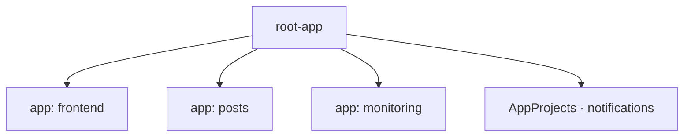
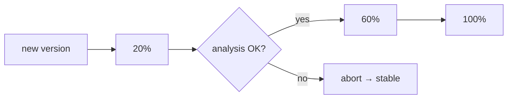

# 🚀 16 · Advanced & Production Operations

> [!TIP]
> Use these once the basics work: bootstrap everything from one app, scale to fleets, release safely, recover from disaster.

## 1. Topics at a glance
| Topic | Problem it solves | Approaches |
|---|---|---|
| App-of-Apps | Bootstrap a whole cluster with one command | root Application |
| ApplicationSet | Generate many apps/clusters from one template | git · clusters · matrix · pull request · list |
| Progressive delivery | Safer releases | canary · blue/green · analysis (auto-rollback) |
| Scale & HA | Thousands of apps | sharding · HPA · tuning |
| Backup & DR | Recover quickly | export/import · rebuild from Git |
| Upgrades | Stay current safely | Helm · manifest · GitOps |
| Customization | Fewer false OutOfSync | ignoreDifferences · Lua health · exclusions |

## 2. App-of-Apps

Add a YAML file to `argocd/apps/` and a new app appears. A whole cluster is rebuilt with `kubectl apply -f root-app.yaml`.
<details>
<summary>📄 <b>root-app.yaml</b> — The one Application you apply by hand.</summary>

```yaml
# ======================================================================
# FILE   : root-app.yaml
# PURPOSE: The one Application you apply by hand.
# APPLY  : kubectl apply -f root-app.yaml
# ======================================================================
# The ONE app you apply by hand. It deploys every other Application from Git.
apiVersion: argoproj.io/v1alpha1
kind: Application
metadata:
  name: root-app
  namespace: argocd
  finalizers: [resources-finalizer.argocd.argoproj.io]
spec:
  project: default
  source:
    repoURL: https://github.com/<org>/<gitops-repo>.git
    targetRevision: main
    path: argocd/apps                   # folder holding Application YAMLs
    directory:
      recurse: true
  destination:
    server: https://kubernetes.default.svc
    namespace: argocd                   # child Applications are created here
  syncPolicy:
    automated: {prune: true, selfHeal: true}
```

</details>

## 3. ApplicationSet generators
| Generator | Creates one app per | Use for |
|---|---|---|
| `list` | list item | few fixed environments |
| `git` directories / files | folder / config file | new folder = new app |
| `clusters` | registered cluster | platform add-ons on every cluster |
| `matrix` | combination of two generators | every app × every cluster |
| `pullRequest` | open PR | preview environments |

<details>
<summary>📄 <b>applicationset-generators.yaml</b> — git, clusters, matrix, pull-request generators.</summary>

```yaml
# ======================================================================
# FILE   : applicationset-generators.yaml
# PURPOSE: git, clusters, matrix, pull-request generators.
# APPLY  : kubectl apply -f applicationset-generators.yaml
# ======================================================================
# APPLICATIONSET GENERATORS: how one template becomes many Applications. Pick the generator that matches your layout.
# 1) git DIRECTORIES: one app per folder
apiVersion: argoproj.io/v1alpha1
kind: ApplicationSet
metadata: {name: apps-by-folder, namespace: argocd}
spec:
  generators:
    - git:
        repoURL: https://github.com/<org>/<gitops-repo>.git
        revision: main
        directories: [{path: "k8-manifest/apps/*"}]
  template:
    metadata: {name: "{{path.basename}}"}
    spec:
      project: myargoproject-dev
      source: {repoURL: "https://github.com/<org>/<gitops-repo>.git", targetRevision: main, path: "{{path}}"}
      destination: {server: "https://kubernetes.default.svc", namespace: "{{path.basename}}"}
      syncPolicy: {automated: {prune: true, selfHeal: true}, syncOptions: [CreateNamespace=true]}
---
# 2) CLUSTERS: one app per registered cluster (label selected) e.g. install monitoring everywhere
apiVersion: argoproj.io/v1alpha1
kind: ApplicationSet
metadata: {name: monitoring-everywhere, namespace: argocd}
spec:
  generators:
    - clusters:
        selector: {matchLabels: {env: prod}}          # label the cluster Secret with env=prod
  template:
    metadata: {name: "monitoring-{{name}}"}
    spec:
      project: default
      source: {repoURL: "https://github.com/<org>/<gitops-repo>.git", targetRevision: main, path: platform/monitoring}
      destination: {server: "{{server}}", namespace: monitoring}
      syncPolicy: {automated: {selfHeal: true}, syncOptions: [CreateNamespace=true]}
---
# 3) MATRIX: combine generators (every folder x every cluster)
apiVersion: argoproj.io/v1alpha1
kind: ApplicationSet
metadata: {name: apps-x-clusters, namespace: argocd}
spec:
  generators:
    - matrix:
        generators:
          - git: {repoURL: "https://github.com/<org>/<gitops-repo>.git", revision: main, directories: [{path: "k8-manifest/apps/*"}]}
          - clusters: {}
  template:
    metadata: {name: "{{path.basename}}-{{name}}"}
    spec:
      project: default
      source: {repoURL: "https://github.com/<org>/<gitops-repo>.git", targetRevision: main, path: "{{path}}"}
      destination: {server: "{{server}}", namespace: "{{path.basename}}"}
---
# 4) PULL REQUEST: a preview environment per open PR (deleted when the PR closes)
apiVersion: argoproj.io/v1alpha1
kind: ApplicationSet
metadata: {name: pr-previews, namespace: argocd}
spec:
  generators:
    - pullRequest:
        github:
          owner: <org>
          repo: <app-repo>
          tokenRef: {secretName: github-token, key: token}
        requeueAfterSeconds: 120
  template:
    metadata: {name: "preview-{{number}}"}
    spec:
      project: myargoproject-dev
      source: {repoURL: "https://github.com/<org>/<app-repo>.git", targetRevision: "{{head_sha}}", path: deploy}
      destination: {server: "https://kubernetes.default.svc", namespace: "preview-{{number}}"}
      syncPolicy: {automated: {prune: true}, syncOptions: [CreateNamespace=true]}
```

</details>

## 4. Progressive delivery (Argo Rollouts)
```bash
kubectl create namespace argo-rollouts
kubectl apply -n argo-rollouts -f https://github.com/argoproj/argo-rollouts/releases/latest/download/install.yaml
# CLI plugin: https://argo-rollouts.readthedocs.io/en/stable/installation/#kubectl-plugin-installation
kubectl argo rollouts get rollout web -w ; kubectl argo rollouts promote web ; kubectl argo rollouts abort web
```
| Strategy | Good for | Rollback | Extra cost |
|---|---|---|---|
| Canary | gradual with metrics | abort = instant | low |
| Blue/Green | switch all at once after testing | instant | 2× pods during release |
| Canary + analysis | **automatic** rollback on bad metrics | automatic | needs Prometheus |


<details>
<summary>📄 <b>rollout-canary.yaml</b> — Canary 20% → 50% → 100% with pauses.</summary>

```yaml
# ======================================================================
# FILE   : rollout-canary.yaml
# PURPOSE: Canary 20% → 50% → 100% with pauses.
# APPLY  : kubectl apply -f rollout-canary.yaml
# ======================================================================
# Canary release: 20% -> pause -> 50% -> pause -> 100%. Replaces a Deployment.
apiVersion: argoproj.io/v1alpha1
kind: Rollout
metadata:
  name: web
spec:
  replicas: 4
  selector:
    matchLabels: {app: web}
  template:
    metadata:
      labels: {app: web}
    spec:
      containers:
        - name: web
          image: nginx:1.27
          ports: [{containerPort: 80}]
  strategy:
    canary:
      steps:
        - setWeight: 20
        - pause: {duration: 2m}        # watch metrics/logs; or "pause: {}" = wait for manual promote
        - setWeight: 50
        - pause: {duration: 2m}
        # then 100% automatically. Abort = instant rollback to stable.
```

</details>
<details>
<summary>📄 <b>rollout-bluegreen.yaml</b> — Blue/Green with preview Service and manual promote.</summary>

```yaml
# ======================================================================
# FILE   : rollout-bluegreen.yaml
# PURPOSE: Blue/Green with preview Service and manual promote.
# APPLY  : kubectl apply -f rollout-bluegreen.yaml
# ======================================================================
# Blue/Green: new version (green) starts next to the live one (blue).
# Test it through the preview Service, then promote = instant switch. Abort = nothing changed.
apiVersion: argoproj.io/v1alpha1
kind: Rollout
metadata:
  name: web-bg
spec:
  replicas: 3
  selector:
    matchLabels: {app: web-bg}
  template:
    metadata:
      labels: {app: web-bg}
    spec:
      containers:
        - name: web
          image: nginx:1.27
          ports: [{containerPort: 80}]
  strategy:
    blueGreen:
      activeService: web-bg-active       # live traffic (must exist, see below)
      previewService: web-bg-preview     # test traffic to the new version
      autoPromotionEnabled: false        # a human promotes: kubectl argo rollouts promote web-bg
      scaleDownDelaySeconds: 300         # keep old pods 5 min for fast rollback
---
apiVersion: v1
kind: Service
metadata:
  name: web-bg-active
spec:
  selector: {app: web-bg}                # Rollouts adds a hash label to point at the right ReplicaSet
  ports: [{port: 80, targetPort: 80}]
---
apiVersion: v1
kind: Service
metadata:
  name: web-bg-preview
spec:
  selector: {app: web-bg}
  ports: [{port: 80, targetPort: 80}]
```

</details>
<details>
<summary>📄 <b>rollout-analysis.yaml</b> — Canary with Prometheus analysis (auto-abort).</summary>

```yaml
# ======================================================================
# FILE   : rollout-analysis.yaml
# PURPOSE: Canary with Prometheus analysis (auto-abort).
# APPLY  : kubectl apply -f rollout-analysis.yaml
# ======================================================================
# AUTOMATIC ROLLBACK: a canary that checks Prometheus and aborts by itself if errors rise.
apiVersion: argoproj.io/v1alpha1
kind: AnalysisTemplate
metadata: {name: success-rate}
spec:
  metrics:
    - name: success-rate
      interval: 1m
      count: 3
      successCondition: result[0] >= 0.95                 # 95% requests must be OK
      failureLimit: 1
      provider:
        prometheus:
          address: http://monitoring-kube-prometheus-prometheus.monitoring:9090
          query: |
            sum(rate(http_requests_total{app="web",code!~"5.."}[2m])) / sum(rate(http_requests_total{app="web"}[2m]))
---
apiVersion: argoproj.io/v1alpha1
kind: Rollout
metadata: {name: web-analysis}
spec:
  replicas: 4
  selector: {matchLabels: {app: web}}
  template:
    metadata: {labels: {app: web}}
    spec:
      containers: [{name: web, image: nginx:1.27, ports: [{containerPort: 80}]}]
  strategy:
    canary:
      steps:
        - setWeight: 20
        - analysis: {templates: [{templateName: success-rate}]}   # fail => automatic abort + rollback
        - setWeight: 60
        - pause: {duration: 2m}
```

</details>

## 5. Scale & high availability
| Symptom at scale | Setting |
|---|---|
| Slow status updates | `controller.status.processors` ↑ |
| Syncs queue up | `controller.operation.processors` ↑ |
| repo-server OOM | `reposerver.parallelism.limit` ↓, more replicas |
| Many clusters | controller **sharding** (`replicas` + `ARGOCD_CONTROLLER_REPLICAS`) |
| Git rate limits | webhooks + larger `timeout.reconciliation` |
<details>
<summary>📄 <b>ha-sharding-values.yaml</b> — HA, sharding, autoscaling, tuning.</summary>

```yaml
# ======================================================================
# FILE   : ha-sharding-values.yaml
# PURPOSE: HA, sharding, autoscaling, tuning.
# APPLY  : merge into helm-values.yaml
# ======================================================================
# SCALE & HA (Helm values). Use when you have many apps/clusters.
controller:
  replicas: 3                               # SHARDS: each replica owns a share of the clusters
  env:
    - {name: ARGOCD_CONTROLLER_REPLICAS, value: "3"}   # must equal replicas
  resources: {requests: {cpu: 500m, memory: 1Gi}, limits: {memory: 2Gi}}
repoServer:
  replicas: 3
  autoscaling: {enabled: true, minReplicas: 2, maxReplicas: 6}
  resources: {requests: {cpu: 250m, memory: 512Mi}}
server:
  replicas: 3
  autoscaling: {enabled: true, minReplicas: 2, maxReplicas: 5}
redis-ha: {enabled: true}
redis: {enabled: false}
configs:
  params:
    controller.status.processors: 50        # more parallel status checks
    controller.operation.processors: 25
    reposerver.parallelism.limit: 10
    controller.sharding.algorithm: round-robin
  cm:
    timeout.reconciliation: 300s            # poll less often (use webhooks instead)
    resource.exclusions: |
      - apiGroups: ["", "events.k8s.io"]
        kinds: ["Event"]                    # less noise, less memory
        clusters: ["*"]
```

</details>

## 6. Backup & disaster recovery
<details>
<summary>📄 <b>backup-restore.sh</b> — Export/import and the GitOps rebuild plan.</summary>

```bash
#!/bin/sh
# ======================================================================
# FILE   : backup-restore.sh
# PURPOSE: Export/import and the GitOps rebuild plan.
# APPLY  : schedule daily
# ======================================================================
# BACKUP: everything Argo CD stores in the cluster (apps, projects, repos, settings). Run daily (CronJob / CI).
argocd admin export -n argocd > argocd-backup-$(date +%F).yaml        # contains secrets: encrypt it, store off-cluster (S3 + KMS)
# aws s3 cp argocd-backup-$(date +%F).yaml s3://<bucket>/argocd/ --sse aws:kms

# RESTORE (fresh Argo CD installed first)
argocd admin import -n argocd - < argocd-backup-2026-01-01.yaml

# REAL DR PLAN with GitOps: Applications/Projects are in Git, so:
#   1) install Argo CD (folder 02)  2) restore secrets (folder 15)  3) kubectl apply -f root-app.yaml  -> everything returns
```

</details>

## 7. Upgrades
<details>
<summary>📄 <b>upgrade-argocd.sh</b> — Safe upgrade steps for Helm, manifest and GitOps installs.</summary>

```bash
#!/bin/sh
# ======================================================================
# FILE   : upgrade-argocd.sh
# PURPOSE: Safe upgrade steps for Helm, manifest and GitOps installs.
# APPLY  : follow in order
# ======================================================================
# SAFE UPGRADE CHECKLIST (one minor version at a time)
# 1. Read release notes + "upgrading" guide:  https://argo-cd.readthedocs.io/en/stable/operator-manual/upgrading/overview/
# 2. Backup:           argocd admin export -n argocd > backup-before-upgrade.yaml
# 3. Upgrade NON-prod first.
# 4. Helm:             helm upgrade argocd argo/argo-cd -n argocd --version <NEW_CHART> -f helm-values.yaml
#    Manifest:         kubectl apply -n argocd --server-side --force-conflicts -f https://raw.githubusercontent.com/argoproj/argo-cd/<NEW_VERSION>/manifests/install.yaml
#    Kustomize/GitOps: change <ARGOCD_VERSION> in Git, merge, sync the 'argocd' Application
# 5. Verify:           kubectl -n argocd get pods; argocd version; argocd app list   (all Synced?)
# 6. Re-test RBAC with `argocd account can-i` (permissions semantics change between majors)
# Rollback: helm rollback argocd <rev> -n argocd   (or re-apply the previous version URL)
```

</details>

## 8. Customizations (fewer false alarms)
<details>
<summary>📄 <b>health-and-diff-customizations.yaml</b> — ignoreDifferences, Lua health check, exclusions.</summary>

```yaml
# ======================================================================
# FILE   : health-and-diff-customizations.yaml
# PURPOSE: ignoreDifferences, Lua health check, exclusions.
# APPLY  : kubectl apply -f health-and-diff-customizations.yaml
# ======================================================================
# TUNE how Argo CD judges things (put in argocd-cm). Examples you will really need.
apiVersion: v1
kind: ConfigMap
metadata:
  name: argocd-cm
  namespace: argocd
  labels: {app.kubernetes.io/name: argocd-cm, app.kubernetes.io/part-of: argocd}
data:
  # 1) Ignore fields that controllers/webhooks always change, for ALL apps
  resource.customizations.ignoreDifferences.apps_Deployment: |
    jsonPointers:
      - /spec/replicas                                   # HPA owns replicas
  resource.customizations.ignoreDifferences.admissionregistration.k8s.io_MutatingWebhookConfiguration: |
    jqPathExpressions:
      - '.webhooks[]?.clientConfig.caBundle'             # cert-manager injects this
  # 2) Custom health for a CRD (Lua): healthy when .status.phase == Ready
  resource.customizations.health.example.com_Widget: |
    hs = {}
    if obj.status ~= nil and obj.status.phase == "Ready" then
      hs.status = "Healthy"; hs.message = "ready"
    else
      hs.status = "Progressing"; hs.message = "waiting"
    end
    return hs
  # 3) Stop watching noisy kinds
  resource.exclusions: |
    - apiGroups: [""]
      kinds: [Event]
      clusters: ["*"]
```

</details>

## 9. Other approaches worth knowing
| Need | Solution |
|---|---|
| Custom config tool (e.g. jsonnet, cdk8s) | Config Management Plugin (sidecar on repo-server) |
| Argo CD in many teams' namespaces | `application.namespaces` + "Applications in any namespace" |
| Audit who did what | Kubernetes audit logs + Argo CD events + notifications |
| Terminal into pods from UI | `exec.enabled` + RBAC `exec` (off by default, keep off in prod) |

## 10. Troubleshooting
| Symptom | Cause | Fix |
|---|---|---|
| Rollout stuck paused | waiting for promote | `kubectl argo rollouts promote` |
| Rollout shows OutOfSync | HPA/Rollouts change replicas | `ignoreDifferences` |
| Apps not created from root | wrong path / `recurse` | check `directory.recurse` |
| ApplicationSet no apps | empty generator | `kubectl describe applicationset` |

## 11. Checklist
- [ ] Root app bootstraps the cluster · [ ] backup scheduled and tested · [ ] HA replicas · [ ] upgrade rehearsed in non-prod · [ ] webhooks instead of fast polling
