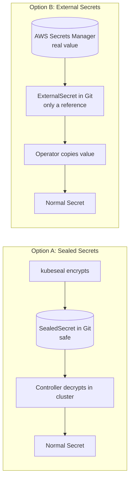

# 16 · Secrets Management (never put real passwords in Git)

> ### 🟢 Simple version
> **In one line:** Git must only hold *encrypted* secrets or *references* to secrets.
> **Your goal:** Pick ONE tool below and use it for every Secret in this repo (repo token, AWS keys, SSO keys).

## The big picture


| | Sealed Secrets | External Secrets Operator |
|---|---|---|
| Where is the real value? | Encrypted inside Git | AWS Secrets Manager / Vault |
| Rotate a secret | re-seal and commit | change it in AWS, auto-refresh |
| Best for | small teams, simple | AWS shops, many secrets, audits |
| Your case (AWS EKS + ECR) | good start | **best long term** |


---

## Files in this guide

| # | File | Purpose | What you change |
|---|---|---|---|
| 1 | [`sealed-secret-howto.sh`](sealed-secret-howto.sh) | Commands to install and use Sealed Secrets. | Secret names and values (locally only). |
| 2 | [`external-secrets-aws.yaml`](external-secrets-aws.yaml) | SecretStore + ExternalSecret that copies a secret from AWS Secrets Manager. | Region, secret key path, target Secret. |

---

## The files, with explanations

Every file has `#` comments on each important line. Replace anything in `<angle brackets>`.

### File 1: `sealed-secret-howto.sh`
**Purpose:** Commands to install and use Sealed Secrets.  
**What you change:** Secret names and values (locally only).  
**Apply:** `run the commands step by step`

```bash
#!/bin/bash
# ======================================================================
# FILE   : sealed-secret-howto.sh
# PURPOSE: Commands to install and use Sealed Secrets.
# CHANGE : Secret names and values (locally only).
# APPLY  : run the commands step by step
# ======================================================================
# HOW TO USE SEALED SECRETS (commands, run them one by one; this is a guide, not a script to run blindly)
# 1) Install the controller in the cluster
helm repo add sealed-secrets https://bitnami-labs.github.io/sealed-secrets
helm install sealed-secrets sealed-secrets/sealed-secrets -n kube-system

# 2) Install the kubeseal CLI on your laptop (see https://github.com/bitnami-labs/sealed-secrets/releases)

# 3) Make a normal Secret file locally (DO NOT commit it) ...
kubectl create secret generic repo-gitops -n argocd \
  --from-literal=username=<user> --from-literal=password=<token> \
  --dry-run=client -o yaml > /tmp/secret.yaml

# 4) ... encrypt it. The output is SAFE to commit to Git
kubeseal --format yaml < /tmp/secret.yaml > sealed-repo-gitops.yaml
rm /tmp/secret.yaml

# 5) Commit sealed-repo-gitops.yaml. The controller creates the real Secret in the cluster.
# IMPORTANT: back up the controller key, otherwise you cannot decrypt after a rebuild:
kubectl -n kube-system get secret -l sealedsecrets.bitnami.com/sealed-secrets-key -o yaml > sealed-secrets-key-BACKUP.yaml   # store offline!
```

### File 2: `external-secrets-aws.yaml`
**Purpose:** SecretStore + ExternalSecret that copies a secret from AWS Secrets Manager.  
**What you change:** Region, secret key path, target Secret.  
**Apply:** `kubectl apply -f external-secrets-aws.yaml`

```yaml
# ======================================================================
# FILE   : external-secrets-aws.yaml
# PURPOSE: SecretStore + ExternalSecret that copies a secret from AWS Secrets Manager.
# CHANGE : Region, secret key path, target Secret.
# APPLY  : kubectl apply -f external-secrets-aws.yaml
# ======================================================================
# EXTERNAL SECRETS OPERATOR + AWS SECRETS MANAGER
# Install: helm repo add external-secrets https://charts.external-secrets.io
#          helm install external-secrets external-secrets/external-secrets -n external-secrets --create-namespace
# AWS side: create a secret named  argocd/github-repo  with JSON {"username":"..","password":".."}
# Give the operator an IAM role (IRSA) with secretsmanager:GetSecretValue on that secret.

# 1) SecretStore: HOW to reach AWS Secrets Manager
apiVersion: external-secrets.io/v1beta1
kind: ClusterSecretStore
metadata:
  name: aws-secrets-manager           # referenced by ExternalSecret below
spec:
  provider:
    aws:
      service: SecretsManager
      region: ap-south-1              # region where the secret lives
      auth:
        jwt:
          serviceAccountRef:          # uses IRSA: the ServiceAccount is annotated with the IAM role
            name: external-secrets
            namespace: external-secrets
---
# 2) ExternalSecret: WHAT to copy and WHAT Kubernetes Secret to create
apiVersion: external-secrets.io/v1beta1
kind: ExternalSecret
metadata:
  name: repo-gitops
  namespace: argocd
spec:
  refreshInterval: 1h                 # re-read AWS every hour (rotation is automatic)
  secretStoreRef:
    kind: ClusterSecretStore
    name: aws-secrets-manager
  target:
    name: repo-gitops                 # the Kubernetes Secret that will be created
    creationPolicy: Owner
    template:
      metadata:
        labels:
          argocd.argoproj.io/secret-type: repository   # makes Argo CD treat it as a repo credential
      data:
        type: git
        url: https://github.com/<org>/<gitops-repo>.git
        username: "{{ .username }}"   # filled from AWS
        password: "{{ .password }}"
  data:
    - secretKey: username
      remoteRef: {key: argocd/github-repo, property: username}
    - secretKey: password
      remoteRef: {key: argocd/github-repo, property: password}
```

---

## Apply and Verify

```bash
kubectl get sealedsecrets -A
kubectl get externalsecrets -A        # STATUS SecretSynced
kubectl -n argocd get secret repo-gitops
```

---

## Troubleshooting

| Symptom | Likely cause | Fix |
|---|---|---|
| ExternalSecret SecretSyncedError | IAM role cannot read the secret | Fix IRSA policy |
| Cannot unseal after rebuild | Lost controller key | Restore the key backup |

---

## Checklist

- [ ] No plaintext secret in Git history
- [ ] Key backup stored offline
- [ ] Rotation plan exists
