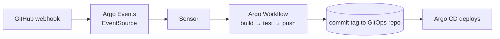

# ⚙️ 17 · Argo Workflows & Events (optional)

> [!NOTE]
> Optional. Your CI is Jenkins, so you can skip this. It is here to show the full Argo family.

## 1. What & why
Argo CD **deploys**. **Workflows** run jobs (build, test, DB tasks) as pods. **Events** start workflows on webhooks, queues or schedules.

## 2. Architecture


## 3. Choose your approach
| Need | Use |
|---|---|
| Simple CI in Kubernetes | Workflows (DAG) |
| Nightly jobs | CronWorkflow |
| React to webhook/queue/S3 events | Argo Events + Sensor |
| Already have Jenkins/GitHub Actions | skip |

## 4. Install (lab; pin versions in production)
```bash
kubectl create namespace argo
kubectl apply -n argo -f https://github.com/argoproj/argo-workflows/releases/latest/download/quick-start-minimal.yaml
kubectl -n argo port-forward svc/argo-server 2746:2746
kubectl create namespace argo-events
kubectl apply -f https://github.com/argoproj/argo-events/releases/latest/download/install.yaml
```

## 5. Examples
<details>
<summary>📄 <b>hello-world.yaml</b> — First workflow.</summary>

```yaml
# ======================================================================
# FILE   : hello-world.yaml
# PURPOSE: First workflow.
# APPLY  : argo submit -n argo --watch hello-world.yaml
# ======================================================================
apiVersion: argoproj.io/v1alpha1
kind: Workflow
metadata:
  generateName: hello-world-        # unique name each run
spec:
  entrypoint: say
  templates:
    - name: say
      container:
        image: alpine:3.20
        command: [echo]
        args: ["hello from argo workflows"]
```

</details>
<details>
<summary>📄 <b>dag-example.yaml</b> — build → (test, lint in parallel) → publish.</summary>

```yaml
# ======================================================================
# FILE   : dag-example.yaml
# PURPOSE: build → (test, lint in parallel) → publish.
# APPLY  : argo submit -n argo --watch dag-example.yaml
# ======================================================================
# DAG: build first, then test and lint in parallel, then publish.
apiVersion: argoproj.io/v1alpha1
kind: Workflow
metadata:
  generateName: dag-
spec:
  entrypoint: main
  templates:
    - name: main
      dag:
        tasks:
          - {name: build,   template: step, arguments: {parameters: [{name: msg, value: build}]}}
          - {name: test,    template: step, dependencies: [build], arguments: {parameters: [{name: msg, value: test}]}}
          - {name: lint,    template: step, dependencies: [build], arguments: {parameters: [{name: msg, value: lint}]}}
          - {name: publish, template: step, dependencies: [test, lint], arguments: {parameters: [{name: msg, value: publish}]}}
    - name: step
      inputs:
        parameters: [{name: msg}]
      container:
        image: alpine:3.20
        command: [echo]
        args: ["{{inputs.parameters.msg}}"]
```

</details>
<details>
<summary>📄 <b>cron-workflow.yaml</b> — Scheduled job, 02:00 daily.</summary>

```yaml
# ======================================================================
# FILE   : cron-workflow.yaml
# PURPOSE: Scheduled job, 02:00 daily.
# APPLY  : kubectl apply -n argo -f cron-workflow.yaml
# ======================================================================
apiVersion: argoproj.io/v1alpha1
kind: CronWorkflow
metadata:
  name: nightly-job
spec:
  schedule: "0 2 * * *"               # every day 02:00
  timezone: Asia/Kolkata
  concurrencyPolicy: Forbid           # do not start if the last run is still going
  workflowSpec:
    entrypoint: job
    templates:
      - name: job
        container:
          image: alpine:3.20
          command: [sh, -c]
          args: ["echo nightly cleanup"]
```

</details>

## 6. Commands
```bash
argo list -n argo ; argo logs -n argo @latest ; argo retry -n argo <name> ; argo delete -n argo --all
```

## 7. Troubleshooting & checklist
| Symptom | Fix |
|---|---|
| Workflow Pending | check ServiceAccount permissions and node capacity |

- [ ] Versions pinned · [ ] UI behind SSO · [ ] artifacts/logs stored in S3 for production
