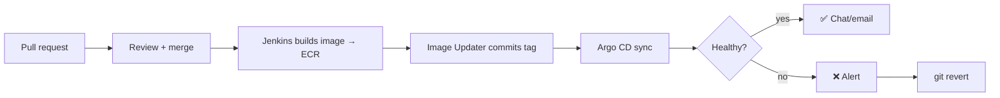

# 13 · Production Checklist & Troubleshooting

> ### 🟢 Simple version
> **In one line:** A checklist before go-live and a table of common errors.
> **Your goal:** Tick every box before production.
> **You will:** Go through the checklist → Use the error table when stuck
> Need the full detail? Keep reading below. Otherwise jump to the files.


## Production end-to-end flow


## Go-live checklist
**Install & access**
- [ ] HA (≥2 replicas server/repo-server), resource limits, PDB
- [ ] HTTPS ingress, SSO enabled, local `admin` disabled, 2+ admins
- [ ] RBAC by Google groups, `policy.default: ""`

**Git & projects**
- [ ] One AppProject per environment; no apps in `default`
- [ ] `sourceRepos`/`destinations` locked down (no `'*'` in prod)
- [ ] Read-only repo token for Argo CD; separate write token for Image Updater
- [ ] Branch protection on `main` + PR reviews (Image Updater allowed to push)

**Apps**
- [ ] `selfHeal`, `prune`, `retry`, `CreateNamespace`; `ignoreDifferences` for HPA
- [ ] Resource requests/limits, probes on every workload
- [ ] Image tags are immutable (build number / commit SHA), never `latest`
- [ ] Prod sync window or manual sync, as agreed

**Secrets**
- [ ] No plain secrets in Git (Sealed Secrets / ESO / SOPS)
- [ ] Any token ever pasted in a chat/issue is revoked and rotated
- [ ] AWS IAM user has least privilege (ECR read only) or use IRSA

**Operations**
- [ ] Notifications for sync failed / degraded
- [ ] Prometheus + Grafana + alert rules
- [ ] `argocd admin export` backup on a schedule
- [ ] Tested: rollback, disaster recovery, Argo CD upgrade in non-prod

## Troubleshooting
| Symptom | Likely cause | Fix |
|---|---|---|
| App `OutOfSync` forever | HPA/controller edits fields | `ignoreDifferences` |
| `ComparisonError` / `repository not accessible` | wrong repo URL / no credential | match URL exactly, check [05](../05_repositories/README.md) |
| `permission denied: applications, sync` | RBAC | `argocd account can-i`; user must re-login |
| Project error `not permitted in project` | repo/namespace/kind not allowed | edit AppProject |
| `namespace not found` | missing | add `CreateNamespace=true` |
| `Resource not found: CRD` on first sync | CRD order | sync-wave or `SkipDryRunOnMissingResource=true` |
| Sync stuck `Running` | hook/job hanging | `argocd app terminate-op <app>` |
| App delete hangs | finalizer | patch finalizers to null |
| `ImagePullBackOff` | ECR token expired / no `imagePullSecrets` | run refresh script (07) |
| Image Updater silent | regex, name mismatch, token | check logs, see 07 |
| Changes not seen for minutes | polling 3 min | webhook or `argocd app get --hard-refresh` |
| SSO: empty groups | delegation/scope | see 10 |
| Secret ignored | missing label | `argocd.argoproj.io/secret-type: repository` |

Useful logs:
```bash
kubectl -n argocd logs deploy/argocd-server
kubectl -n argocd logs deploy/argocd-repo-server
kubectl -n argocd logs statefulset/argocd-application-controller
kubectl -n argocd logs deploy/argocd-image-updater-controller
kubectl -n argocd logs deploy/argocd-notifications-controller
```
