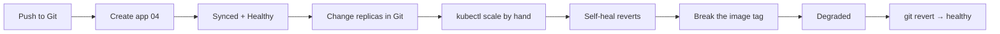

# 🧪 18 · Sample App (practice end to end)

> [!TIP]
> A tiny nginx app. Deploy it, break it, heal it, roll it back. Zero risk.

## 1. Layout
```
k8-manifest/
├── kustomization.yaml   # file list + image tag
├── namespace.yaml       # sync-wave -1 (created first)
├── deployment.yaml      # nginx with resources + probes
├── service.yaml
└── hpa.yaml             # 2 to 6 pods at 70% CPU
```

## 2. Exercise path

1. Copy `k8-manifest/` to your GitOps repo and push.
2. Create the project ([03](../03_projects/README.md)) and application ([04](../04_applications/README.md), namespace `demo-dev`).
3. `argocd app get demo` → **Synced** + **Healthy**.
4. `kubectl -n demo-dev scale deploy web --replicas=5` → self-heal puts it back.
5. Set image tag `nope` → **Degraded** → `git revert` ([07](../07_sync_rollback_operations/README.md)).

## 3. Files
<details>
<summary>📄 <b>k8-manifest/kustomization.yaml</b> — File list and image tag.</summary>

```yaml
# ======================================================================
# FILE   : k8-manifest/kustomization.yaml
# PURPOSE: File list and image tag.
# ======================================================================
apiVersion: kustomize.config.k8s.io/v1beta1
kind: Kustomization
namespace: demo-dev          # applies to every resource below
resources:
  - namespace.yaml
  - deployment.yaml
  - service.yaml
  - hpa.yaml
images:
  - name: nginx
    newTag: "1.27"           # Image Updater / CI changes this line
```

</details>
<details>
<summary>📄 <b>k8-manifest/namespace.yaml</b> — Namespace first (wave -1).</summary>

```yaml
# ======================================================================
# FILE   : k8-manifest/namespace.yaml
# PURPOSE: Namespace first (wave -1).
# ======================================================================
apiVersion: v1
kind: Namespace
metadata:
  name: demo-dev
  annotations:
    argocd.argoproj.io/sync-wave: "-1"    # create first
```

</details>
<details>
<summary>📄 <b>k8-manifest/deployment.yaml</b> — nginx Deployment, resources, probes.</summary>

```yaml
# ======================================================================
# FILE   : k8-manifest/deployment.yaml
# PURPOSE: nginx Deployment, resources, probes.
# ======================================================================
apiVersion: apps/v1
kind: Deployment
metadata:
  name: web
spec:
  replicas: 2
  selector:
    matchLabels: {app: web}
  template:
    metadata:
      labels: {app: web}
    spec:
      containers:
        - name: web
          image: nginx                   # tag comes from kustomization.yaml
          ports: [{containerPort: 80}]
          resources:                     # ALWAYS set in production
            requests: {cpu: 50m, memory: 64Mi}
            limits: {cpu: 200m, memory: 128Mi}
          readinessProbe:                # Argo CD health depends on this
            httpGet: {path: /, port: 80}
            initialDelaySeconds: 3
          livenessProbe:
            httpGet: {path: /, port: 80}
            initialDelaySeconds: 10
```

</details>
<details>
<summary>📄 <b>k8-manifest/service.yaml</b> — ClusterIP Service.</summary>

```yaml
# ======================================================================
# FILE   : k8-manifest/service.yaml
# PURPOSE: ClusterIP Service.
# ======================================================================
apiVersion: v1
kind: Service
metadata:
  name: web
spec:
  selector: {app: web}
  ports: [{port: 80, targetPort: 80}]
```

</details>
<details>
<summary>📄 <b>k8-manifest/hpa.yaml</b> — Autoscaler 2 to 6.</summary>

```yaml
# ======================================================================
# FILE   : k8-manifest/hpa.yaml
# PURPOSE: Autoscaler 2 to 6.
# ======================================================================
apiVersion: autoscaling/v2
kind: HorizontalPodAutoscaler
metadata:
  name: web
spec:
  scaleTargetRef: {apiVersion: apps/v1, kind: Deployment, name: web}
  minReplicas: 2
  maxReplicas: 6
  metrics:
    - type: Resource
      resource: {name: cpu, target: {type: Utilization, averageUtilization: 70}}
# HPA changes replicas -> add ignoreDifferences for /spec/replicas in the Application.
```

</details>

> [!NOTE]
> The HPA changes `replicas`, so add `ignoreDifferences` for `/spec/replicas` in the Application.
