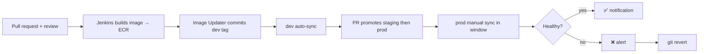

# ✅ 19 · Production Checklist & Troubleshooting

> [!TIP]
> Walk the checklist top to bottom before go-live. When something breaks, find the symptom in the troubleshooting tables and open the linked folder.

## 1. End-to-end production flow


## 2. Go-live checklist

### Install & access
- [ ] Version pinned, HA (≥ 2 replicas server and repo-server, redis-ha) — [02](../02_installation/README.md)
- [ ] HTTPS valid and auto-renewing — [13](../13_exposure_https/README.md)
- [ ] SSO works, local admin disabled, ≥ 2 admins — [11](../11_authentication_sso/README.md)
- [ ] `policy.default: ""`, groups only, roles tested — [12](../12_rbac/README.md)

### Git, projects, clusters
- [ ] One project per environment, no `'*'` in prod — [03](../03_projects/README.md)
- [ ] Read-only repo credential (GitHub App or SSH) — [05](../05_repositories/README.md)
- [ ] Clusters registered with least privilege / IAM roles — [06](../06_clusters/README.md)
- [ ] Branch protection + PR review on `main`; Image Updater allowed to push dev

### Applications
- [ ] selfHeal + prune + retry; HPA `ignoreDifferences` — [04](../04_applications/README.md)
- [ ] Requests/limits and probes on every workload
- [ ] Image tags immutable (build number/SHA), never `latest`
- [ ] Prod = manual sync or sync window — [03](../03_projects/README.md)

### Automation
- [ ] Image Updater: write-back **git**, `allowTags` regex, ECR login via IRSA — [08](../08_image_updater/README.md)
- [ ] ECR token refresh tested (CronJob last run OK)
- [ ] Webhook configured — [07](../07_sync_rollback_operations/README.md)

### Secrets
- [ ] No plaintext secret in Git or history; one approach everywhere — [15](../15_secrets/README.md)
- [ ] Any token ever exposed is revoked and rotated

### Observability & recovery
- [ ] Notifications for failed sync / degraded — [09](../09_notifications/README.md)
- [ ] Prometheus targets UP, alerts routed — [10](../10_monitoring/README.md)
- [ ] Backup scheduled, **restore tested**, upgrade rehearsed — [16](../16_advanced/README.md)

## 3. Troubleshooting by area

### Applications and sync
| Symptom | Cause | Fix |
|---|---|---|
| OutOfSync forever | HPA / webhook mutates a field | `ignoreDifferences` ([04](../04_applications/README.md)) |
| `ComparisonError` | repo or path wrong | [05](../05_repositories/README.md) |
| `not permitted in project` | project fence | edit AppProject ([03](../03_projects/README.md)) |
| `namespace not found` | missing | `CreateNamespace=true` |
| CRD not found on first sync | ordering | sync-wave, `SkipDryRunOnMissingResource=true` |
| Sync stuck Running | hook/job hanging | `argocd app terminate-op <app>` |
| Delete hangs | finalizer | patch finalizers to null |
| Changes appear late | polling 3 min | webhook or `--hard-refresh` |

### Images and registry
| Symptom | Cause | Fix |
|---|---|---|
| `ImagePullBackOff` | no/expired pull secret | refresh ([08](../08_image_updater/README.md)) or node role |
| Image Updater silent | regex / name / auth | logs + `allowTags` |
| Update loop | CI reacts to bot commit | exclude bot commits |

### Login and permissions
| Symptom | Cause | Fix |
|---|---|---|
| Login OK, UI empty | group ≠ `g,` line | `argocd account get-user-info` ([12](../12_rbac/README.md)) |
| No groups | delegation / scope / OAuth app approval | [11](../11_authentication_sso/README.md) |
| `redirect_uri_mismatch` | callback path | Dex `/api/dex/callback`, OIDC `/auth/callback` |
| Permission change ignored | old token | log out and in |

### Platform
| Symptom | Cause | Fix |
|---|---|---|
| Redirect loop | TLS terminated earlier | `server.insecure: true` ([13](../13_exposure_https/README.md)) |
| CLI hangs behind LB | gRPC blocked | `--grpc-web` |
| repo-server OOM | too many parallel renders | `reposerver.parallelism.limit` ([16](../16_advanced/README.md)) |
| Notifications silent | no subscription | [09](../09_notifications/README.md) |
| Targets missing in Prometheus | label mismatch | [10](../10_monitoring/README.md) |

## 4. Where to look (logs)
```bash
kubectl -n argocd logs deploy/argocd-server
kubectl -n argocd logs deploy/argocd-repo-server
kubectl -n argocd logs statefulset/argocd-application-controller
kubectl -n argocd logs deploy/argocd-dex-server
kubectl -n argocd logs deploy/argocd-notifications-controller
kubectl -n argocd logs deploy/argocd-image-updater-controller
kubectl -n argocd get events --sort-by=.lastTimestamp | tail -20
```
