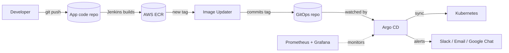

# ArgoCD + GitOps Complete Guide (Basic → Production)

One folder = one topic. Every folder has:
- a `README.md` guide (simple version, big picture, diagram, steps, **every YAML explained**, verify, troubleshooting, checklist)
- the separate, ready-to-use `.yaml` files with `#` comments on every important line

> Replace every `<placeholder>` and `example.com`. **Never commit real passwords, tokens or AWS keys** (see folder 16).
> New? Start with [00_start_here](00_start_here/README.md) (5 minutes, plain words).



## Folders

| # | Folder | What you get |
|---|---|---|
| 00 | [00_start_here](00_start_here/README.md) | Simple explanation, glossary, order to follow |
| 01 | [01_intro_gitops](01_intro_gitops/README.md) | GitOps, Argo CD parts, sync loop |
| 02 | [02_installation](02_installation/README.md) | Helm install, CLI, values.yaml, ingress |
| 03 | [03_projects](03_projects/README.md) | AppProjects dev and prod |
| 04 | [04_applications](04_applications/README.md) | Application YAML, Helm app, sync policy, waves/hooks |
| 05 | [05_repositories](05_repositories/README.md) | Connect private Git safely |
| 06 | [06_sync_rollback_commands](06_sync_rollback_commands/README.md) | Sync, rollback, full command cheat sheet |
| 07 | [07_image_updater](07_image_updater/README.md) | ECR → Git → Argo CD, token refresh script |
| 08 | [08_notifications](08_notifications/README.md) | Slack, email, Google Chat |
| 09 | [09_monitoring](09_monitoring/README.md) | Prometheus, Grafana, alert rules |
| 10 | [10_sso_rbac_google](10_sso_rbac_google/README.md) | Google SSO + group RBAC (all files) |
| 11 | [11_local_users_github_sso](11_local_users_github_sso/README.md) | Local users, robot tokens, GitHub SSO |
| 12 | [12_https_cert_manager](12_https_cert_manager/README.md) | Free HTTPS with Let's Encrypt |
| 13 | [13_multi_environment](13_multi_environment/README.md) | dev/staging/prod with Kustomize, multi-cluster |
| 14 | [14_advanced](14_advanced/README.md) | App-of-Apps, ApplicationSet, canary, blue/green, backup |
| 15 | [15_workflows_events](15_workflows_events/README.md) | Argo Workflows and Events (optional) |
| 16 | [16_secrets_management](16_secrets_management/README.md) | Sealed Secrets and External Secrets (AWS) |
| 17 | [17_sample_app](17_sample_app/README.md) | Practice app |
| 18 | [18_production_checklist_troubleshooting](18_production_checklist_troubleshooting/README.md) | Go-live checklist, common errors |
| 19 | [19_interview_questions](19_interview_questions/README.md) | 25 Q&A |

## Suggested layout of your own GitOps repo
```
My_Gitops/
├── argocd/
│   ├── projects/        # from 03
│   ├── repos/           # from 05 (sealed!)
│   ├── apps/            # from 04, 13
│   ├── image-updater/   # from 07
│   ├── notifications/   # from 08
│   └── sso-rbac/        # from 10
└── k8-manifest/<app>/   # what actually gets deployed
```
Base for the reference chapters: https://github.com/LondheShubham153/argocd-in-one-shot
