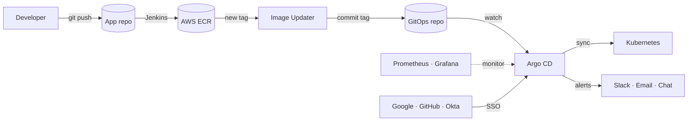

# 🚀 ArgoCD + GitOps: Basic → Production Guide

> [!TIP]
> Every topic shows **all the common approaches** side by side (A / B / C …) with a comparison table, a diagram, key values, ready YAML and troubleshooting. New? Start at [00_start_here](00_start_here/README.md).

## Architecture


## Folders and the approaches they cover
| # | Folder | Approaches included |
|---|---|---|
| 00 | [start_here](00_start_here/README.md) | plain-words intro, glossary, order |
| 01 | [architecture](01_architecture/README.md) | components, config objects, key values, 4 flows, topologies |
| 02 | [installation](02_installation/README.md) | **Helm · Manifest (std/HA/core/namespaced) · Kustomize · CLI** |
| 03 | [projects](03_projects/README.md) | YAML · CLI · UI |
| 04 | [applications](04_applications/README.md) | UI · CLI · YAML · plain · Kustomize · Helm (Git/repo/multi-source) · manual vs auto sync · hooks/waves |
| 05 | [repositories](05_repositories/README.md) | HTTPS token · SSH · GitHub App · CodeCommit · Helm repo · OCI/ECR · repo-creds · CLI/UI |
| 06 | [clusters](06_clusters/README.md) | CLI · declarative Secret · EKS IAM |
| 07 | [sync_rollback_operations](07_sync_rollback_operations/README.md) | auto · UI · CLI · CI · webhook; rollback by git revert · CLI · pin; cheat sheet |
| 08 | [image_updater](08_image_updater/README.md) | CR vs annotations · **git vs argocd write-back** · 4 strategies · **ECR login A–E (keys, CronJob, IRSA, registries, `.docker`)** · pod pull secrets |
| 09 | [notifications](09_notifications/README.md) | Slack · Email · Google Chat · Teams · Telegram · webhook; global/project/app/appset subscriptions |
| 10 | [monitoring](10_monitoring/README.md) | Helm values · ServiceMonitor · static scrape; alerts + Alertmanager routes |
| 11 | [authentication_sso](11_authentication_sso/README.md) | **Google+Dex · GitHub+Dex · Google OIDC · Keycloak/Okta/Azure · local users** |
| 12 | [rbac](12_rbac/README.md) | global · project roles · local users · GitHub teams · e-mail · CI tokens · tests |
| 13 | [exposure_https](13_exposure_https/README.md) | NGINX+cert-manager · ALB+ACM · passthrough · LoadBalancer · port-forward |
| 14 | [multi_environment](14_multi_environment/README.md) | Kustomize overlays · Helm values · ApplicationSet · PR promotion · multi-cluster |
| 15 | [secrets](15_secrets/README.md) | Sealed Secrets · External Secrets · SOPS · Vault plugin |
| 16 | [advanced](16_advanced/README.md) | App-of-Apps · generators · canary/blue-green/analysis · HA/sharding · backup · upgrade · customizations |
| 17 | [workflows_events](17_workflows_events/README.md) | Workflows · DAG · Cron · Events (optional) |
| 18 | [sample_app](18_sample_app/README.md) | practice exercise |
| 19 | [checklist_troubleshooting](19_checklist_troubleshooting/README.md) | go-live checklist, error tables, log commands |
| 20 | [interview_questions](20_interview_questions/README.md) | 30 Q&A |

## How each folder is organised
`What & why` → `Architecture` → `Key values` → `Choose your approach` (table + decision diagram) → `Approach A/B/C…` (explained YAML) → `Verify` → `Troubleshooting` → `Checklist`.
Each YAML is shown in a collapsible block and also exists as a separate file with `#` comments. Replace `<placeholders>` and `example.com`.

> [!WARNING]
> Never commit real tokens, AWS keys or passwords. See [15_secrets](15_secrets/README.md). Pin versions in production.

## Suggested layout of your GitOps repo
```
My_Gitops/
├── argocd/
│   ├── install/         # 02 (kustomize)
│   ├── projects/        # 03, 12
│   ├── repos/           # 05 (sealed / external secrets)
│   ├── apps/            # 04, 14 (root app reads this)
│   ├── image-updater/   # 08
│   ├── notifications/   # 09
│   └── sso-rbac/        # 11, 12
└── k8-manifest/<app>/   # what gets deployed
```
Reference chapters: https://github.com/LondheShubham153/argocd-in-one-shot
